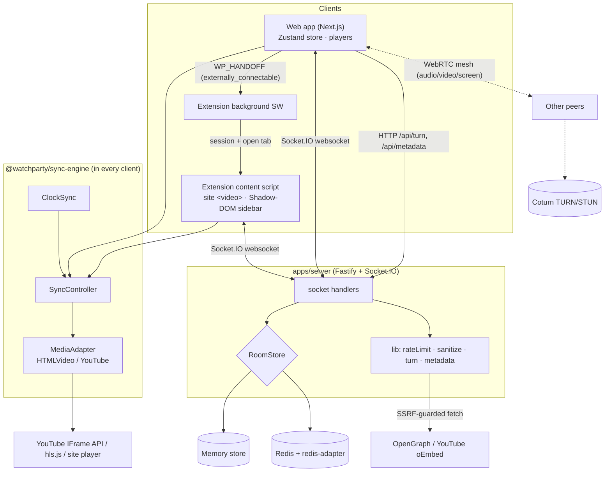
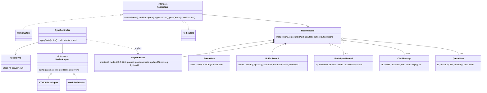

# CLAUDE.md — WatchParty map

Watch-party platform: 6-char room code → synced playback + chat, reactions, queue, voice/video.
Modes: **A** in-app player (hls/file/youtube/local) · **B** Chrome extension on DRM sites · **C** WebRTC tab share.

## 1. Annotated file tree

```
.
├── README.md                      # setup, env vars, run, extension
├── package.json · turbo.json · pnpm-workspace.yaml · tsconfig.base.json # monorepo + strict TS
├── docker-compose.yml · coturn/ · nginx/ # redis, TURN, TLS websocket proxy
├── scripts/lint.mjs · party.mjs   # stub/innerHTML grep; one-command host+tunnel
├── docs/CODING_CONTRACT.md        # full rules, constants, events, limits
├── docs/{ARCHITECTURE,SYNC_PROTOCOL,EXTENSION_SPEC,WEBRTC_AND_MEDIA,DEVOPS_AND_SECURITY,IMPLEMENTATION_ROADMAP}.md
├── packages/
│   ├── shared-types/src/
│   │   ├── constants.ts           # all tunables, DRM provider table
│   │   ├── schemas.ts             # zod payloads + inferred types
│   │   └── events.ts              # typed C2S/S2C maps, Ack
│   └── sync-engine/src/
│       ├── clock.ts               # NTP offset/RTT, serverNow()
│       ├── controller.ts          # SyncController: drift, locks, buffering
│       ├── adapters/html-video.ts # MediaAdapter over <video>
│       ├── classify.ts            # classifyMediaUrl → kind + mode
│       └── timecode.ts            # @mm:ss parse/format
└── apps/
    ├── server/src/                # Fastify 5 + Socket.IO 4, :4000
    │   ├── index.ts               # entry: env, store, listen
    │   ├── env.ts                 # zod-parsed process.env
    │   ├── app.ts                 # HTTP: healthz, turn, metadata
    │   ├── socket/index.ts        # io setup, redis adapter, sweep
    │   ├── socket/handlers/
    │   │   ├── context.ts         # handler wrapper, effects, control check
    │   │   ├── room.ts            # create/join/leave, host handoff
    │   │   ├── player.ts          # play/pause/seek/load, wait-for-buffer
    │   │   ├── chat.ts · queue.ts # chat w/ timestamps; shared queue
    │   │   ├── rtc.ts             # offer/answer/ice relay
    │   │   └── sync.ts            # sync:ping → t1/t2
    │   ├── store/
    │   │   ├── types.ts           # RoomStore interface, records
    │   │   ├── memory.ts          # single-instance store (dev default)
    │   │   └── redis.ts           # WATCH/MULTI store, TTLs
    │   └── lib/
    │       ├── rateLimit.ts       # token buckets, trusted-proxy IP
    │       ├── metadata.ts        # SSRF-safe OpenGraph/oEmbed fetch
    │       ├── turn.ts · proxy.ts # TURN creds; WEB_UPSTREAM same-origin proxy
    │       └── sanitize.ts · roomCode.ts · timestamps.ts
    ├── web/src/                   # Next.js 15 App Router, :3000
    │   ├── app/page.tsx           # landing: create/join forms
    │   ├── app/room/[code]/page.tsx # room shell, gate, layout
    │   ├── middleware.ts          # per-request nonce CSP
    │   ├── store/room.ts          # Zustand room/session/call state
    │   ├── lib/socket.ts          # socket, join/rejoin, attachSync
    │   ├── lib/webrtc.ts          # mesh voice/cam/screen, gains, VAD
    │   ├── lib/youtube-adapter.ts # MediaAdapter over YT iframe
    │   ├── lib/extension.ts       # Mode B handoff to extension
    │   └── components/
    │       ├── PlayerHost.tsx     # picks player by media kind
    │       ├── VideoPlayer.tsx    # <video> + hls.js, PiP
    │       ├── YouTubePlayer.tsx  # YT player + adapter wiring
    │       ├── ScreenShareView.tsx # Mode C broadcast/receive
    │       ├── ExtensionHandoff.tsx # Mode B banner/install steps
    │       ├── ChatPanel.tsx · ChatMessage.tsx # chat, clickable @timestamps
    │       ├── ReactionOverlay.tsx # spring-physics floating emoji
    │       └── CallBar.tsx · CallGrid.tsx · QueuePanel.tsx · …
    └── extension/                 # Chrome MV3 via Vite + crxjs
        ├── manifest.config.ts     # permissions, matches, externally_connectable
        └── src/
            ├── background.ts      # router, session in storage.session
            ├── bridge.ts          # zod message schemas, ok/fail
            ├── content/index.tsx  # owns socket, SyncController, sidebar mount
            ├── content/video-finder.ts # MutationObserver, scoring, ad filter
            ├── content/sidebar/   # Shadow-DOM React UI + store
            └── popup/Popup.tsx    # create/join room from toolbar
```

## 2. System architecture



## 3. Core data model



## 4. Entry points & rules

- **Entries:** server `apps/server/src/index.ts` · web `apps/web/src/app/page.tsx` + `room/[code]/page.tsx` · extension `src/background.ts`, `src/content/index.tsx`, `src/popup/main.tsx` · shared code `packages/*/src/index.ts`.
- **Run:** `pnpm install` → `pnpm dev` (no Docker: `REDIS_URL` unset ⇒ memory store) · gate before any commit: `pnpm typecheck && pnpm build && pnpm test` + `pnpm lint`. Path has a space — quote it; use Git Bash for `&&`.
- **Contract:** wire shapes and constants live only in `packages/shared-types` (zod → `z.infer`); every C2S payload is zod-validated server-side; apps never import each other. Full rules: [docs/CODING_CONTRACT.md](docs/CODING_CONTRACT.md).
- **Banned:** `TODO/FIXME`, `any`, `@ts-ignore`, stubs, default exports (except framework), `innerHTML`/`dangerouslySetInnerHTML`, network `!` assertions. Known limits get a `shortcut:`/`ponytail:` comment.
- **Style:** ESM, `.js` suffix on relative imports in NodeNext packages, `import type`, `node:test` tests beside code (`*.test.ts`, run from `dist`), time as epoch ms / positions as seconds.
