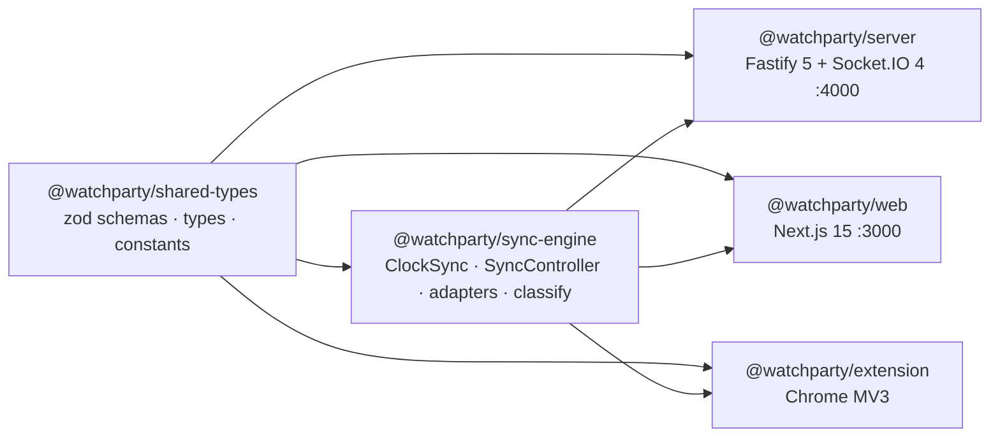

# CLAUDE.md — WatchParty Agent Memory & Coding Contract

This file is loaded into every agent/session working in this repo. It is the **coding contract**. When this file
and a design doc disagree, this file wins for *how* code is written; the design docs win for *what* a protocol
does. If two docs disagree on a protocol detail, stop and fix the docs first (one PR, all docs) — never "pick one"
silently in code.

| Doc | Owns |
| --- | --- |
| [README.md](README.md) | Setup, env reference, run commands, loading the extension |
| [docs/ARCHITECTURE.md](docs/ARCHITECTURE.md) | System topology, package boundaries, data model, store design |
| [docs/SYNC_PROTOCOL.md](docs/SYNC_PROTOCOL.md) | Clock sync, playback state machine, drift correction, buffering, every Socket.IO event |
| [docs/EXTENSION_SPEC.md](docs/EXTENSION_SPEC.md) | MV3 extension: background router, content script, Shadow DOM sidebar, handoff bridge |
| [docs/WEBRTC_AND_MEDIA.md](docs/WEBRTC_AND_MEDIA.md) | Mesh A/V calls, screen share (Mode C), TURN, media adapters, HLS/YouTube/local |
| [docs/DEVOPS_AND_SECURITY.md](docs/DEVOPS_AND_SECURITY.md) | Docker compose, coturn, nginx, rate limits, SSRF, CSP, threat model |
| [docs/IMPLEMENTATION_ROADMAP.md](docs/IMPLEMENTATION_ROADMAP.md) | Milestones 1–5, file-by-file checklist, per-developer acceptance criteria |

---

## 1. What we are building

A social watch-party platform: people join a 6-character room code and watch the same thing at the same time,
with chat, reactions, a shared queue, and voice/video. Three playback modes:

| Mode | When | How it syncs |
| --- | --- | --- |
| **A** — in-app player | `hls`, `file`, `youtube`, `local` media | Web app plays media itself; `SyncController` drives a `MediaAdapter` |
| **B** — extension | `drm` sites (Netflix, Prime, Disney+, …) | Each viewer uses their own subscription; the Chrome extension's content script drives the site's `<video>` with the same `SyncController` |
| **C** — tab/screen share | `unknown` http(s) pages | One sharer streams via `getDisplayMedia` over WebRTC; no position sync needed |



The server depends on `sync-engine` only for `classifyMediaUrl` and `parseTimecode`. Nothing depends on an app.
Apps never import from each other.

---

## 2. Non-negotiable rules

### 2.1 Zero-stub policy

These are **build-breaking review failures**. A PR containing any of them is rejected without further review:

- `// TODO`, `// FIXME`, `// XXX`, `// HACK`, `TBD`, "implement later", "not implemented".
- Functions that `throw new Error('not implemented')`, return hard-coded fake data, or have empty bodies that
  should do something.
- Placeholder UI ("Coming soon", lorem ipsum, a button with no handler).
- Commented-out code blocks.
- `any`, `as any`, `@ts-ignore`, `@ts-expect-error` (the last is allowed only in a test that asserts a type error,
  with a comment explaining why).
- Non-null assertions (`!`) on values that come from the network, storage, or the DOM. Narrow instead.

If a feature can't be finished in the current milestone, **don't start the file**. Ship less, completely.
A deliberate, bounded simplification is allowed only with a `ponytail:` comment naming the ceiling and the
upgrade path, e.g. `// ponytail: mesh WebRTC, ~6 video peers max; SFU if rooms need more`.

Check before every commit (Git Bash):

```bash
grep -rnE "TODO|FIXME|XXX|HACK|not implemented|as any|@ts-ignore" apps packages --include=*.ts --include=*.tsx \
  --exclude-dir=node_modules --exclude-dir=dist --exclude-dir=.next && echo "STUB FOUND" || echo "clean"
```

### 2.2 Mandatory gate after every milestone (and before every PR)

From the repo root:

```bash
pnpm install --frozen-lockfile
pnpm typecheck     # must exit 0, zero errors
pnpm build         # must exit 0 for all 5 packages
pnpm test          # must exit 0
```

A milestone is **not done** until these three commands pass on a clean checkout *and* the milestone's manual
acceptance checklist in [docs/IMPLEMENTATION_ROADMAP.md](docs/IMPLEMENTATION_ROADMAP.md) is ticked by the owner
and one reviewer. Paste the tail of each command's output into the milestone PR description.

### 2.3 Keep it boring

- No abstraction without a second concrete use. `RoomStore` (memory + redis) is the sanctioned interface; most
  other things should be plain functions.
- No new dependency for something the platform or an existing dependency does (`crypto.randomInt`,
  `crypto.randomUUID`, `fetch`, `AbortSignal.timeout`, `node:dns/promises`, `node:test`, `process.loadEnvFile`).
- No config knobs for values that never change — they go in `packages/shared-types/src/constants.ts`.
- One file per concern from the directory map. Don't add files outside the map without updating
  [docs/IMPLEMENTATION_ROADMAP.md](docs/IMPLEMENTATION_ROADMAP.md) in the same PR.

---

## 3. The five-developer squad

Every file has exactly one owner. Owners review all changes to their files; cross-boundary changes (anything in
`packages/shared-types`) need the owner of every consuming package to approve.

| ID | Persona | Owns (paths) | Primary responsibilities |
| --- | --- | --- | --- |
| **DEV-1** | Platform & DevOps Lead | root config (`package.json`, `pnpm-workspace.yaml`, `turbo.json`, `tsconfig.base.json`, `.gitignore`, `.env.example`), `docker-compose.yml`, `coturn/`, `nginx/`, all `Dockerfile`s | Workspace health, turbo pipeline, container images, TURN, reverse proxy, release checklist, CI-equivalent gate script |
| **DEV-2** | Sync & Protocol Engineer | `packages/shared-types/**`, `packages/sync-engine/**` | Wire contract (zod schemas, event maps, constants), clock sync, drift correction, media classification, `HTMLVideoAdapter`, unit tests |
| **DEV-3** | Realtime Backend Engineer | `apps/server/**` | Fastify app, Socket.IO handlers, room lifecycle, stores (memory + Redis), rate limits, TURN credentials, metadata (SSRF-safe), server tests |
| **DEV-4** | Web & RTC Engineer | `apps/web/**` | Next.js app, room UI, Mode A players (HTML/HLS/YouTube/local), Zustand store, WebRTC mesh + screen share (Mode C), extension handoff (web side) |
| **DEV-5** | Extension Engineer | `apps/extension/**` | MV3 manifest, background router, content script + video finder, Shadow DOM sidebar, popup, Mode B site support |

Persona rules for agents: when you are asked to act as DEV-n, only edit files DEV-n owns. If you need a change
in another owner's file (most often `shared-types`), write it as a separate, minimal commit and call it out in
your reply as "cross-boundary change: <file> — needs DEV-x review".

---

## 4. Shared contract — quick reference

This is the condensed contract. Full semantics live in [docs/SYNC_PROTOCOL.md](docs/SYNC_PROTOCOL.md) and
[docs/ARCHITECTURE.md](docs/ARCHITECTURE.md). The **code source of truth** is `packages/shared-types`: any
constant or shape below must be imported from there, never re-declared.

### 4.1 Packages

| Path | Name | Build | Module resolution | Notes |
| --- | --- | --- | --- | --- |
| `packages/shared-types` | `@watchparty/shared-types` | `tsc` → `dist` | NodeNext | zod schemas, inferred types, constants, Socket.IO event maps |
| `packages/sync-engine` | `@watchparty/sync-engine` | `tsc` → `dist` | NodeNext, `lib: DOM` | No DOM globals touched at module top level (server imports it) |
| `apps/server` | `@watchparty/server` | `tsc` → `dist`; dev `tsx watch` | NodeNext | Fastify 5, Socket.IO 4, ioredis, `@socket.io/redis-adapter`, port 4000 |
| `apps/web` | `@watchparty/web` | `next build` | Bundler (Next) | Next 15 App Router, React 19, Tailwind 3.4, Zustand 5, hls.js, socket.io-client, port 3000 |
| `apps/extension` | `@watchparty/extension` | `vite build` → `apps/extension/dist` | Bundler (Vite) | MV3, `@crxjs/vite-plugin` 2.x, React 19 sidebar in Shadow DOM, Tailwind 3.4 |

### 4.2 Constants (`packages/shared-types/src/constants.ts`)

| Constant | Value |
| --- | --- |
| `ROOM_CODE_ALPHABET` / `ROOM_CODE_REGEX` | `ABCDEFGHJKLMNPQRSTUVWXYZ23456789` (no 0/O/1/I) / `/^[…]{6}$/` |
| `ROOM_CODE_LENGTH` | `6` (generated with `crypto.randomInt`, never `Math.random`) |
| `MAX_PARTICIPANTS` | `12` |
| `NICKNAME_MAX` | `24` (min 1; both re-checked after sanitize) |
| `CHAT_TEXT_MAX` | `500` (min 1; both re-checked after sanitize) |
| `CHAT_HISTORY_ON_JOIN` / `CHAT_HISTORY_MAX` | `50` / `200` |
| `REACTION_EMOJIS` | `['👍','👎','😂','😮','😢','😡','❤️','🔥','👏','🎉','💀','🍿']` (exactly 12) |
| `PLAYBACK_RATE_MIN` / `PLAYBACK_RATE_MAX` | `0.25` / `2` |
| `MAX_POSITION_S` / `SDP_MAX` | `86400` / `32768` |
| `CLOCK_BURST_COUNT` / `CLOCK_INTERVAL_MS` / `CLOCK_WINDOW` | `8` / `5000` / `10` |
| `CLOCK_PING_TIMEOUT_MS` / `CLOCK_MAX_RTT_MS` / `CLOCK_READY_TIMEOUT_MS` | `2000` / `5000` / `1500` |
| `DRIFT_IGNORE_S` / `DRIFT_HARD_SEEK_S` / `DRIFT_HARD_SEEK_COARSE_S` | `0.08` / `1.5` / `0.5` |
| `CORRECTION_RATE_MIN` / `CORRECTION_RATE_MAX` / `DRIFT_GAIN` | `0.96` / `1.04` / `0.04 / 1.5` (rate factor per second of drift) |
| `CORRECTION_INTERVAL_MS` | `500` |
| `REMOTE_LOCK_TIMEOUT_MS` | `300` |
| `INTENT_DEBOUNCE_MS` / `SEEK_DEBOUNCE_MS` | `150` / `250` |
| `BUFFER_GRACE_MS` / `BUFFER_TIMEOUT_MS` / `RESUME_DELAY_MS` | `400` / `8000` / `300` |
| `TURN_TTL_SECONDS` | `3600` |
| `QUEUE_MAX` / `QUEUE_TITLE_MAX` / `MEDIA_URL_MAX` | `50` / `200` / `2048` |
| `CHAT_TIMESTAMPS_MAX` | `10` (max `@mm:ss` tags parsed per message) |
| `RATE_LIMITS` / `JOIN_FAIL_MAX` / `JOIN_FAIL_WINDOW_S` | see §4.6 / `10` / `600` |
| `ERROR_CODES` | `RATE_LIMITED`, `INVALID_PAYLOAD`, `ROOM_NOT_FOUND`, `FORBIDDEN`, `TOO_MANY_ATTEMPTS`, `ROOM_FULL`, `INTERNAL` |
| `DRM_PROVIDERS` / `DRM_PROVIDER_KEYS` / `PROVIDER_MATCHES` | `{key, host: RegExp, pathPrefix?, matches}[]` (14 providers) / keys tuple / flattened manifest match patterns |

### 4.3 Playback state (authoritative on server)

```ts
type PlaybackMode = 'A' | 'B' | 'C';
type MediaKind = 'hls' | 'file' | 'youtube' | 'local' | 'drm' | 'unknown';

interface PlaybackState {
  mediaUrl: string | null;
  mode: PlaybackMode | null;
  kind: MediaKind | null;
  paused: boolean;
  position: number;   // seconds, valid at updatedAt
  rate: number;
  updatedAt: number;  // server epoch ms (may be up to RESUME_DELAY_MS in the future for scheduled resume)
  seq: number;        // strictly increasing per room
  byUserId: string | null; // who caused this change; null for server-initiated (buffer pause/resume)
}

// expected position at server time `now`
const expected = s.paused ? s.position : s.position + ((now - s.updatedAt) / 1000) * s.rate;
```

A scheduled resume sets `updatedAt = now + 300` with `paused: false`; clients must treat `now < updatedAt` as
"hold at `position`, start playing at `updatedAt`" (expected position is clamped to `position` until then).

Clients drop any `room:state` whose `seq` is `<=` the last applied `seq`.

### 4.4 Media classification — `classifyMediaUrl(url, contentType?)`

Returns `{ kind, mode, url, youtubeId?, provider? } | null`. **Invalid input returns `null`; it never throws.**
(Decision: callers already branch on validity; `null` keeps server handlers free of try/catch.)
The optional `contentType` lets the server/metadata path detect HLS served without an `.m3u8` extension.

| Kind | Match | Mode |
| --- | --- | --- |
| `hls` | path ends `.m3u8`, or contentType `application/vnd.apple.mpegurl` / `application/x-mpegURL` | A |
| `file` | path ends `.mp4 .webm .ogg .ogv .mov .m4v .mkv` | A |
| `youtube` | `youtube.com/watch?v=`, `youtu.be/`, `youtube.com/shorts/`, `youtube.com/embed/`, `music.youtube.com`; id `[A-Za-z0-9_-]{11}` | A |
| `local` | `blob:`, `file:`, or sentinel `local:<filename>` | A |
| `drm` | netflix.com, primevideo.com, amazon.*/gp/video, disneyplus.com, hulu.com, max.com, hbomax.com, tv.apple.com, peacocktv.com, paramountplus.com, crunchyroll.com, moviebox.* (incl. moviebox.ng / moviebox.ph), hotstar.com, jiocinema.com; `provider` = site key | B |
| `unknown` | any other `http(s)` URL | C (UI may offer B) |

Hostnames match the registrable domain *and* subdomains (`www.netflix.com` ✓, `netflix.com.evil.io` ✗).
The web app never sends `blob:`/`file:` URLs to the server — it sends `local:<filename>`.

### 4.5 Socket.IO events

All C2S payloads are zod-validated on the server with the schema from `shared-types/src/schemas.ts`.
Every ack is `Ack<T> = { ok: true; data: T } | { ok: false; error: { code: ErrorCode; message: string } }`.
Typed maps `ClientToServerEvents` / `ServerToClientEvents` live in `shared-types/src/events.ts`; both server and
clients construct `Server<C2S, S2C, {}, SocketData>` / `Socket<S2C, C2S>` with them, so a misspelled event name
or wrong payload shape is a compile error.

| C2S event | Payload | Ack data | Who |
| --- | --- | --- | --- |
| `room:create` | `{nickname, mediaUrl?}` | `{roomCode, userId, state, participants}` | anyone |
| `room:join` | `{roomCode, nickname}` | `{roomCode, userId, hostId, state, participants, chat, queue}` | anyone |
| `room:leave` | `{}` | — | member |
| `sync:ping` | `{t0}` | `{t0, t1, t2}` | anyone (rate-limited) |
| `player:play` / `player:pause` / `player:seek` | `{position}` | — | member; host only if `hostOnlyControl` |
| `player:rate` | `{rate}` | — | same |
| `player:buffering` | `{buffering}` | — | member |
| `player:load` | `{mediaUrl}` | — | same as play |
| `chat:send` | `{text}` | — | member |
| `reaction:send` | `{emoji}` | — | member |
| `queue:add` / `queue:remove` / `queue:next` | `{mediaUrl, title?}` / `{id}` / `{}` | — | member (`queue:next` follows control rule) |
| `room:settings` | `{hostOnlyControl?}` | — | host only |
| `rtc:offer` / `rtc:answer` / `rtc:ice` | `{to, sdp}` / `{to, sdp}` / `{to, candidate}` | — | member, `to` must be in same room |
| `rtc:media` | `{audio, video, screen}` | — | member |

| S2C event | Payload |
| --- | --- |
| `room:state` | `{state}` (full `PlaybackState`) |
| `room:participants` | `{participants: [{id, nickname, isHost, joinedAt, media:{audio,video,screen}}], hostId}` |
| `room:buffer` | `{waiting, userIds}` |
| `chat:message` | `{id, userId, nickname, text, timestamps: number[], at}` |
| `reaction` | `{id, userId, emoji, at}` |
| `queue:update` | `{queue: [{id, mediaUrl, title, addedBy, kind, mode}]}` |
| `room:settings` | `{hostOnlyControl}` |
| `rtc:offer` / `rtc:answer` / `rtc:ice` | `{from, sdp}` / `{from, sdp}` / `{from, candidate}` |
| `error` | `{code, message}` |

Fire-and-forget C2S events that fail validation/authorization/rate limit get an S2C `error` event; events with an
ack get `{ok:false}` in the ack instead (never both).

Room rules: max 12 participants (`ROOM_FULL`). Host = creator; when the host leaves, the participant with the
smallest `joinedAt` becomes host and `room:participants` is broadcast.

### 4.6 Rate limits (token bucket per socket, `apps/server/src/lib/rateLimit.ts`)

| Events | `RATE_LIMITS` key | Capacity | Refill window |
| --- | --- | --- | --- |
| `chat:send` | `chat` | 5 | 5 s |
| `reaction:send` | `reaction` | 10 | 2 s |
| `player:*`, `room:*`, `queue:*` | `player` | 20 | 5 s |
| `sync:ping` | `sync` | 20 | 5 s |
| `rtc:*` | `rtc` | 200 | 10 s |
| `GET /api/metadata` (per IP) | `metadata` | 30 | 60 s |
| `GET /api/turn` (per IP) | `turn` | 10 | 60 s |
| `room:join` failures | `JOIN_FAIL_MAX` / `JOIN_FAIL_WINDOW_S` | 10 per IP | 600 s (Redis `ratelimit:join:{ip}` / memory map) → `TOO_MANY_ATTEMPTS`. Each join INCRs first and is gated on the INCR result (atomic); the hit is refunded once the code names a real room |
| `room:create` | `CREATE_MAX` / `JOIN_FAIL_WINDOW_S` | 20 per IP | 600 s (`ratelimit:create:{ip}`) → `RATE_LIMITED`. A room whose last participant leaves gets `EMPTY_ROOM_TTL_S` (300 s) |

### 4.7 HTTP

| Route | Response |
| --- | --- |
| `GET /healthz` | `{ok: true, store: 'memory' \| 'redis', uptime}` |
| `GET /api/turn?roomCode=<code>&userId=<id>` | 403 `FORBIDDEN` unless `userId` is a participant of `roomCode`; else `{iceServers, ttl: 3600}`; username `${expiry}:${userId}`, credential `base64(HMAC-SHA1(TURN_SECRET, username))`; if `TURN_SECRET` is empty only STUN entries are returned |
| `GET /api/metadata?url=` | `{title, description, image, siteName, kind, mode}` — OpenGraph + YouTube oEmbed, SSRF-safe |

### 4.8 Redis keys

| Key | Type | Content |
| --- | --- | --- |
| `room:{code}` | hash | `meta` (JSON: hostId, hostOnlyControl, createdAt, buffering map), `state` (JSON PlaybackState); TTL `ROOM_TTL_SECONDS`, refreshed on activity |
| `room:{code}:participants` | hash | `userId` → JSON participant |
| `room:{code}:chat` | list | JSON chat messages, `RPUSH` + `LTRIM -200 -1` |
| `room:{code}:queue` | list | JSON queue items |
| `ratelimit:join:{ip}` | string counter | `INCR`, `EXPIRE 600` on first increment |
| `ratelimit:create:{ip}` | string counter | `INCR`, `EXPIRE 600` on first increment |

All `room:{code}*` keys get the same TTL refresh in one `MULTI`. State mutations use `WATCH`/`MULTI` (retry ≤ 3)
so two instances can't lose an update; the memory store is single-threaded and needs no locking.

---

## 5. TypeScript conventions

`tsconfig.base.json` (root) — every package extends it:

```jsonc
{
  "compilerOptions": {
    "target": "ES2022",
    "lib": ["ES2023"],
    "module": "NodeNext",
    "moduleResolution": "NodeNext",
    "strict": true,
    "noUncheckedIndexedAccess": true,
    "noImplicitOverride": true,
    "noFallthroughCasesInSwitch": true,
    "useUnknownInCatchVariables": true,
    "verbatimModuleSyntax": true,
    "isolatedModules": true,
    "esModuleInterop": true,
    "forceConsistentCasingInFileNames": true,
    "resolveJsonModule": true,
    "skipLibCheck": true,
    "declaration": true,
    "sourceMap": true
  }
}
```

Rules:

1. **ESM everywhere.** Every `package.json` has `"type": "module"`. In NodeNext packages (`shared-types`,
   `sync-engine`, `server`) relative imports carry the `.js` extension: `import { ClockSync } from './clock.js'`.
   Web and extension use bundler resolution and omit extensions.
2. **`import type`** for type-only imports (enforced by `verbatimModuleSyntax`).
3. **Types come from zod.** Wire types are `z.infer<typeof schema>`, exported from `shared-types`. Never write an
   interface that duplicates a schema.
4. **Validate at every trust boundary**: socket payloads (server), HTTP query strings (server), `chrome.runtime`
   external messages (extension background), `localStorage` / `chrome.storage` reads (clients), env vars
   (`apps/server/src/env.ts` parses `process.env` with zod once at startup and exits with a readable error).
5. **Errors**: `catch (err: unknown)`, narrow with `instanceof Error`. Server handlers never let an exception
   escape: a thrown error becomes `{ok:false, error:{code:'INTERNAL'}}` and a `log.error` with the room code.
6. **No default exports** except where a framework demands them (Next pages/layouts, Vite/crxjs config).
7. **Naming**: files `kebab-case.ts` in packages/server, React components `PascalCase.tsx`; event names
   `domain:verb`; constants `SCREAMING_SNAKE`.
8. **Time**: server time is `Date.now()` epoch ms; client "server time" is only ever `clock.serverNow()`. Media
   positions are seconds (float). Never mix units in one variable name — suffix `Ms` or `S` when ambiguous.
9. Package `exports` (shared-types, sync-engine):
   ```json
   { "exports": { ".": { "types": "./dist/index.d.ts", "import": "./dist/index.js" } }, "files": ["dist"] }
   ```
   Consumers depend on them with `"@watchparty/shared-types": "workspace:*"`.

---

## 6. pnpm + turborepo conventions

- pnpm **9.15.4** (`"packageManager": "pnpm@9.15.4"` in root `package.json`), Node **≥ 24** (`engines`).
  Never use npm or yarn; never commit `package-lock.json`.
- `pnpm-workspace.yaml`: `packages: ['apps/*', 'packages/*']`.
- Add deps with `pnpm --filter <name> add <dep>`; dev tools shared by all packages (`typescript`, `turbo`) live at
  the root only.
- Every package exposes the same script names so turbo can fan out:

| Script | shared-types / sync-engine | server | web | extension |
| --- | --- | --- | --- | --- |
| `dev` | `tsc -w -p tsconfig.json` | `tsx watch src/index.ts` | `next dev -p 3000` | `vite` |
| `build` | `tsc -p tsconfig.json` | `tsc -p tsconfig.json` | `next build` | `tsc --noEmit && vite build` |
| `typecheck` | `tsc --noEmit -p tsconfig.json` | same | `tsc --noEmit` | `tsc --noEmit` |
| `lint` | `node ../../scripts/lint.mjs` | same | same | same |
| `test` | `node --test "dist/**/*.test.js"` | `node --test "dist/**/*.test.js"` | — | — |
| `start` | — | `node dist/index.js` | `next start -p 3000` | — |
| `clean` | `node -e "fs.rmSync('dist',{recursive:true,force:true})"` | same | same for `.next` | same |

- `turbo.json` (turbo 2 `tasks` syntax): `build` → `dependsOn: ["^build"]`, `outputs: ["dist/**", ".next/**",
  "!.next/cache/**"]`; `typecheck` → `dependsOn: ["^build"]`; `test` → `dependsOn: ["build"]`;
  `dev` → `dependsOn: ["^build"]`, `cache: false`, `persistent: true`.
- Root scripts: `dev`, `build`, `typecheck`, `lint`, `test`, `clean` each = `turbo run <task>`. Every package's
  `lint` is `node ../../scripts/lint.mjs` (the §2.1 stub grep plus the §7 banned HTML sinks, over `src/`).
- `turbo.json` sets `"envMode": "loose"` so shell env (`REDIS_URL`, `PORT`, …) reaches `dev` tasks; `globalEnv`
  still decides cache keys.
- **Tests** use `node:test` + `node:assert/strict` only. Test files sit next to the code as `*.test.ts`, compile
  with the package, and run from `dist`. No jest/vitest. Every non-trivial pure function (classification, clock
  math, drift policy, timestamp parsing, sanitize, rate limiter, TURN credential, SSRF IP guard, room code) has a
  test. Server has one Socket.IO integration test (real server on port 0, memory store, two clients).
- Env loading: server calls `process.loadEnvFile('.env')` in `env.ts` when the file exists (Node stdlib, no
  `dotenv`). Next reads `apps/web/.env.local`; Vite reads `apps/extension/.env`. `NEXT_PUBLIC_*` and `VITE_*`
  values are inlined at build time — rebuild after changing them.

---

## 7. Security rules (always on)

- **Never render user text as HTML.** React text nodes only. `dangerouslySetInnerHTML`, `innerHTML`,
  `insertAdjacentHTML`, `document.write` are banned in web and extension (grep for them in review).
- Server sanitizes nickname / chat / queue titles in `lib/sanitize.ts`: remove C0/C1 control characters and bidi
  overrides (U+202A–U+202E, U+2066–U+2069), collapse `\r\n\t` to a space, trim, then enforce min/max length.
- Room codes are capabilities: 6 chars × 32-symbol alphabet ≈ 1.07 × 10⁹ codes; brute force is bounded by the
  join-failure limiter. Never log full chat text at `info`.
- Socket.IO runs with `transports: ['websocket']` on server and all clients (no long-polling → no sticky sessions,
  no CORS preflight for the socket). **Origin is not an auth boundary**: extension content scripts connect with the
  host page's Origin (e.g. `https://www.netflix.com`), so the socket accepts any Origin; `CORS_ORIGINS` +
  `EXTENSION_IDS` govern the HTTP routes via `@fastify/cors`.
- Client IP for rate limiting: `socket.handshake.address` / `request.ip`; the first `X-Forwarded-For` hop is used
  **only** when the direct peer is in `TRUSTED_PROXIES` (IPs/CIDRs, default loopback; compose adds its `backend`
  subnet for nginx). Never trust XFF from public or LAN peers.
- `/api/metadata` fetches untrusted URLs: http/https only, ports 80/443, DNS-resolve and reject private, loopback,
  link-local, CGNAT, multicast and IPv6 ULA/mapped addresses **for every redirect hop** (max 3), 5 s timeout,
  1 MB body cap, HTML only. Also rate-limited per IP (30 / 60 s, reusing `lib/rateLimit.ts`).
- TURN secret never leaves the server. Credentials expire after 3600 s.
- Extension background accepts `chrome.runtime.onMessageExternal` only when `new URL(sender.origin).origin ===
  new URL(VITE_WEB_URL).origin`, and validates the message with zod. Internal messages are accepted only from the
  extension's own id (`sender.id === chrome.runtime.id`).
- Secrets never in git: `.env*` ignored except `.env.example`.

---

## 8. Environment facts for agents

- Workspace: `d:\strreaming platform` — **the path contains a space**. Quote every path in shell commands.
- Windows 11, PowerShell 5.1 + Git Bash. PowerShell has no `&&` — use Git Bash for chained gate commands.
- Node 24.18.0, pnpm 9.15.4 installed globally. **No Docker locally**: develop with `REDIS_URL` unset (memory
  store) and STUN-only ICE. Docker compose is for CI/servers/teammates who have it.
- Not a git repo yet. If you initialise one, commit only when asked.
- Ports: 3000 web, 4000 server, 6379 redis, 3478 / 5349 / 49160–49200 coturn.

---

## 9. Known gotchas (read before touching these areas)

| Area | Gotcha | Rule |
| --- | --- | --- |
| Next 15 | `params` in server pages is a `Promise` | Room page is a client component and uses `useParams()` |
| Next 15 | No ESLint config → build warnings | `next.config.ts` sets `eslint.ignoreDuringBuilds: true`; typecheck is the gate |
| Next / hls.js / YouTube | `window` not available during SSR | Import `hls.js` dynamically inside `useEffect`; players are `'use client'` |
| MV3 | Service worker is killed after ~30 s idle | Background holds no in-memory truth; everything in `chrome.storage.session` |
| MV3 | Content-script network uses the page's Origin | Socket uses websocket transport only (see §7) |
| Shadow DOM + Tailwind | Host page `html { font-size }` changes `rem` | Sidebar styles are injected into the shadow root via `?inline` CSS; see EXTENSION_SPEC for the rem strategy |
| Netflix | Writing `video.currentTime` directly can trigger player error M7375 | Seek strategy per site lives in `video-finder.ts`; a main-world helper `src/content/main-world.ts` is the one sanctioned addition to the directory map if needed |
| Server imports sync-engine | sync-engine `.d.ts` references DOM types | `skipLibCheck: true`; sync-engine must not touch `window`/`document` at import time |
| coturn | Does **not** expand `${TURN_SECRET}` in its config file | Compose renders the template with `sed` before `exec turnserver` |
| Chrome 142+ | Public HTTPS pages calling `localhost` may trigger a Local Network Access prompt | Allow it in dev; production uses a public HTTPS server URL |
| Multi-instance | Timers (8 s buffer timeout, resume) live on one instance | Timer callbacks re-read state and act only if `seq` is unchanged |

---

## 10. Definition of done (per PR)

- [ ] Only files owned by the acting persona changed (or cross-boundary changes called out).
- [ ] `pnpm typecheck && pnpm build && pnpm test` green from root (output pasted).
- [ ] Stub grep (§2.1) prints `clean`; no `dangerouslySetInnerHTML` / `innerHTML`.
- [ ] Every new socket payload has a zod schema in `shared-types` and is validated server-side.
- [ ] New pure logic has a `*.test.ts`.
- [ ] Docs updated in the same PR when behaviour, env vars, events or files change (README env table,
      SYNC_PROTOCOL event table, ROADMAP checklist).
- [ ] Manual check done for UI/extension changes (two browser profiles in the same room).

## 11. Contract decisions log

Decisions taken where the original contract left a choice open. Change only by editing this table *and* the
affected docs in one PR.

| # | Decision |
| --- | --- |
| D1 | `classifyMediaUrl` returns `null` for invalid input (never throws); takes optional `contentType` second arg |
| D2 | Error code `INTERNAL` added for unexpected server failures |
| D3 | Socket.IO is websocket-only on server and all clients |
| D4 | `/api/turn` takes `?roomCode=&userId=` (must be a current participant, else 403); with empty `TURN_SECRET` it returns STUN-only `iceServers` |
| D5 | Buffering set is stored in the room `meta` (keyed by userId) so it survives across instances |
| D6 | Rooms are not deleted when empty; they expire via `ROOM_TTL_SECONDS`. First joiner of an empty room becomes host |
| D7 | Reconnect = new `room:join` with the stored nickname; a new `userId` is issued |
| D8 | `/api/metadata` is rate-limited 30/60 s per IP via the same token-bucket module |
| D9 | Tests use `node:test` against compiled `dist` (no test framework dependency) |
