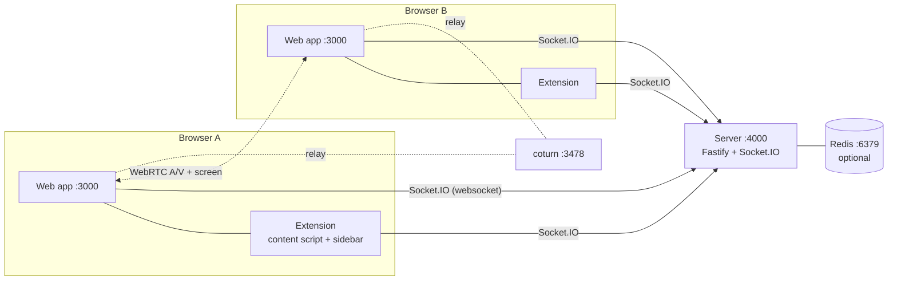

# WatchParty

Watch anything together. Create a room, share the 6-character code, and everyone's player stays in sync —
with chat, emoji reactions, a shared queue and voice/video calls.

## Host a party from your PC (the fast path)

**Once:** install Node 24+, pnpm 9 (`npm i -g pnpm@9.15.4`) and Cloudflare's tunnel tool, then open a **new** terminal:

```bash
winget install --id Cloudflare.cloudflared
pnpm install
```

**Party time:** from the project folder run

```bash
pnpm party
```

It builds everything, starts the app, and prints **`Share this link with your friends: https://….trycloudflare.com`**.
Keep that window open; Ctrl+C ends the party. The link changes every run. `pnpm party --local` skips the tunnel
(`http://localhost:4000`, this PC only); `--no-build` skips the build.

**Friends:** open the link in Chrome → enter a nickname → create or join a room → paste a link.

| What you watch | What each friend needs |
| --- | --- |
| YouTube, `.mp4`/`.webm`, `.m3u8` streams | Nothing — just the link. If their browser blocks autoplay they get **▶ Click to join playback** once. |
| Netflix, Prime, Disney+, MovieBox, … | Their own account **and** the extension: `pnpm party` writes `watchparty-extension.zip` to the project folder — send it, they unzip it, open `chrome://extensions`, turn on Developer mode, **Load unpacked** → the unzipped folder. Then "Open with extension" in the room. |
| Any other page | Nothing — the host shares the tab (Netflix and other DRM sites show black when shared; use the extension for those). |

Voice/video and screen share connect peer-to-peer without a relay server here, so a friend on a very strict
network (some corporate/mobile networks) may not get audio/video; playback sync and chat always work.

| Mode | Media | How |
| --- | --- | --- |
| **A — In-app player** | HLS (`.m3u8`), video files (`.mp4 .webm .ogg .ogv .mov .m4v .mkv`), YouTube, local files | The web app plays it and keeps everyone within ~80 ms |
| **B — Extension** | Netflix, Prime Video, Disney+, Hulu, Max, Apple TV+, Peacock, Paramount+, Crunchyroll, MovieBox, Hotstar, JioCinema | Everyone uses their own account; the Chrome extension syncs the site's player and adds a chat sidebar |
| **C — Screen share** | Any other web page | One person shares a tab over WebRTC; others watch the stream |



Design docs: [Architecture](docs/ARCHITECTURE.md) · [Sync protocol](docs/SYNC_PROTOCOL.md) ·
[Extension](docs/EXTENSION_SPEC.md) · [WebRTC & media](docs/WEBRTC_AND_MEDIA.md) ·
[DevOps & security](docs/DEVOPS_AND_SECURITY.md) · [Roadmap](docs/IMPLEMENTATION_ROADMAP.md) ·
[Contributor/agent contract](docs/CODING_CONTRACT.md)

---

## Contents

1. [Repository layout](#1-repository-layout)
2. [Prerequisites](#2-prerequisites)
3. [Quick start without Docker (in-memory store)](#3-quick-start-without-docker-in-memory-store)
4. [Environment variable reference](#4-environment-variable-reference)
5. [Running with Docker Compose](#5-running-with-docker-compose)
6. [pnpm command reference](#6-pnpm-command-reference)
7. [Loading the Chrome extension (unpacked)](#7-loading-the-chrome-extension-unpacked)
8. [Using the app](#8-using-the-app)
9. [Testing a party alone](#9-testing-a-party-alone)
10. [Troubleshooting](#10-troubleshooting)
11. [Production notes](#11-production-notes)

---

## 1. Repository layout

```text
.
├── apps/
│   ├── server/        @watchparty/server     Fastify 5 + Socket.IO 4 (port 4000)
│   ├── web/           @watchparty/web        Next.js 15 App Router (port 3000)
│   └── extension/     @watchparty/extension  Chrome MV3 (Vite + @crxjs) → apps/extension/dist
├── packages/
│   ├── shared-types/  @watchparty/shared-types  zod schemas, types, constants, event maps
│   └── sync-engine/   @watchparty/sync-engine   ClockSync, SyncController, adapters, classifyMediaUrl
├── coturn/turnserver.conf
├── nginx/nginx.conf
├── docker-compose.yml
├── turbo.json · pnpm-workspace.yaml · tsconfig.base.json
└── docs/
```

Build order is handled by turborepo: `shared-types` → `sync-engine` → `server`, `web`, `extension`.

---

## 2. Prerequisites

| Tool | Version | Needed for | Check |
| --- | --- | --- | --- |
| Node.js | **24.x** (tested on 24.18.0) | everything | `node -v` |
| pnpm | **9.15.4** | everything | `pnpm -v` |
| Google Chrome / Chromium (or Edge) | 120+ (MV3, `chrome.storage.session`, Shadow DOM) | extension, WebRTC | `chrome://version` |
| Docker Desktop / Engine + Compose v2 | 24+ | **optional** — Redis, coturn, full stack | `docker compose version` |
| OpenSSL | any | optional — generating `TURN_SECRET` (Node works too) | `openssl version` |

Install pnpm if missing:

```bash
npm install -g pnpm@9.15.4
# or: corepack enable && corepack prepare pnpm@9.15.4 --activate
```

> **Windows note.** If your checkout path contains spaces (e.g. `d:\strreaming platform`), always quote it:
> `cd "d:/strreaming platform"`. Chained commands below use Git Bash syntax (`&&`); in Windows PowerShell 5.1 run
> them one per line or use `;`.

---

## 3. Quick start without Docker (in-memory store)

This is the default local setup. With `REDIS_URL` unset the server keeps rooms, chat, queue and rate-limit
counters in process memory: everything works on **one server instance**, and all rooms are lost when the server
restarts. Without coturn, calls use STUN only — fine on the same machine/LAN, may fail across strict NATs.

```bash
cd "d:/strreaming platform"

# 1. install
pnpm install

# 2. env files (copy the examples, defaults work for localhost)
cp apps/server/.env.example    apps/server/.env
cp apps/web/.env.example       apps/web/.env.local
cp apps/extension/.env.example apps/extension/.env
echo NEXT_PUBLIC_SERVER_URL=http://localhost:4000 > apps/web/.env.development.local   # next dev on :3000 -> server :4000

# 3. build the shared packages once (turbo does this automatically for `pnpm dev` too)
pnpm build

# 4. run server + web + extension watcher + package watchers
pnpm dev
```

PowerShell equivalent of step 2:

```powershell
Copy-Item apps/server/.env.example apps/server/.env
Copy-Item apps/web/.env.example apps/web/.env.local
Copy-Item apps/extension/.env.example apps/extension/.env
Set-Content apps/web/.env.development.local 'NEXT_PUBLIC_SERVER_URL=http://localhost:4000' -Encoding ascii
```

Verify:

```bash
curl http://localhost:4000/healthz
# {"ok":true,"store":"memory","uptime":3.21}

curl "http://localhost:4000/api/turn?roomCode=K7QX2M&userId=<uuid>"
# 403 FORBIDDEN unless userId is a participant of that room (ids come from the room:create / room:join ack).
# As a participant: {"iceServers":[{"urls":["stun:stun.l.google.com:19302"]}],"ttl":3600}   (STUN-only while TURN_SECRET is empty)
```

Open <http://localhost:3000>, create a room, and open the room link in a second browser profile.

Prefer separate terminals? Run each app on its own:

```bash
pnpm --filter @watchparty/server dev      # http://localhost:4000
pnpm --filter @watchparty/web dev         # http://localhost:3000
pnpm --filter @watchparty/extension dev   # writes apps/extension/dist, rebuilds on change
```

(Run `pnpm build` first so `packages/*/dist` exists.)

---

## 4. Environment variable reference

Values are read once at startup. `NEXT_PUBLIC_*` and `VITE_*` are **inlined at build time** — restart `next dev`
or rebuild the extension after changing them.

### 4.1 Server — `apps/server/.env`

Loaded by `apps/server/src/env.ts` (Node's built-in `process.loadEnvFile`) and validated with zod; an invalid
value stops the server with a message naming the variable.

| Variable | Default | Required | Description |
| --- | --- | --- | --- |
| `PORT` | `4000` | no | HTTP + Socket.IO port |
| `HOST` | `0.0.0.0` | no | Bind address. Use `127.0.0.1` to keep it off the LAN |
| `CORS_ORIGINS` | `http://localhost:3000` | no | Comma-separated origins allowed on HTTP routes (`/api/*`). Must include the web app origin exactly (scheme + host + port) |
| `EXTENSION_IDS` | `kgeaggokfampiakpipghoaeockijhbai` (the pinned ID) | for extension popup HTTP calls | Comma-separated Chrome extension IDs; each becomes an allowed origin `chrome-extension://<id>` |
| `REDIS_URL` | *(unset)* | no | e.g. `redis://localhost:6379`. Unset ⇒ in-memory store, single instance. Set ⇒ Redis store **and** `@socket.io/redis-adapter`, so you can run several instances |
| `TURN_SECRET` | *(empty)* | for TURN | Shared secret, identical to coturn's `static-auth-secret`. Empty ⇒ `/api/turn` returns STUN servers only |
| `TURN_URLS` | `turn:localhost:3478?transport=udp,turn:localhost:3478?transport=tcp` | no | Comma-separated TURN URLs handed to clients (ignored when `TURN_SECRET` is empty) |
| `STUN_URLS` | `stun:stun.l.google.com:19302` | no | Comma-separated STUN URLs |
| `ROOM_TTL_SECONDS` | `86400` | no | Idle lifetime of a room and all its keys; refreshed on every activity |
| `LOG_LEVEL` | `info` | no | Fastify/pino level: `fatal` `error` `warn` `info` `debug` `trace` `silent` (JSON logs) |
| `TRUSTED_PROXIES` | `127.0.0.1/8,::1/128` | behind a proxy | Comma-separated IPs/CIDRs of your reverse proxy. `X-Forwarded-For` is used for the client IP (rate limits, join lockout) **only** when the TCP peer is in this list. Compose sets `127.0.0.1/8,::1/128,172.30.0.0/24` (its `backend` network). Never list a range untrusted clients can connect from |
| `WEB_UPSTREAM` | *(unset)* | for one-tunnel hosting | Plain `http://` origin of the Next.js app, e.g. `http://127.0.0.1:3000`. Set ⇒ every request the server does not handle itself (`/socket.io/`, `/healthz`, `/api/*`) is reverse-proxied there, so one tunnel (`cloudflared tunnel --url http://localhost:4000`) serves web app + API + socket from one origin. Run the web app with `next start` (no HMR websocket through the proxy). Upstream down ⇒ `502` |

Example:

```dotenv
PORT=4000
HOST=0.0.0.0
CORS_ORIGINS=http://localhost:3000
EXTENSION_IDS=
# REDIS_URL=redis://localhost:6379
TURN_SECRET=
TURN_URLS=turn:localhost:3478?transport=udp,turn:localhost:3478?transport=tcp
STUN_URLS=stun:stun.l.google.com:19302
ROOM_TTL_SECONDS=86400
LOG_LEVEL=info
# WEB_UPSTREAM=http://127.0.0.1:3000
```

### 4.2 Web — `apps/web/.env.local`

| Variable | Default | Required | Description |
| --- | --- | --- | --- |
| `NEXT_PUBLIC_SERVER_URL` | *(empty)* | no | Base URL of the server for Socket.IO and `/api/*`. Empty ⇒ same origin, resolved at runtime from the page URL (the server proxies the web app via `WEB_UPSTREAM`, e.g. one Cloudflare tunnel → `:4000`). Set `http://localhost:4000` only for `next dev` on `:3000` — put it in `apps/web/.env.development.local`, which `next build` never reads |
| `NEXT_PUBLIC_EXTENSION_ID` | *(empty)* | for Mode B | ID of the installed extension (see [§7](#7-loading-the-chrome-extension-unpacked)). Empty ⇒ the Mode B panel shows install steps only |

### 4.3 Extension — `apps/extension/.env`

| Variable | Default | Required | Description |
| --- | --- | --- | --- |
| `VITE_SERVER_URL` | `http://localhost:4000` | yes | Server the content script connects to; also added to `host_permissions` |
| `VITE_WEB_URL` | `http://localhost:3000` | yes | Web app origin. Used for `externally_connectable.matches` and the background's `sender.origin` check — must match the origin in your browser bar exactly |

### 4.4 Docker Compose — root `.env`

`docker compose` reads a `.env` file next to `docker-compose.yml` for variable substitution.

| Variable | Example | Description |
| --- | --- | --- |
| `TURN_SECRET` | 64 hex chars | Passed to both the `server` and `coturn` services (required) |
| `REDIS_PASSWORD` | 64 hex chars | Redis `requirepass`; compose builds the server's `REDIS_URL` from it (required) |
| `TURN_EXTERNAL_IP` | `127.0.0.1` locally, the public IP in production | coturn `external-ip` (required) |
| `CORS_ORIGINS` | `http://localhost:3000` | Forwarded to `server` |
| `EXTENSION_IDS` | `abcdefghijklmnopabcdefghijklmnop` | Forwarded to `server` |
| `TRUSTED_PROXIES` | `127.0.0.1/8,::1/128,172.30.0.0/24` (default) | Forwarded to `server`; the compose `backend` subnet is pinned to `172.30.0.0/24` |
| `NEXT_PUBLIC_SERVER_URL` | `http://localhost:4000` | Build arg for the `web` image (baked into the JS bundle) |
| `NEXT_PUBLIC_EXTENSION_ID` | same as above | Build arg for the `web` image |

Generate a secret:

```bash
node -e "console.log(require('node:crypto').randomBytes(32).toString('hex'))"
# or
openssl rand -hex 32
```

---

## 5. Running with Docker Compose

Services defined in `docker-compose.yml`:

| Service | Image | Ports | Notes |
| --- | --- | --- | --- |
| `redis` | `redis:7-alpine` | `127.0.0.1:6379` | AOF on, `requirepass ${REDIS_PASSWORD}`, `volatile-ttl` eviction |
| `coturn` | `coturn/coturn:4.6.3` | `3478/udp`, `3478/tcp`, `5349/tcp+udp` (TLS, needs `certs/turn/*.pem`), `49160-49200/udp` (relay) | Config from `coturn/turnserver.conf` with `use-auth-secret` + `static-auth-secret=${TURN_SECRET}` rendered at container start |
| `server` | built from `apps/server/Dockerfile` | `4000` | `REDIS_URL=redis://:${REDIS_PASSWORD}@redis:6379` set by compose |
| `web` | built from `apps/web/Dockerfile` | `3000` | `NEXT_PUBLIC_*` passed as build args |

```bash
cd "d:/strreaming platform"
cp .env.example .env              # then set TURN_SECRET, REDIS_PASSWORD, TURN_EXTERNAL_IP
docker compose up -d --build
docker compose ps                 # all services "running" / "healthy"
docker compose logs -f server     # look for: store=redis, listening on 0.0.0.0:4000
curl http://localhost:4000/healthz
# {"ok":true,"store":"redis","uptime":...}
```

Useful variants:

```bash
docker compose up -d redis coturn         # infra only; run server/web with `pnpm dev` and REDIS_URL=redis://localhost:6379
docker compose up -d --scale server=2     # multi-instance test (needs nginx or distinct ports; see DEVOPS doc)
docker compose down                       # stop (Redis AOF data stays in the redis-data volume; add -v to wipe it)
```

Verify TURN (from a machine with coturn utils, or inside the container):

```bash
# Git Bash, with TURN_SECRET exported in your shell
U="$(( $(date +%s) + 3600 )):test"
P="$(printf '%s' "$U" | openssl dgst -sha1 -hmac "$TURN_SECRET" -binary | base64)"
docker compose exec coturn turnutils_uclient -y -u "$U" -w "$P" 127.0.0.1
# success = "Total lost packets 0" and allocations reported
```

The extension is **not** a compose service — build it with pnpm and load it in Chrome (§7).
Reverse proxy / TLS setup is in [nginx/nginx.conf](nginx/nginx.conf) and
[docs/DEVOPS_AND_SECURITY.md](docs/DEVOPS_AND_SECURITY.md).

---

## 6. pnpm command reference

Run from the repo root unless stated.

| Command | What it does |
| --- | --- |
| `pnpm install` | Install all workspace deps (use `--frozen-lockfile` in CI) |
| `pnpm dev` | `turbo run dev`: package watchers + server (`tsx watch`) + web (`next dev`) + extension (`vite`) |
| `pnpm build` | `turbo run build`: builds all 5 packages in dependency order |
| `pnpm typecheck` | `turbo run typecheck`: `tsc --noEmit` everywhere — must be zero errors |
| `pnpm test` | `turbo run test`: `node:test` suites in shared-types, sync-engine and server |
| `pnpm clean` | Remove `dist/` and `.next/` |
| `pnpm --filter @watchparty/server dev` | Server only, restarts on change |
| `pnpm --filter @watchparty/server start` | Run built server (`node dist/index.js`) |
| `pnpm --filter @watchparty/web dev` | Web only on :3000 |
| `pnpm --filter @watchparty/web start` | Serve production build |
| `pnpm --filter @watchparty/extension build` | Production build into `apps/extension/dist` |
| `pnpm --filter @watchparty/extension dev` | Watch build into `apps/extension/dist` (crxjs dev mode) |
| `pnpm --filter @watchparty/sync-engine test` | Sync engine unit tests only |
| `pnpm --filter <pkg> add <dep>` | Add a dependency to one package |

**Milestone gate** (required by [docs/CODING_CONTRACT.md](docs/CODING_CONTRACT.md)): `pnpm typecheck && pnpm build && pnpm test`.

---

## 7. Loading the Chrome extension (unpacked)

1. **Set the extension env (optional).** `apps/extension/.env` holds only the *defaults* for local dev
   (`VITE_SERVER_URL=http://localhost:4000`, `VITE_WEB_URL=http://localhost:3000`). The real server comes at runtime:
   from the web app's handoff, from the popup's **Server** field (remembered after the first successful join), or
   from a `#wp=CODE@host` link. So one build works for any Cloudflare quick tunnel (`https://<random>.trycloudflare.com`),
   whose address changes every run; friends can load the same `dist` folder unchanged.
2. **Build it.**
   ```bash
   pnpm --filter @watchparty/extension build
   ```
   Confirm `apps/extension/dist/manifest.json` exists.
3. **Open the extensions page.** Go to `chrome://extensions` (Edge: `edge://extensions`).
4. **Enable Developer mode** with the toggle in the top-right corner.
5. **Load unpacked.** Click **Load unpacked** and select the folder `apps/extension/dist`
   (full path e.g. `D:\strreaming platform\apps\extension\dist`). Select the `dist` folder itself, not
   `apps/extension`.
6. **Check the ID.** The manifest pins it with a public `key`, so every copy on every machine shows
   **`kgeaggokfampiakpipghoaeockijhbai`**, whatever folder it is loaded from.
7. **Nothing to configure.** The web app (`NEXT_PUBLIC_EXTENSION_ID`) and server (`EXTENSION_IDS`) default to this ID.
8. **Reload** the web page so it detects the extension.
9. **Pin it.** Click the puzzle icon in the toolbar and pin WatchParty. The popup shows the server status and the
   current session, if any.
10. **Check the bridge.** Open a room at <http://localhost:3000>; the room header shows "Extension connected"
    when the web app's `WP_PING` gets an answer.
11. **Optional — incognito/second profile.** For a second test user, either install the unpacked extension in a
    second Chrome profile (steps 3–6; same path ⇒ same ID) or enable **Allow in Incognito** on the extension's
    details page.

After code changes:

- With `pnpm --filter @watchparty/extension dev` running, most changes reload automatically; content-script
  changes need a reload of the streaming tab.
- After `build`, click the **reload** icon on the extension card, then reload the streaming tab.
- If you changed `VITE_WEB_URL` or `VITE_SERVER_URL` (the local-dev defaults), rebuild **and** reload.

Permissions you will see: `storage`, `tabs`, `activeTab`, `scripting`, and host access to the supported streaming sites plus
`VITE_SERVER_URL`. Besides `VITE_WEB_URL`, any `https://*.trycloudflare.com` page may talk to the extension (to
hand off a room); see the shortcut note in [docs/EXTENSION_SPEC.md](docs/EXTENSION_SPEC.md) §9. Details and rationale: [docs/EXTENSION_SPEC.md](docs/EXTENSION_SPEC.md).

---

## 8. Using the app

1. **Create a room** on the home page: enter a nickname (1–24 characters), optionally paste a media URL, click
   **Create**. You get a code like `K7QX2M` and become the host.
2. **Invite**: share `http://localhost:3000/room/K7QX2M` or just the code. Up to 12 people per room.
3. **Load media** by pasting a URL in the room. The app classifies it:
   - `.m3u8` / video file / YouTube → plays in the page (Mode A).
   - Netflix, Prime, Disney+ … → **Open <site> with WatchParty** (Mode B). Every viewer needs the extension and
     their own account; the extension opens the title in a tab, joins the room, and shows the sidebar.
   - Anything else → **Share a tab** (Mode C), or **Try with the extension** if the page has a `<video>`.
   - **Local file**: choose **Local file** and pick the file; every viewer picks their own copy of the same file.
4. **Control playback** — play/pause/seek/speed by anyone, unless the host ticks **Only I control playback**.
5. **Chat** — type `@12:34` or `@1:02:03` to post a clickable timestamp that seeks the room there.
6. **React** with one of 12 emojis; reactions float over the player for everyone.
7. **Queue** media; the host (or anyone, if host-only control is off) clicks **Play next**.
8. **Call** — turn on mic/camera from the call bar. Calls are peer-to-peer (mesh); keep video to ~6 people.

If someone's player stalls, everyone pauses with a "Waiting for <name>…" banner and resumes together when they
catch up (or after 8 s).

---

## 9. Testing a party alone

- Use **two Chrome profiles** (or one normal + one incognito window). Two tabs in the same profile also work for
  Mode A but share mic/camera devices.
- Good Mode A test media:
  - HLS: `https://test-streams.mux.dev/x36xhzz/x36xhzz.m3u8`
  - MP4: any direct `.mp4` URL you are allowed to stream
  - YouTube: any `https://www.youtube.com/watch?v=<11-char-id>`
- Check sync: pause in one window — the other pauses within a few hundred ms. Seek in one — the other jumps.
  Throttle one tab in DevTools → Network → **Slow 3G** to trigger the buffering banner.
- Check drift correction: in one window's DevTools console run
  `setInterval(() => console.log(document.querySelector('video')?.playbackRate), 500)` and nudge that window's
  video with `document.querySelector('video').currentTime += 0.5`: the rate moves inside 0.96–1.04 and returns
  to 1 once the drift is under 80 ms. A nudge over 1.5 s triggers a hard seek instead.

---

## 10. Troubleshooting

| Symptom | Cause / fix |
| --- | --- |
| Server exits on start after a `<VAR>: <message>` line (e.g. `PORT: Expected number, received nan`) | A variable failed zod validation; fix the named value in `apps/server/.env` |
| Room header shows "Server unreachable" | Server not running, or `NEXT_PUBLIC_SERVER_URL` wrong — restart `next dev` after editing it |
| `/api/metadata` blocked by CORS | Web origin missing from `CORS_ORIGINS` (scheme + host + port must match) |
| `TOO_MANY_ATTEMPTS` when joining | 10 failed joins from your IP within 10 minutes. Wait, or restart the server (memory store) / `DEL ratelimit:join:<ip>` (Redis) |
| `ROOM_FULL` | 12 participants already in the room |
| No "Extension connected" badge / Mode B shows "Install the WatchParty extension" | `NEXT_PUBLIC_EXTENSION_ID` empty or wrong, extension disabled, or `VITE_WEB_URL` doesn't match the page origin (e.g. `127.0.0.1` vs `localhost`). Rebuild + reload after fixing |
| Extension sidebar doesn't appear on Netflix etc. | Reload the streaming tab after installing/reloading the extension; confirm the site is in the Mode B list and check the extension card in `chrome://extensions` for errors |
| Chrome asks to "look for and connect to devices on your local network" on a streaming site | Chrome's Local Network Access check for `localhost` requests from public sites. Allow it for local development; production uses a public HTTPS server |
| Call connects on LAN but not across networks | No TURN. Set `TURN_SECRET` and run coturn (`docker compose up -d coturn`), with relay ports 49160–49200/udp reachable |
| `pnpm dev` fails with "Cannot find module '@watchparty/shared-types'" | Packages not built yet: run `pnpm build` once |
| Port 3000/4000 already in use | `netstat -ano \| findstr :4000` (cmd/PowerShell) and stop the process, or change `PORT` (update `NEXT_PUBLIC_SERVER_URL` and `VITE_SERVER_URL` to match) |
| YouTube video won't play | Some videos disallow embedding; the player shows the YouTube error code. Pick another video |
| Rooms vanish after server restart | Expected with the in-memory store. Set `REDIS_URL` to persist rooms for `ROOM_TTL_SECONDS` |

---

## 11. Production notes

- Put nginx (or any TLS proxy) in front: `https://watch.example.com` → web :3000, `https://api.example.com` →
  server :4000 with WebSocket upgrade headers. See [nginx/nginx.conf](nginx/nginx.conf).
- Set `CORS_ORIGINS=https://watch.example.com`, `NEXT_PUBLIC_SERVER_URL=https://api.example.com`, rebuild the
  extension with `VITE_SERVER_URL=https://api.example.com` and `VITE_WEB_URL=https://watch.example.com`.
- Set `REDIS_URL` to run more than one server instance. Socket.IO is websocket-only, so no sticky sessions are
  needed.
- coturn needs a public IP (`external-ip`), open relay ports, and TLS certs for `turns:` on 5349.
- Full hardening checklist (CSP, headers, rate limits, SSRF, secrets): [docs/DEVOPS_AND_SECURITY.md](docs/DEVOPS_AND_SECURITY.md).
