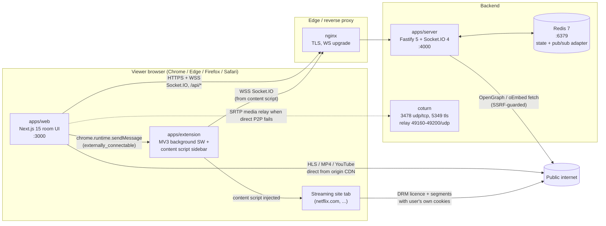
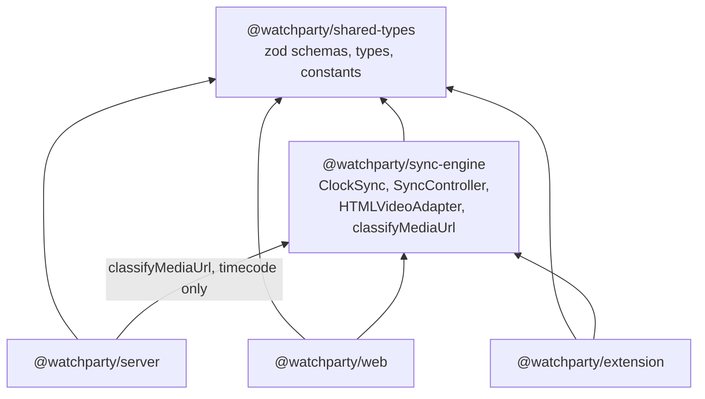
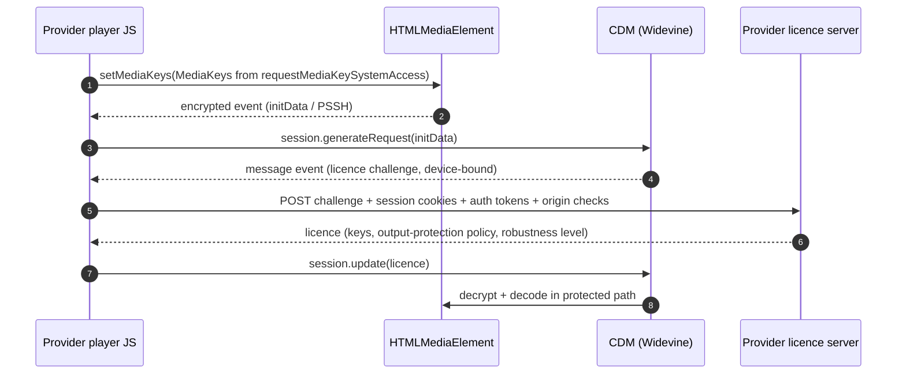
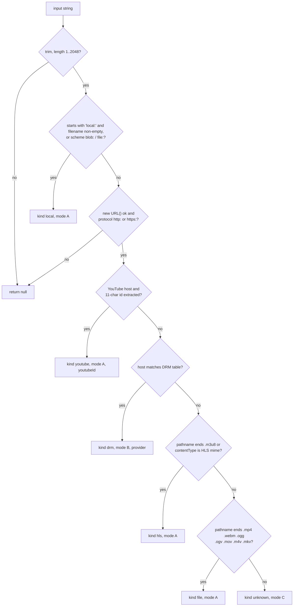
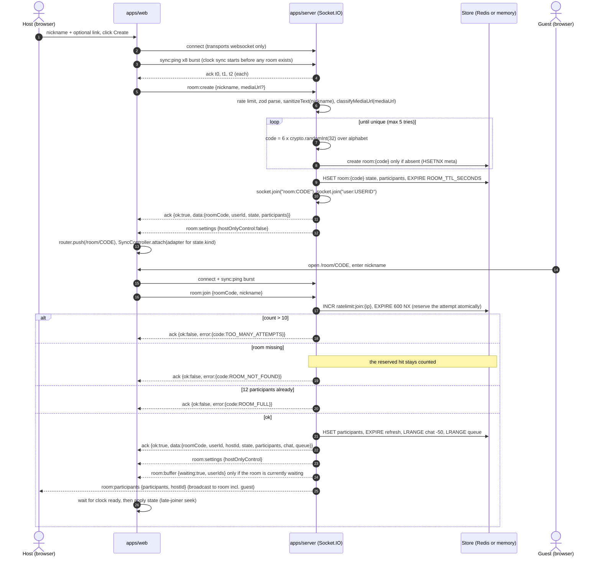
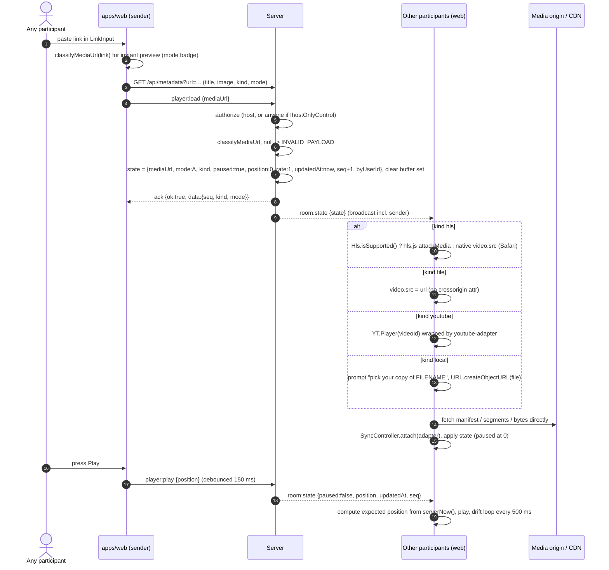
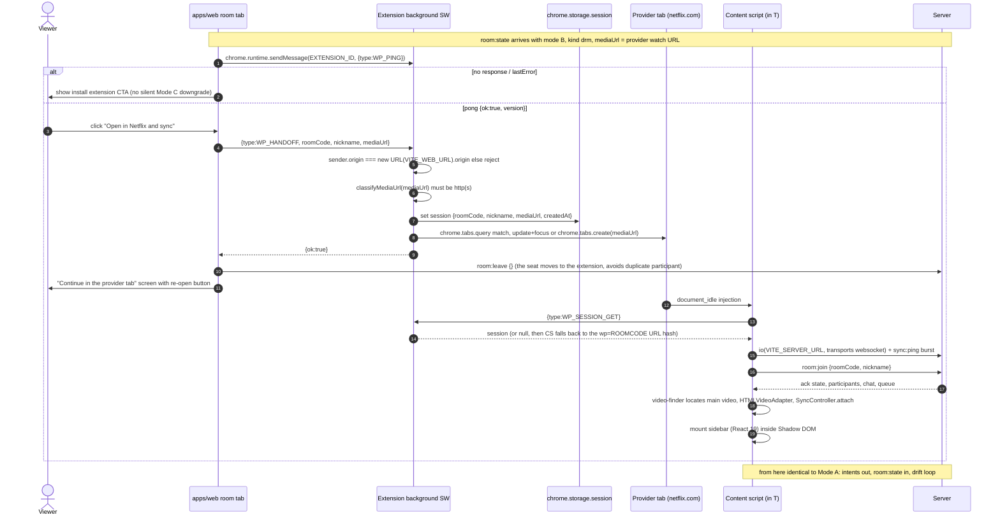
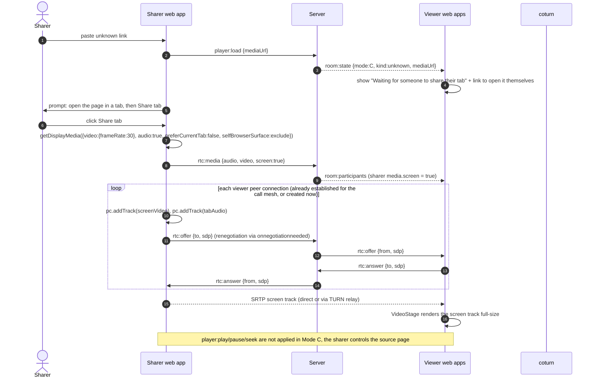
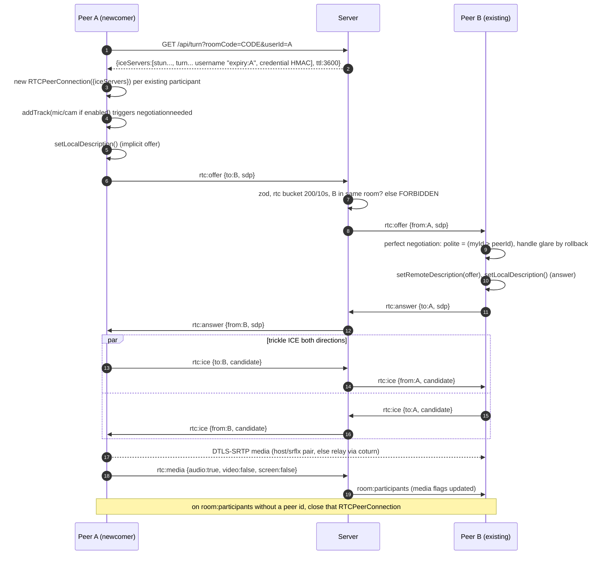
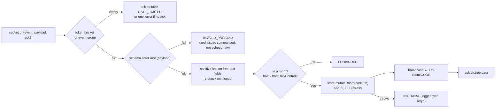

# Architecture

> Status: authoritative design reference for the WatchParty monorepo.
> Companion documents: [SYNC_PROTOCOL.md](./SYNC_PROTOCOL.md) (clock math, playback state, every Socket.IO event and Zod schema),
> [EXTENSION_SPEC.md](./EXTENSION_SPEC.md) (Chrome MV3 extension internals),
> [WEBRTC_AND_MEDIA.md](./WEBRTC_AND_MEDIA.md) (mesh calls, screen share, TURN),
> [DEVOPS_AND_SECURITY.md](./DEVOPS_AND_SECURITY.md) (deployment, nginx, coturn, threat model),
> [IMPLEMENTATION_ROADMAP.md](./IMPLEMENTATION_ROADMAP.md) (build order and milestones),
> [../README.md](../README.md) and [CODING_CONTRACT.md](CODING_CONTRACT.md) (quick start and contributor rules).

---

## 1. What we are building

A social watch-party platform: a group of up to **12 people** opens one room (6-character code), watches the same media in lock-step, and talks over chat, emoji reactions and an optional WebRTC voice/video mesh. A single pasted link decides *how* the group watches it, through the **3-Mode Unified Link Engine**:

| Mode | Name | Who decodes the video | Sync mechanism | Typical links |
|---|---|---|---|---|
| **A** | Native playback | Our web app, in our own `<video>` / YouTube IFrame Player | Full sync engine (clock sync + drift correction + wait-for-buffer) | `.m3u8`, `.mp4`/`.webm`/..., YouTube, a local file each viewer picks |
| **B** | Extension overlay | The streaming site itself, in each viewer's own logged-in tab | Same sync engine, driving the site's `<video>` from our content script | Netflix, Prime Video, Disney+, Hulu, Max, Apple TV+, Peacock, Paramount+, Crunchyroll, MovieBox, Hotstar, JioCinema |
| **C** | Tab share | One sharer's browser; everyone else receives a WebRTC screen track | None needed (live stream); latency is the WebRTC path | Any other `http(s)` page with non-DRM video |

### 1.1 Glossary

| Term | Meaning |
|---|---|
| Room | Server-side aggregate: meta, authoritative `PlaybackState`, participants, chat, queue. Key `room:{code}`. |
| Participant | One Socket.IO connection that joined a room. Has a server-generated `userId` (`crypto.randomUUID()`). |
| Host | Room creator; on host leave the oldest remaining participant (min `joinedAt`) becomes host. |
| `PlaybackState` | `{ mediaUrl, mode, kind, paused, position, rate, updatedAt, seq, byUserId }`, authoritative on the server. See [SYNC_PROTOCOL.md §4](./SYNC_PROTOCOL.md#4-authoritative-playback-state). |
| Adapter | An implementation of `MediaAdapter` (sync-engine) that wraps one concrete player: `HTMLVideoAdapter` (web Mode A file/HLS/local, extension Mode B) or the YouTube adapter (`apps/web/src/lib/youtube-adapter.ts`). |
| Intent | A local user action (play/pause/seek/rate) that the client sends to the server. It is not applied as truth until it comes back as `room:state`. |
| Mode | `'A' \| 'B' \| 'C'` routing decision from `classifyMediaUrl`. |
| Kind | `'hls' \| 'file' \| 'youtube' \| 'local' \| 'drm' \| 'unknown'`. |

---

## 2. System context



Non-negotiable architectural rules:

1. **The server never proxies media bytes.** Mode A media is fetched by each browser directly from its origin/CDN; Mode B media is fetched by the provider's own player with the viewer's own account; Mode C media travels peer-to-peer (or via TURN relay) as WebRTC. This keeps bandwidth cost flat and keeps us out of the content-redistribution business.
2. **The server is the single source of truth for playback.** Clients send intents; they apply only `room:state` (ordered by `seq`).
3. **Every inbound payload is Zod-validated server-side** (schemas in `@watchparty/shared-types`), after a per-socket token-bucket rate limit.
4. **No ambient credentials.** There are no cookies or sessions; the room code is the capability, the `userId` is per connection. This is what makes the Origin policy in §8.4 safe.
5. **User-generated text is rendered as React text nodes only**, never `dangerouslySetInnerHTML`. The server strips control characters and trims; HTML-escaping is the renderer's job.

---

## 3. Monorepo directory map

pnpm workspace + Turborepo. Every package is TypeScript `strict`, ESM (`"type": "module"`).

```text
d:\strreaming platform\
├── package.json                      # private root; scripts: dev, build, lint, typecheck, test (all via turbo)
├── pnpm-workspace.yaml               # packages: ["apps/*", "packages/*"]
├── turbo.json                        # pipeline: build dependsOn ^build, outputs dist/** .next/**; dev persistent
├── tsconfig.base.json                # strict, ES2022, moduleResolution Bundler/NodeNext per package
├── .env.example                      # every variable from §9, with defaults
├── docker-compose.yml                # redis, coturn, server, web
├── coturn/
│   └── turnserver.conf               # use-auth-secret, static-auth-secret=${TURN_SECRET}, relay 49160-49200
├── nginx/
│   └── nginx.conf                    # example TLS edge: /socket.io/ upgrade, /api/ -> :4000, / -> :3000
├── CODING_CONTRACT.md
├── README.md
├── docs/
│   ├── ARCHITECTURE.md               # this file
│   ├── SYNC_PROTOCOL.md
│   ├── EXTENSION_SPEC.md
│   ├── WEBRTC_AND_MEDIA.md
│   ├── DEVOPS_AND_SECURITY.md
│   └── IMPLEMENTATION_ROADMAP.md
├── packages/
│   ├── shared-types/                 # @watchparty/shared-types   (build: tsc -> dist)
│   │   ├── package.json              # deps: zod
│   │   ├── tsconfig.json
│   │   └── src/
│   │       ├── index.ts              # re-exports everything below
│   │       ├── constants.ts          # alphabet, limits, emoji allowlist, sync timings, rate-limit table, error codes
│   │       ├── schemas.ts            # Zod schemas for every C2S payload + S2C shapes + PlaybackState
│   │       └── events.ts             # ClientToServerEvents / ServerToClientEvents / Ack<T> types for Socket.IO generics
│   └── sync-engine/                  # @watchparty/sync-engine    (build: tsc -> dist; deps: @watchparty/shared-types)
│       ├── package.json
│       ├── tsconfig.json
│       └── src/
│           ├── index.ts              # public API: ClockSync, SyncController, MediaAdapter, HTMLVideoAdapter, classifyMediaUrl, timecode helpers
│           ├── clock.ts              # ClockSync: ping burst/interval, 10-sample window, min-RTT selection, serverNow()
│           ├── controller.ts         # SyncController: applies room:state, drift loop, isRemoteAction lock, intent debounce, buffering reporter
│           ├── classify.ts           # classifyMediaUrl(url, contentType?) -> MediaClassification | null
│           ├── timecode.ts           # formatTimecode(seconds) / parseTimecode("h:mm:ss") shared by UI + server tag parser
│           └── adapters/
│               └── html-video.ts     # HTMLVideoAdapter implements MediaAdapter over HTMLMediaElement
├── apps/
│   ├── server/                       # @watchparty/server  (Fastify 5, Socket.IO 4, ioredis, @socket.io/redis-adapter; :4000)
│   │   ├── package.json              # deps: @watchparty/shared-types, @watchparty/sync-engine (classify + timecode only)
│   │   ├── tsconfig.json
│   │   ├── Dockerfile
│   │   └── src/
│   │       ├── index.ts              # boot: read env, build app, attach Socket.IO, listen HOST:PORT, graceful shutdown
│   │       ├── env.ts                # zod-validated process.env -> typed Env (defaults from §9)
│   │       ├── app.ts                # Fastify instance: CORS, /healthz, /api/turn, /api/metadata
│   │       ├── socket/
│   │       │   ├── index.ts          # Server<C2S,S2C>, redis adapter when REDIS_URL, connection wiring, origin check
│   │       │   └── handlers/
│   │       │       ├── room.ts       # room:create, room:join, room:leave, room:settings, disconnect, host transfer
│   │       │       ├── sync.ts       # sync:ping
│   │       │       ├── player.ts     # player:play|pause|seek|rate|load|buffering, wait-for-buffer state machine
│   │       │       ├── chat.ts       # chat:send, reaction:send
│   │       │       ├── queue.ts      # queue:add, queue:remove, queue:next
│   │       │       └── rtc.ts        # rtc:offer, rtc:answer, rtc:ice, rtc:media relay
│   │       ├── store/
│   │       │   ├── types.ts          # RoomStore interface + RoomRecord / ParticipantRecord / BufferRecord
│   │       │   ├── memory.ts         # in-memory store (REDIS_URL unset; single instance only)
│   │       │   └── redis.ts          # ioredis store, WATCH/MULTI optimistic room mutation, TTL refresh
│   │       └── lib/
│   │           ├── rateLimit.ts      # token bucket per socket + join-failure counter per IP
│   │           ├── roomCode.ts       # crypto.randomInt over ROOM_CODE_ALPHABET, collision retry
│   │           ├── turn.ts           # HMAC-SHA1 time-limited TURN credentials
│   │           ├── metadata.ts       # SSRF-safe OpenGraph scrape + YouTube oEmbed
│   │           ├── proxy.ts          # WEB_UPSTREAM same-origin gateway: stream non-API requests to Next.js
│   │           ├── sanitize.ts       # sanitizeText(): CR/LF/TAB -> space, strip control + bidi-override chars, trim
│   │           └── timestamps.ts     # parse @mm:ss / @h:mm:ss tags -> seconds[]
│   ├── web/                          # @watchparty/web  (Next.js 15 App Router, React 19, Tailwind 3.4, Zustand 5; :3000)
│   │   ├── package.json              # deps: hls.js, socket.io-client, zustand, @watchparty/*
│   │   ├── next.config.mjs           # transpilePackages for workspace packages
│   │   ├── tailwind.config.ts
│   │   ├── postcss.config.mjs
│   │   ├── Dockerfile
│   │   └── src/
│   │       ├── app/
│   │       │   ├── layout.tsx        # root layout, fonts, theme
│   │       │   ├── page.tsx          # landing: create room (nickname + optional link) / join by code
│   │       │   └── room/[code]/page.tsx  # room shell (client component): stage + sidebar
│   │       ├── components/           # e.g. VideoStage, HlsPlayer, YouTubePlayer, LocalFilePicker, ModeBPanel,
│   │       │                         #      TabSharePanel, ChatPanel, ReactionBar, ReactionOverlay, ParticipantList,
│   │       │                         #      CallGrid, QueuePanel, LinkInput, BufferingBanner, SettingsMenu
│   │       ├── lib/
│   │       │   ├── socket.ts         # typed socket.io-client singleton, ack helper with timeout
│   │       │   ├── webrtc.ts         # mesh manager, perfect negotiation, getUserMedia/getDisplayMedia
│   │       │   ├── youtube-adapter.ts# MediaAdapter over YT.Player (IFrame Player API)
│   │       │   └── extension.ts      # WP_PING / WP_HANDOFF via chrome.runtime.sendMessage(NEXT_PUBLIC_EXTENSION_ID)
│   │       └── store/
│   │           └── room.ts           # Zustand store: connection, room, participants, chat, queue, buffer, call state
│   └── extension/                    # @watchparty/extension  (MV3, Vite + @crxjs/vite-plugin; output apps/extension/dist)
│       ├── package.json
│       ├── manifest.config.ts        # defineManifest: background SW, content_scripts for DRM hosts, externally_connectable
│       ├── vite.config.ts
│       ├── tailwind.config.ts
│       └── src/
│           ├── background.ts         # router/state: validates sender.origin, chrome.storage.session, tab open/focus
│           ├── content/
│           │   ├── index.tsx         # owns socket.io-client, SyncController, mounts sidebar in Shadow DOM
│           │   ├── video-finder.ts   # finds the "main" <video>, survives SPA re-mounts (MutationObserver)
│           │   └── sidebar/          # React 19 sidebar: chat, reactions, participants, sync status
│           └── popup/                # popup UI: current session, leave, open web room
```

### 3.1 Package dependency graph



Rules: `shared-types` has exactly one runtime dependency (`zod`) and no DOM types. `sync-engine` may reference DOM types (`HTMLMediaElement`) only inside `adapters/`; `clock.ts`, `controller.ts`, `classify.ts`, `timecode.ts` are environment-neutral so the server can import `classify` and `timecode`. Turborepo `build` runs `^build` first, so packages compile to `dist/` before apps consume them.

---

## 4. Why iframes fail for streaming services

The naive watch-party design is "put the Netflix page in an `<iframe>` inside our room and script it". Every layer of the modern web platform blocks this, deliberately. Understanding each layer is why Mode B exists.

### 4.1 Layer 1: framing refusal (`X-Frame-Options`, CSP `frame-ancestors`)

| Mechanism | Header example | Effect |
|---|---|---|
| `X-Frame-Options` (legacy, RFC 7034) | `X-Frame-Options: DENY` or `SAMEORIGIN` | Browser refuses to render the response inside any frame (DENY) or any cross-origin frame (SAMEORIGIN). The frame shows an error page; no script of ours can override it. |
| CSP Level 2+ `frame-ancestors` | `Content-Security-Policy: frame-ancestors 'self' https://*.netflix.com` | Supersedes XFO when both exist. Every ancestor in the frame chain must match the list; our origin never will. |
| Frame-busting script | `if (top !== self) top.location = self.location` | Older but still deployed. `sandbox` without `allow-top-navigation` stops the navigation but most players then refuse to initialise. |
| `Cross-Origin-Opener-Policy` / `Cross-Origin-Embedder-Policy` / `Cross-Origin-Resource-Policy` | `COOP: same-origin`, `CORP: same-site` | Isolates browsing-context groups and refuses cross-origin embedding of sub-resources, so even pieces of the player cannot be pulled into our page. |

All major SVOD providers send at least one of these on their watch pages. These are **response headers set by the provider**; a client-side workaround would require modifying responses (e.g. `declarativeNetRequest` header stripping), which is fragile, violates provider ToS, and still runs into layers 2-4. We do not do it.

### 4.2 Layer 2: the same-origin policy blocks control even when framing works

Suppose a site *does* allow framing (YouTube's `/embed/` does). Our page at `https://watch.example` still cannot touch `iframe.contentDocument` of a different origin: no `querySelector('video')`, no `currentTime`, no `play()`, no event listeners. Cross-origin control is only possible if the framed site exposes a `postMessage` API. YouTube does (the IFrame Player API), which is exactly why YouTube is a Mode A kind with its own adapter. Netflix, Prime, Disney+ and the rest publish no such API.

### 4.3 Layer 3: DRM (EME + Widevine / PlayReady / FairPlay)

Premium content is encrypted (CENC/CBCS) and decrypted only by a Content Decryption Module via Encrypted Media Extensions:



Why this kills iframes and screen sharing:

* **Permissions Policy `encrypted-media`**: EME in a cross-origin iframe requires the embedder to grant `allow="encrypted-media"`. Even when granted, the licence request is made by the provider's JS with the provider's tokens; the licence server validates origin, referrer, account session and device, and a framed context fails those checks or is refused outright.
* **Robustness and output protection**: licences carry policies (Widevine L1/L3, HDCP requirements). Hardware-backed (L1) playback renders through a protected path that the compositor never exposes to capture, so `getDisplayMedia` captures **black frames** for DRM video. This is why DRM links are never routed to Mode C.
* **No licence sharing**: keys are bound to the requesting CDM instance and account; one viewer cannot decrypt for another. Every viewer must play the stream with **their own subscription**, in their own tab. Mode B is designed around that fact.

### 4.4 Layer 4: cookies, `SameSite`, and storage partitioning

* Provider session cookies are `SameSite=Lax` or `Strict` (and often `__Host-` prefixed). A Lax cookie is **not sent** on subresource or iframe requests from a cross-site top-level page; only on top-level navigations. Inside our frame the user appears logged out.
* Chrome's third-party cookie phase-out, Safari ITP and Firefox Total Cookie Protection block or **partition** third-party cookies and storage (CHIPS, partitioned `localStorage` / IndexedDB keyed by top-level site). Even a `SameSite=None; Secure` cookie set during a framed login lands in a jar that the provider's real top-level session never sees.
* Result: login state, profile selection, entitlement checks and DRM licence tokens are all unavailable in a framed context.

### 4.5 Consequences for our design

| Problem | Our answer |
|---|---|
| Cannot frame or script the provider page | Do not frame. Each viewer opens the provider page **top-level** in their own tab (Mode B). |
| Cannot reach the `<video>` cross-origin | The extension's **content script** runs in the provider's origin (isolated world) and can read/control the page's `<video>` element directly. |
| DRM licence needs the user's own session and CDM | Each viewer's own logged-in tab fetches its own licence. We synchronise *time*, never media. |
| DRM video captures as black | DRM is never Mode C. Mode C is reserved for non-DRM unknown sites. |
| Non-DRM site with no CORS / anti-hotlinking | Mode C (sharer captures the tab), or Mode B if the user has the extension. |
| Direct media URL (HLS/MP4) | Mode A: our own `<video>` (+ hls.js), no framing at all. HLS via hls.js uses XHR/fetch, so the segment host must send CORS headers; if it does not, the player surfaces an error and the UI offers Mode C. Plain file URLs play without CORS because we never set the `crossorigin` attribute (we never read pixels). |

---

## 5. The 3-Mode Unified Link Engine

### 5.1 `classifyMediaUrl`

Lives in `packages/sync-engine/src/classify.ts`; used by the web app (instant UI routing while typing), by the server (authoritative classification on `player:load` / `queue:add`), and by `/api/metadata`.

```ts
export type MediaKind = 'hls' | 'file' | 'youtube' | 'local' | 'drm' | 'unknown';
export type SyncMode = 'A' | 'B' | 'C';

export interface MediaClassification {
  kind: MediaKind;
  mode: SyncMode;
  url: string;          // normalised: WHATWG URL .href, or the 'local:<filename>' sentinel
  youtubeId?: string;   // kind === 'youtube'
  provider?: string;    // kind === 'drm', site key from table 5.2
}

// Returns null for invalid input (documented choice: never throws).
export function classifyMediaUrl(url: string, contentType?: string): MediaClassification | null;
```

Decision: **invalid input returns `null`** (never throws), so callers branch without try/catch; the server maps `null` to `INVALID_PAYLOAD`. The optional `contentType` argument (lower-cased, parameters after `;` ignored) lets `/api/metadata` upgrade an extension-less URL to `hls` when the origin answers `application/vnd.apple.mpegurl` or `application/x-mpegURL`.

Evaluation order (first match wins):



Matching details:

* Host matching is on `URL.hostname` lower-cased: `host === d || host.endsWith('.' + d)`. Never substring matching (`notnetflix.com` must not match `netflix.com`).
* Extension matching is on `URL.pathname` lower-cased, so query strings (`?token=...`) do not interfere.
* YouTube id regex: `^[A-Za-z0-9_-]{11}$`, extracted from:
  * `youtube.com/watch?v=ID` (any subdomain: `www.`, `m.`, `music.`),
  * `youtu.be/ID`,
  * `youtube.com/shorts/ID`,
  * `youtube.com/embed/ID`,
  * `youtube.com/live/ID`.
  A YouTube host without a valid id (channel page, search) falls through and ends as `unknown` / Mode C.
* `local`: `local:<filename>` is the wire sentinel. A `blob:` URL is meaningless to other participants (it is scoped to one document), so the web client converts a picked `File` to `local:<file.name>` before sending `player:load`; `blob:`/`file:` are still classified as `local` so a pasted one routes correctly. Each participant is prompted to pick their own copy of the file.

Test vectors (unit tests in `packages/sync-engine`):

| Input | Result |
|---|---|
| `https://cdn.example.com/live/master.m3u8?token=x` | `{kind:'hls', mode:'A'}` |
| `https://example.com/stream`, contentType `application/vnd.apple.mpegurl` | `{kind:'hls', mode:'A'}` |
| `https://example.com/v/movie.MKV` | `{kind:'file', mode:'A'}` |
| `https://www.youtube.com/watch?v=dQw4w9WgXcQ&t=42` | `{kind:'youtube', mode:'A', youtubeId:'dQw4w9WgXcQ'}` |
| `https://youtu.be/dQw4w9WgXcQ`, `.../shorts/dQw4w9WgXcQ`, `.../embed/dQw4w9WgXcQ`, `.../live/dQw4w9WgXcQ`, `https://music.youtube.com/watch?v=dQw4w9WgXcQ` | `youtube`, same id |
| `https://www.youtube.com/@somechannel` | `{kind:'unknown', mode:'C'}` |
| `local:holiday.mp4` | `{kind:'local', mode:'A', url:'local:holiday.mp4'}` |
| `blob:http://localhost:3000/5e1c...` | `{kind:'local', mode:'A'}` |
| `https://www.netflix.com/watch/81234567` | `{kind:'drm', mode:'B', provider:'netflix'}` |
| `https://www.amazon.co.uk/gp/video/detail/B0XYZ` | `{kind:'drm', mode:'B', provider:'amazon'}` |
| `https://www.amazon.com/dp/B0XYZ` | `{kind:'unknown', mode:'C'}` |
| `https://moviebox.ph/movies/x` | `{kind:'drm', mode:'B', provider:'moviebox'}` |
| `https://notnetflix.com/watch/1` | `{kind:'unknown', mode:'C'}` |
| `ftp://x/y.mp4`, `javascript:alert(1)`, `not a url`, `''`, `local:` | `null` |

### 5.2 Provider table (Mode B)

| Provider key | Host rule | Notes |
|---|---|---|
| `netflix` | `netflix.com` | |
| `primevideo` | `primevideo.com` | |
| `amazon` | second-level label `amazon` on any TLD (`amazon.com`, `amazon.co.uk`, `amazon.de`, ...) **and** pathname starts with `/gp/video` | Other Amazon pages are `unknown`. |
| `disneyplus` | `disneyplus.com` | |
| `hulu` | `hulu.com` | |
| `max` | `max.com` | |
| `hbomax` | `hbomax.com` | |
| `appletv` | hostname exactly `tv.apple.com` | Rest of apple.com is `unknown`. |
| `peacock` | `peacocktv.com` | |
| `paramountplus` | `paramountplus.com` | |
| `crunchyroll` | `crunchyroll.com` | |
| `moviebox` | any hostname whose registrable label is `moviebox` (`moviebox.ng`, `moviebox.ph`, `moviebox.*`) | Anti-embed rather than DRM; still Mode B. |
| `hotstar` | `hotstar.com` | |
| `jiocinema` | `jiocinema.com` | |

The same list (as a `DRM_PROVIDERS` constant in `shared-types/constants.ts`) generates the extension's `content_scripts.matches` in `manifest.config.ts`, so classification and injection can never disagree. See [EXTENSION_SPEC.md](./EXTENSION_SPEC.md).

### 5.3 Mode capability matrix

| Capability | Mode A | Mode B | Mode C |
|---|---|---|---|
| Requires extension | No | Yes (every viewer) | No |
| Requires each viewer's own subscription | No (YouTube: no) | Yes | No |
| Frame-accurate sync | Yes (±80 ms target) | Yes, as far as the site's player allows seeking | N/A (single source, ~150-500 ms glass-to-glass) |
| Play/pause/seek by any participant | Yes (unless `hostOnlyControl`) | Yes | Only the sharer controls the source |
| Wait-for-buffer | Yes | Yes | No |
| Uplink cost | None | None | Sharer uploads one stream per viewer (mesh) |
| Works for DRM | No | Yes | No (black frames) |
| Server sees media | Never | Never | Never (SRTP end-to-end, TURN relays ciphertext) |

Fallback rules in the UI:

* `unknown` (Mode C) shows a secondary action "Try with extension" (Mode B) when `WP_PING` succeeds, since many non-DRM sites have a plain `<video>` the content script can drive. Mode B injection for non-listed sites uses `chrome.scripting` with an optional host permission requested at that moment ([EXTENSION_SPEC.md](./EXTENSION_SPEC.md)).
* `drm` (Mode B) without the extension shows an install CTA. It never silently downgrades to Mode C (black frames).
* Mode A `hls` fatal network/CORS error shows "This stream blocks embedding; share your tab instead" (Mode C).

### 5.4 Room creation and join



Details:

* A socket is in at most one room. `room:create` or `room:join` from a socket already in a room performs an implicit `room:leave` first.
* Every socket joins two Socket.IO rooms: `room:{CODE}` (broadcast scope) and `user:{userId}` (direct addressing for WebRTC relay, works across instances through the Redis adapter).
* Host transfer on leave/disconnect: `hostId = participants sorted by joinedAt asc [0].id`, then `room:participants` broadcast. A room with zero participants stays in the store until its TTL expires, so a full-page refresh can rejoin; the first participant to join an empty room becomes host.

### 5.5 Mode A routing



### 5.6 Mode B routing (extension handoff)



Notes:

* The MV3 service worker can be killed at any time, so **the content script owns the socket** and the background is only a router plus session store (`chrome.storage.session` survives SW restarts, not browser restarts).
* The provider page navigates in-SPA (e.g. episode autoplay). `video-finder.ts` re-binds the adapter when the `<video>` element is replaced; the `SyncController` instance and socket survive.
* Some providers (notably Netflix) react badly to direct `video.currentTime` writes; site-specific seek strategies are specified in [EXTENSION_SPEC.md](./EXTENSION_SPEC.md). The sync protocol does not change.
* Catalog differences (region, edition) can make participants' content differ; the sidebar shows each participant's reported duration mismatch as a warning only.

### 5.7 Mode C routing (tab share)



Mode C uplink cost is linear in viewers (full mesh): at 2.5 Mbit/s per copy, 11 viewers need ~27.5 Mbit/s upstream. The sharer's encoder parameters scale down with peer count; see [WEBRTC_AND_MEDIA.md](./WEBRTC_AND_MEDIA.md).

### 5.8 WebRTC signaling (call mesh, all modes)

Topology: full mesh, at most 12 peers (66 connections per room). Signaling rides the room socket; the server only relays to `user:{to}` after checking that `to` is a participant of the sender's room.



TURN credentials follow the coturn REST-API convention: `username = "${expiry}:${userId}"` where `expiry = floor(now/1000) + 3600`, `credential = base64(HMAC-SHA1(TURN_SECRET, username))`. The endpoint requires `roomCode` and `userId` query parameters that identify a live participant (403 otherwise) so the relay cannot be harvested anonymously. Full details (bitrate ladder, simulcast decisions, ICE restart) in [WEBRTC_AND_MEDIA.md](./WEBRTC_AND_MEDIA.md).

---

## 6. Server internals

### 6.1 Handler pipeline

Every C2S event goes through one wrapper in `socket/index.ts`, in this order:



* `ack` is optional on every C2S event; if the client passed a function, the server always calls it exactly once. If not, errors are emitted as the `error` S2C event.
* Rate limiting precedes validation so malformed floods still drain the bucket.
* `sync:ping` is the only event allowed before joining a room.

### 6.2 Store contract

`store/types.ts` defines a single `RoomStore` interface with two implementations, `memory.ts` and `redis.ts`, selected by `REDIS_URL`. The important primitive is `mutateRoom(code, fn)`:

* **memory**: synchronous `fn(record)` on the Map entry; Node's single thread makes it atomic (no `await` inside `fn`).
* **redis**: `WATCH room:{code}` → `HGETALL` → `fn` → `MULTI` / `HSET` / `EXPIRE` / `EXEC`; retry up to 5 times on `EXEC` null (concurrent writer on another instance). This guarantees `seq` is strictly monotonic across instances.

### 6.3 Redis key layout

| Key | Type | Fields / content | TTL |
|---|---|---|---|
| `room:{code}` | hash | `meta` JSON `{code, createdAt, hostId, hostOnlyControl}`; `state` JSON `PlaybackState`; `buffer` JSON `{active, userIds[], ignored[], startedAt, resumeOnClear}` | `ROOM_TTL_SECONDS` (86400), refreshed on every mutation and join |
| `room:{code}:participants` | hash | field `userId` → JSON `{id, nickname, joinedAt, media:{audio,video,screen}, lastSeen}` | same as room, refreshed together |
| `room:{code}:chat` | list | JSON `ChatMessage`, `RPUSH` then `LTRIM -200 -1`; join reads `LRANGE -50 -1` | same as room |
| `room:{code}:queue` | list | JSON `QueueItem`, max 50 | same as room |
| `ratelimit:join:{ip}` | string counter | `INCR`; `EXPIRE 600` when the counter becomes 1 | 600 s |

Per-socket token buckets live in process memory (a socket is pinned to one instance). Participant `lastSeen` is refreshed by `sync:ping` (every 5 s); entries older than 30 s are pruned on join and on any participants read, which cleans ghosts left by a crashed instance.

### 6.4 Multi-instance

With `REDIS_URL` set, `@socket.io/redis-adapter` fans broadcasts out through Redis pub/sub; the server is websocket-only, so no sticky sessions are needed. Without `REDIS_URL` the in-memory store is used and the deployment **must** be a single instance. The wait-for-buffer 8 s timer is scheduled on the instance that entered the waiting state; it is idempotent (compares `buffer.startedAt`) and any later `player:*` event on any instance resolves an overdue wait, so an instance crash cannot stall a room forever (see [SYNC_PROTOCOL.md §8](./SYNC_PROTOCOL.md#8-wait-for-buffer)).

---

## 7. HTTP API

| Method + path | Query | Response 200 | Errors |
|---|---|---|---|
| `GET /healthz` | none | `{ok:true, redis:"up"\|"down"\|"disabled", uptime}` | 503 when Redis configured and down |
| `GET /api/turn` | `roomCode`, `userId` | `{iceServers:[{urls:STUN_URLS[]},{urls:TURN_URLS[], username, credential}], ttl:3600}` | 400 invalid query, 403 not a live participant |
| `GET /api/metadata` | `url` (≤2048) | `{title, description, image, siteName, kind, mode}` (strings may be `null`) | 400 invalid / unclassifiable URL, 422 blocked target (SSRF); upstream timeout or failure ⇒ 200 with nulls |

`/api/metadata` rules: YouTube kinds use `https://www.youtube.com/oembed?format=json&url=...`; other http(s) URLs are fetched with SSRF guards: http/https only, ports 80/443 only, DNS resolved first and every resolved address rejected if loopback, private (RFC 1918), link-local, CGNAT, multicast, ULA or unspecified (IPv4 and IPv6, including IPv4-mapped), the socket pinned to the validated address, max 3 redirects each re-validated, 5 s total timeout, 512 KB body cap, only `text/html` parsed for OpenGraph (`og:title`, `og:description`, `og:image`, `og:site_name`, falling back to `<title>`); an HLS content-type upgrades `kind` via `classifyMediaUrl(url, contentType)`. DRM provider pages are not scraped beyond OpenGraph. Responses are cached in-process for 10 minutes by URL.

---

## 8. Cross-cutting concerns

### 8.1 Validation and sanitisation

All C2S schemas are in [SYNC_PROTOCOL.md §10](./SYNC_PROTOCOL.md#10-socketio-event-catalog). Free-text fields (`nickname`, chat `text`, queue `title`) are validated for type and raw max length by Zod, then passed through `sanitizeText` (CR/LF/TAB → space, strip `\u0000-\u001F`, `\u007F-\u009F`, bidi overrides `\u202A-\u202E`, `\u2066-\u2069`, trim), then re-checked for min length 1. An empty result is `INVALID_PAYLOAD`.

### 8.2 Rate limits

| Bucket | Events | Capacity | Refill |
|---|---|---|---|
| `chat` | `chat:send` | 5 | 5 per 5 s |
| `reaction` | `reaction:send` | 10 | 10 per 2 s |
| `player` | `player:*` (incl. `buffering`, `load`), plus `room:*` and `queue:*` (contract extension: these had no bucket) | 20 | 20 per 5 s |
| `sync` | `sync:ping` | 20 | 20 per 5 s |
| `rtc` | `rtc:*` | 200 | 200 per 10 s |
| join failures | `room:join` returning `ROOM_NOT_FOUND` | 10 per IP | window 600 s, then `TOO_MANY_ATTEMPTS` |

The client IP is `socket.handshake.address`, except when the direct peer is loopback or a private address (nginx in compose), in which case the left-most `X-Forwarded-For` entry is used.

### 8.3 Room codes

6 characters from `ABCDEFGHJKLMNPQRSTUVWXYZ23456789` (32 symbols, no `0/O/1/I`) → 32^6 ≈ 1.07 × 10^9 codes. Generated with `crypto.randomInt(32)` per character (unbiased), insert-if-absent with up to 5 retries. Input codes are trimmed and upper-cased before validation. At 10 failed joins per IP per 10 minutes, enumerating even 0.1 % of the space from one IP takes ~2,000 years.

### 8.4 Origins and CORS

* HTTP (`/api/*`): CORS allowlist = `CORS_ORIGINS` (comma list) + `chrome-extension://{id}` for each id in `EXTENSION_IDS`.
* **Content-script sockets carry the host page's Origin** (e.g. `https://www.netflix.com`), not the extension origin, because MV3 content-script network requests are attributed to the page. CORS does not apply to WebSocket, so the content script connects with `transports: ['websocket']`, and the server's `allowRequest` accepts WebSocket upgrades regardless of Origin. This is safe because of rule 4 in §2: there are no cookies or ambient credentials for a cross-site page to ride on; the room code is the only capability, and joins are rate-limited per IP. Any HTTP call the content script needs is routed through the background service worker (extension origin, allowlisted). Threat-model discussion in [DEVOPS_AND_SECURITY.md](./DEVOPS_AND_SECURITY.md).

### 8.5 Failure modes

| Failure | Detection | Behaviour |
|---|---|---|
| Socket disconnect (network blip) | socket.io `disconnect` | Client auto-reconnects, re-runs clock burst, re-sends `room:join` with stored code + nickname (new `userId`), applies ack state. Server removed the old participant on disconnect (host transfer if needed). |
| Server instance crash | Socket.IO reconnect to another instance via nginx | Same as above; ghost participant pruned after 30 s `lastSeen`. |
| Redis down | ioredis error, `/healthz` 503 | Handlers return `INTERNAL`; clients show "Reconnecting"; no silent fallback to memory (would split-brain). |
| Viewer can't load media (CORS, 403, codec) | adapter `error` event | Local error banner + Mode C suggestion; the viewer's buffering flag is cleared so the room is not stalled. |
| One viewer chronically buffering | 8 s wait timeout | Straggler moved to `ignored`, room resumes, straggler catches up via hard seek. |
| Extension SW killed | n/a | Content script keeps the socket; session in `chrome.storage.session` survives. |
| Clock jump on a client (NTP step, sleep/resume) | sample with rtt < 0 or offset jump | Sample discarded, window keeps converging; next ping in ≤ 5 s. |

---

## 9. Configuration

| Variable | App | Default | Meaning |
|---|---|---|---|
| `PORT` | server | `4000` | HTTP + Socket.IO port |
| `HOST` | server | `0.0.0.0` | bind address |
| `CORS_ORIGINS` | server | `http://localhost:3000` | comma-separated web origins |
| `EXTENSION_IDS` | server | empty | comma-separated Chrome extension ids, allowed as `chrome-extension://{id}` |
| `REDIS_URL` | server | unset | unset ⇒ in-memory store, single instance only |
| `TURN_SECRET` | server, coturn | required in production | shared HMAC secret (`static-auth-secret`) |
| `TURN_URLS` | server | `turn:localhost:3478?transport=udp,turn:localhost:3478?transport=tcp` | TURN URLs handed to clients |
| `STUN_URLS` | server | `stun:stun.l.google.com:19302` | STUN URLs handed to clients |
| `ROOM_TTL_SECONDS` | server | `86400` | idle room lifetime |
| `LOG_LEVEL` | server | `info` | pino level |
| `NEXT_PUBLIC_SERVER_URL` | web | `http://localhost:4000` | server base URL |
| `NEXT_PUBLIC_EXTENSION_ID` | web | empty | extension id for `chrome.runtime.sendMessage`; empty disables Mode B CTA |
| `VITE_SERVER_URL` | extension | `http://localhost:4000` | server base URL for the content-script socket |
| `VITE_WEB_URL` | extension | `http://localhost:3000` | trusted web origin (`externally_connectable`, sender validation) |

---

## 10. Architecture review checklist

- [ ] No code path proxies media bytes through `apps/server`.
- [ ] Every C2S handler goes through the rate-limit → Zod → sanitize → authorize → mutate → broadcast wrapper.
- [ ] `classifyMediaUrl` is the only place URL routing logic lives; server, web and extension import it.
- [ ] `DRM_PROVIDERS` drives both classification and `manifest.config.ts` content-script matches.
- [ ] `seq` is incremented only inside `mutateRoom`; clients drop `room:state` with `seq <= lastSeq`.
- [ ] No `dangerouslySetInnerHTML` anywhere in `apps/web` or `apps/extension`.
- [ ] `rtc:*` relays verify that `to` is in the sender's room.
- [ ] `/api/turn` requires a live `roomCode` + `userId`.
- [ ] `/api/metadata` resolves and pins DNS, blocks private ranges, re-validates redirects.
- [ ] In-memory store is never used with more than one server instance.
- [ ] Web tab leaves the room after a successful `WP_HANDOFF`; the content script holds the seat.
