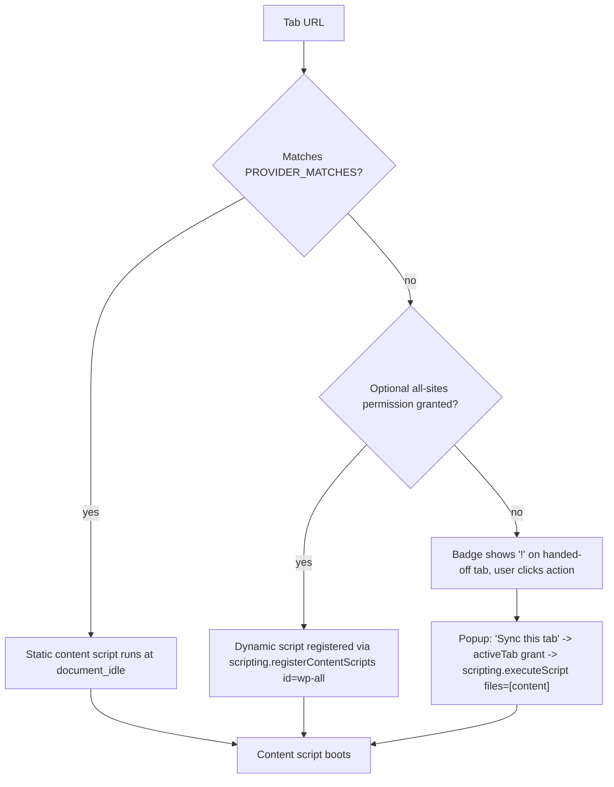
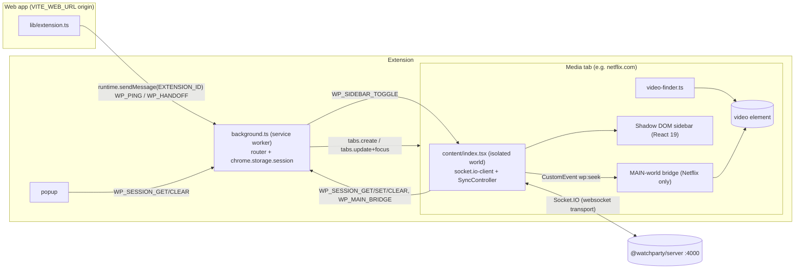
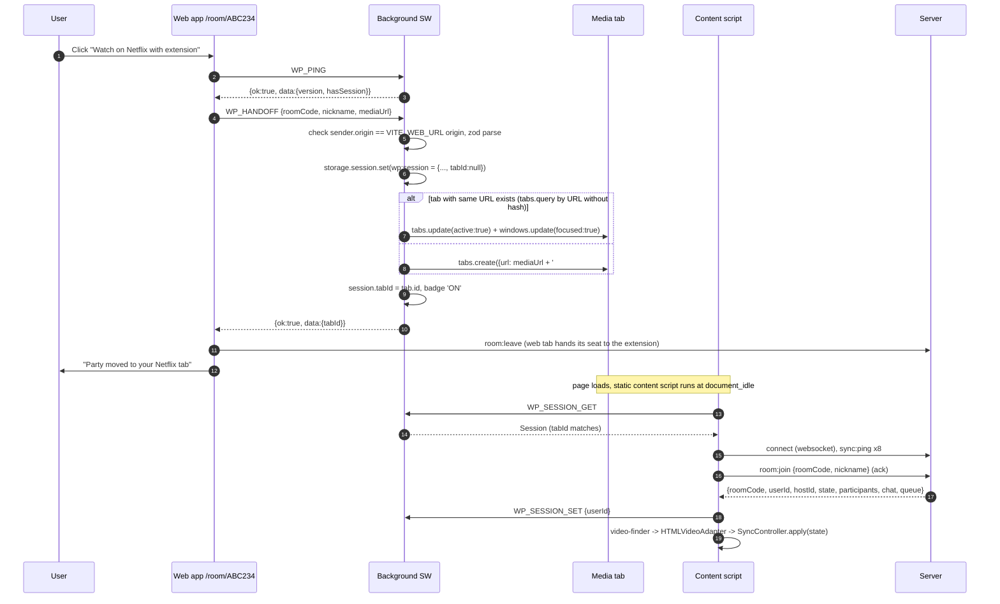
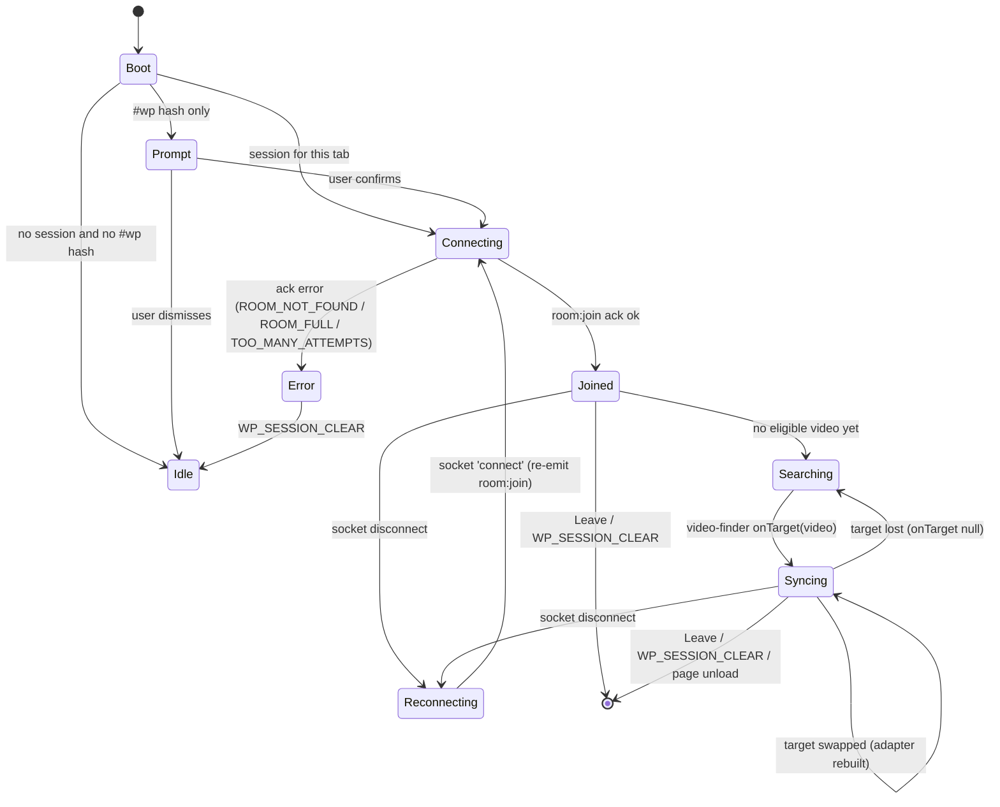

# Chrome Extension Specification (`@watchparty/extension`)

Status: v1 spec, written before implementation. This document is normative for `apps/extension`.
Related: [ARCHITECTURE.md](./ARCHITECTURE.md) (system overview), [SYNC_PROTOCOL.md](./SYNC_PROTOCOL.md) (clock sync, drift correction, buffering, Socket.IO payloads), [WEBRTC_AND_MEDIA.md](./WEBRTC_AND_MEDIA.md) (`classifyMediaUrl`, Mode A/B/C rules), [DEVOPS_AND_SECURITY.md](./DEVOPS_AND_SECURITY.md) (CORS, rate limits, CSP), [IMPLEMENTATION_ROADMAP.md](./IMPLEMENTATION_ROADMAP.md) (delivery order), [../CLAUDE.md](../CLAUDE.md) (repo rules).

---

## 1. Purpose and scope

The extension implements **Mode B**: synchronized playback on sites whose media cannot be played inside our web app (DRM services such as Netflix, Prime Video, Disney+, and so on, as classified by `classifyMediaUrl` with `kind: 'drm'`). Every participant watches the stream in their own logged-in tab. The extension finds the page's `<video>` element, wraps it in `HTMLVideoAdapter` from `@watchparty/sync-engine`, and keeps it in step with the room's authoritative `PlaybackState` over Socket.IO.

It can also be used on `kind: 'unknown'` pages (Mode C by default). The web UI offers "Try with extension". In that case the extension is a best-effort Mode B attempt on a generic `<video>` page.

| In scope (v1) | Out of scope (v1) |
|---|---|
| Find the main `<video>` in the top frame and in same-origin iframes | Videos inside **cross-origin** iframes (see section 5.7) |
| Play, pause, seek and rate sync through `SyncController` | Voice, camera and screen share from the extension. WebRTC lives in the web app only ([WEBRTC_AND_MEDIA.md](./WEBRTC_AND_MEDIA.md)) |
| Chat, reactions, participants and sync status in a Shadow-DOM sidebar | Queue editing from the sidebar (the queue is shown read-only) |
| Handoff from the web app, plus a `#wp=CODE` URL-hash fallback | Firefox and Safari builds |
| Netflix seek through a MAIN-world bridge (section 5.6) | Bypassing DRM, capturing protected frames, or anything that touches EME |

The extension never reads, records or forwards media data. It only reads and writes `currentTime`, `paused` and `playbackRate`, and listens to media events.

---

## 2. Source layout

The layout follows the contract's directory map. Each file has one job.

```
apps/extension/
  manifest.config.ts        # defineManifest(), driven by VITE_* env (section 3)
  vite.config.ts            # vite + @vitejs/plugin-react + @crxjs/vite-plugin
  tailwind.config.ts        # content: ['src/**/*.{ts,tsx,html}'], preflight scoped (section 6)
  postcss.config.js         # tailwindcss, rem-to-px (section 6.3), autoprefixer
  .env.example              # VITE_SERVER_URL, VITE_WEB_URL
  src/
    background.ts           # MV3 service worker: bridge router + session store (section 7)
    content/
      index.tsx             # entry: session bootstrap, socket owner, mounts sidebar
      video-finder.ts       # MutationObserver + scoring (section 5)
      sidebar/
        Sidebar.tsx         # sidebar root (chat, reactions, participants, sync status)
        Chat.tsx
        Reactions.tsx
        Participants.tsx
        SyncStatus.tsx
        JoinPrompt.tsx      # shown when only #wp=CODE is present (no handed-off session)
        sidebar.css         # @tailwind base/components/utilities, imported with ?inline
        store.ts            # Zustand store local to the content script
    popup/
      index.html
      main.tsx
      Popup.tsx             # session status, "Sync this tab", "Enable on all sites", Leave
```

Shared Zod schemas for bridge messages are exported from `@watchparty/shared-types` (`schemas.ts`). The web app (`apps/web/src/lib/extension.ts`) and the extension then validate the same shapes.

---

## 3. Manifest V3 and the permission model

### 3.1 The permissions requested, and why

| Permission | Kind | Why it is needed | What breaks without it |
|---|---|---|---|
| `storage` | API | `chrome.storage.session` holds the active session, which survives service-worker restarts but not a browser restart. `chrome.storage.local` holds the remembered nickname and UI preferences. | The session is lost every time the service worker is killed (about 30 s idle). |
| `tabs` | API | Lets the background read `tab.url` and call `chrome.tabs.query({ url })` to reuse an existing tab during handoff, and handle `tabs.onRemoved` and `tabs.onUpdated` for session cleanup. | A duplicate tab opens on every handoff, and stale sessions are left behind. |
| `activeTab` | API | Grants temporary host access to the current tab when the user clicks the action or popup, so the content script can be injected on any site without a broad install-time warning. | Sites that are not providers cannot be used unless the user grants all-sites access. |
| `scripting` | API | `chrome.scripting.executeScript` injects the content script into an `activeTab` grant, and runs the Netflix MAIN-world bridge. `chrome.scripting.registerContentScripts` adds dynamic registration after an optional all-sites grant. | No on-demand injection, and no Netflix seeking. |
| `host_permissions` | Hosts | The provider sites (section 3.2) get static content scripts. `VITE_SERVER_URL` lets extension pages (popup, background) call `/api/metadata` without CORS friction. | Content scripts do not auto-run on Netflix and the other providers. |
| `optional_host_permissions` | Hosts | `https://*/*` and `http://*/*`, requested at runtime from the popup ("Enable on all sites"). | Not required. Users fall back to per-tab `activeTab`. |
| `externally_connectable.matches` | Manifest key | Allows **only** the web app origin (`VITE_WEB_URL`) to call `chrome.runtime.sendMessage(EXTENSION_ID, ...)`. | The web app cannot detect the extension or hand off to it. |
| `commands` | Manifest key | `toggle-sidebar` is bound to Alt+Shift+W. It needs no permission. | Keyboard toggle only. |

Explicitly **not** requested: `webRequest`, `declarativeNetRequest`, `cookies`, `history`, `<all_urls>` at install time, `debugger`, and `offscreen`. The socket lives in the content script, so no offscreen document is needed. Each of these would add install warnings or review friction for no v1 benefit.

### 3.2 Provider match patterns

Chrome match patterns cannot wildcard a TLD, so Amazon and Moviebox TLDs are listed explicitly. Other Moviebox mirrors (`moviebox.*`) still classify as `drm` and work through `activeTab` or the optional all-sites grant. `https://*.example.com/*` also matches the bare `example.com`.

| Provider key (`classifyMediaUrl().provider`) | Match patterns |
|---|---|
| `netflix` | `https://*.netflix.com/*` |
| `primevideo` | `https://*.primevideo.com/*` |
| `amazon` | `https://www.amazon.com/gp/video/*`, `https://www.amazon.co.uk/gp/video/*`, `https://www.amazon.de/gp/video/*`, `https://www.amazon.co.jp/gp/video/*`, `https://www.amazon.in/gp/video/*`, `https://www.amazon.ca/gp/video/*`, `https://www.amazon.fr/gp/video/*`, `https://www.amazon.it/gp/video/*`, `https://www.amazon.es/gp/video/*`, `https://www.amazon.com.au/gp/video/*`, `https://www.amazon.com.br/gp/video/*`, `https://www.amazon.com.mx/gp/video/*` |
| `disneyplus` | `https://*.disneyplus.com/*` |
| `hulu` | `https://*.hulu.com/*` |
| `max` | `https://*.max.com/*` |
| `hbomax` | `https://*.hbomax.com/*` |
| `appletv` | `https://tv.apple.com/*` |
| `peacock` | `https://*.peacocktv.com/*` |
| `paramountplus` | `https://*.paramountplus.com/*` |
| `crunchyroll` | `https://*.crunchyroll.com/*` |
| `moviebox` | `https://*.moviebox.ng/*`, `https://*.moviebox.ph/*` |
| `hotstar` | `https://*.hotstar.com/*` |
| `jiocinema` | `https://*.jiocinema.com/*` |

These lists must stay in sync with the `drm` rules in [WEBRTC_AND_MEDIA.md section 1](./WEBRTC_AND_MEDIA.md#1-media-classification-classifymediaurl). `PROVIDER_MATCHES` is exported from `@watchparty/shared-types` (`src/constants.ts`) next to `DRM_PROVIDERS`, and `manifest.config.ts` imports it from there, so there is only one source. shared-types must be built before the extension, which turbo's `dependsOn: ["^build"]` handles.

### 3.3 `manifest.config.ts` (reference)

```ts
import { defineManifest } from '@crxjs/vite-plugin';
import { loadEnv } from 'vite';
import { PROVIDER_MATCHES } from '@watchparty/shared-types';
import pkg from './package.json' with { type: 'json' };

export default defineManifest((config) => {
  const env = loadEnv(config.mode, process.cwd(), 'VITE_');
  const webOrigin = new URL(env.VITE_WEB_URL ?? 'http://localhost:3000').origin;
  const serverOrigin = new URL(env.VITE_SERVER_URL ?? 'http://localhost:4000').origin;

  return {
    manifest_version: 3,
    name: 'WatchParty',
    version: pkg.version,
    description: 'Watch together in sync on any streaming site.',
    minimum_chrome_version: '120',
    action: { default_popup: 'src/popup/index.html', default_title: 'WatchParty' },
    background: { service_worker: 'src/background.ts', type: 'module' },
    permissions: ['storage', 'tabs', 'activeTab', 'scripting'],
    host_permissions: [...PROVIDER_MATCHES, `${serverOrigin}/*`],
    optional_host_permissions: ['https://*/*', 'http://*/*'],
    content_scripts: [
      { matches: PROVIDER_MATCHES, js: ['src/content/index.tsx'], run_at: 'document_idle', all_frames: false },
    ],
    externally_connectable: { matches: [`${webOrigin}/*`] },
    commands: {
      'toggle-sidebar': { suggested_key: { default: 'Alt+Shift+W' }, description: 'Toggle the WatchParty sidebar' },
    },
    icons: { 16: 'icons/16.png', 48: 'icons/48.png', 128: 'icons/128.png' },
  };
});
```

Notes:
- `minimum_chrome_version: 120` gives `chrome.storage.session` from content-adjacent contexts, `sender.origin`, `scripting` with `world: 'MAIN'`, and stable MV3 service-worker lifetime rules (each extension API event resets the 30 s idle timer).
- `@crxjs/vite-plugin` adds the `web_accessible_resources` entries that its content-script loader needs, so do not add them by hand. For dynamic injection, `import contentScript from './content/index.tsx?script'` gives the built file path that `executeScript({ files: [contentScript] })` uses.
- **Stable extension ID:** an unpacked extension's ID comes from its folder path. For a stable dev ID that matches `NEXT_PUBLIC_EXTENSION_ID` and server `EXTENSION_IDS`, put the public `key` in the manifest. `manifest.config.ts` does not set `key` in v1 (there is no `VITE_EXTENSION_KEY`); to pin an ID, add the `key` field to the manifest locally. The Chrome Web Store build omits it.

### 3.4 Access tiers at runtime



- "Enable on all sites" in the popup calls `chrome.permissions.request({ origins: ['https://*/*', 'http://*/*'] })`. This needs a user gesture inside the popup. When granted, the background calls `chrome.scripting.registerContentScripts([{ id: 'wp-all', matches: ['https://*/*','http://*/*'], excludeMatches: PROVIDER_MATCHES, js: [contentScript], runAt: 'document_idle', persistAcrossSessions: true }])`. On `chrome.permissions.onRemoved` it calls `unregisterContentScripts({ ids: ['wp-all'] })`.
- **Double-injection guard:** the content script checks `globalThis.__wpLoaded` and exits early if it is set. `executeScript` can run on a tab that already has the static script.

---

## 4. Runtime components



**Ownership rule:** the content script owns the socket, the `ClockSync`, the `SyncController` and the room UI state. The background is a stateless router. Everything it needs to remember goes in `chrome.storage.session`, because Chrome stops an MV3 service worker after about 30 s idle and in-memory state disappears with it. Its listeners are registered synchronously at the top level of `background.ts`, never inside async callbacks, or Chrome cannot wake the worker for them.

---

## 5. Universal `<video>` discovery (`video-finder.ts`)

### 5.1 Goal

Find the one `<video>` element that is the main program. Ignore:
- muted autoplay hover previews and hero banners (Netflix billboard, Prime trailers),
- ad players (IMA SDK, preroll overlays),
- off-screen, zero-size or detached elements,
- secondary elements, for example two `<video>` elements during an MSE source switch.

Then **track** that element across SPA re-renders. Players often replace the element on episode change, after an ad break, or when quality changes.

### 5.2 Candidate collection

```
collect(root = document):
  out = [...root.querySelectorAll('video')]
  for el of root.querySelectorAll('*') where el.shadowRoot (open only):  out += collect(el.shadowRoot)
  for iframe of root.querySelectorAll('iframe'):
     try { doc = iframe.contentDocument } catch {}      // same-origin only, else null/throw
     if doc: out += collect(doc)
  return out
```

- **Closed** shadow roots cannot be reached by design. No provider in section 3.2 currently puts its main video in a closed root.
- The full `querySelectorAll('*')` shadow scan runs only during a full rescan (section 5.4), never on every mutation.

### 5.3 Hard filters (reject outright)

| # | Rule | Rationale |
|---|---|---|
| F1 | `!v.isConnected` | Detached element. |
| F2 | Rendered box `< 200 x 100` CSS px, or `getComputedStyle` gives `display:none`, `visibility:hidden` or `opacity < 0.1`. **Exception:** `v` is or is inside `document.fullscreenElement`. | Tracking pixels, hidden prefetch players. |
| F3 | `v.muted && Number.isFinite(v.duration) && v.duration < 15` | Muted short previews (contract rule). |
| F4 | `v.loop && v.muted` | Looping background or hero videos. |
| F5 | An ancestor within 8 levels has `id` or `class` matching `AD_RE = /(^|[\s_-])(ad|ads|adv|advert|advertisement|sponsor|preroll|midroll|ima-ad|videoAdUi|ad-showing)([\s_-]|$)/i` | Ad containers. The token boundaries avoid matching `header` or `download`. |
| F6 | `v.currentSrc` host ends with one of `doubleclick.net`, `googlesyndication.com`, `imasdk.googleapis.com`, `googleads.g.doubleclick.net`, `amazon-adsystem.com`, `adnxs.com`, `springserve.com`, `innovid.com`, `tremorhub.com`, `serving-sys.com` | Ad media served from known ad CDNs. |

When `duration` is `NaN` (metadata not loaded yet), F3 is skipped and the candidate is scored again on `loadedmetadata`.

### 5.4 Scoring

```
score(v):
  vis      = visibleArea(v) / viewportArea                         // intersection of rect and viewport
  s  = 40 * min(1, vis / 0.25)                                     // a quarter of the viewport or more gets full marks
  s += 20 * (v.duration === Infinity ? 0.75                         // live stream
             : Number.isFinite(v.duration) ? min(1, log10(max(v.duration, 1)) / log10(3600))
             : 0.5)                                                // unknown yet
  s += 10 if !v.muted && v.volume > 0
  s += 10 if !v.paused || v.currentTime > 0
  s += 10 if v.readyState >= 2                                     // HAVE_CURRENT_DATA
  s +=  5 if v.currentSrc.startsWith('blob:')                      // MSE players are almost always the real player
  s +=  5 if v.hasAttribute('controls') || session.provider != null
  s += 15 if document.fullscreenElement?.contains(v) || document.fullscreenElement === v
  return s                                                          // range 0..115
ELIGIBLE_MIN = 30
```

Selection:
1. Drop candidates that fail any filter in section 5.3.
2. Take the highest score `>= ELIGIBLE_MIN`.
3. **Hysteresis:** switch away from the current target only if the current target is gone or filtered out, or `best.score > current.score * 1.25`. This stops flapping between a trailer and the main video while both are visible.
4. Emit `onTarget(video | null)` only when the target actually changes.

Module API (`video-finder.ts`): `watchPrimaryVideo(onTarget): () => void` runs the triggers in section 5.5 with hysteresis and returns a dispose function. Per-provider seek handling (`createAdapter`) is described in section 5.6.

`ponytail:` this heuristic is hand-tuned weights, and the ceiling is new provider layouts. The upgrade path is a per-provider `selector` override table in `video-finder.ts` (for example Netflix `.watch-video video`). Add an entry only when QA shows the generic score picking the wrong element.

### 5.5 When to evaluate again

| Trigger | Mechanism | Cost control |
|---|---|---|
| DOM changes | `new MutationObserver(cb).observe(document.documentElement, { childList: true, subtree: true })` | `cb` checks only whether an added node is a `VIDEO`, contains one (`node.querySelector?.('video')`), or a removed node contains the current target. A **250 ms debounced** rescan follows. |
| Media becomes relevant | `document.addEventListener(evt, h, { capture: true })` for `loadedmetadata`, `play`, `playing`, `emptied`, `durationchange` | Media events do not bubble, so capture is required. They are also not `composed`, so videos in open shadow roots are covered by the 2 s poll. |
| Fullscreen | `fullscreenchange` | Immediate rescan. Also moves the sidebar host (section 6.5). |
| Visibility or layout | `resize` (debounced 250 ms) | |
| Safety net | `setInterval(rescan, 2000)` | Stops after 5 consecutive stable scans with a target, and restarts on any trigger above. |
| SPA navigation | `location.href` checked every 1000 ms, plus `popstate` | See section 8.4. |

When the target changes, the content script calls `dispose()` on the old `HTMLVideoAdapter`, builds a new one for the new element, and rebuilds the `SyncController` with it. The `ClockSync` instance and the socket are kept. The new controller immediately applies the last `room:state` it received (expected position per [SYNC_PROTOCOL.md](./SYNC_PROTOCOL.md)).

### 5.6 Provider quirks

| Provider | Quirk | Handling |
|---|---|---|
| `netflix` | Setting `video.currentTime` triggers Netflix error M7375 and kills playback. | Seeks go through the MAIN-world bridge (below). Play, pause and `playbackRate` on the element work. |
| `youtube` (extension on youtube.com in Mode C or B attempt) | Ads play in the same `<video>`, and `#movie_player.ad-showing` is present during them. | While `ad-showing` is present, emit `player:buffering {buffering:true}`. The server's 8 s straggler timeout limits how long others wait. When it clears, emit `{buffering:false}`; drift correction then hard-seeks. |
| `primevideo` / `amazon` | Several `<video>` elements exist (trailer plus main), and the main one is under a full-viewport player overlay. | The generic scoring with fullscreen and visibility bonuses picks the main element. Verify in QA (section 10). |
| `disneyplus`, `max`, `hulu` | The element is replaced on episode change. | Covered by `emptied` capture and MutationObserver. |
| any | The DRM player rejects `playbackRate` outside 0.5 to 2. | The controller already bounds the rate to 0.96..1.04. |

**Netflix MAIN-world bridge.** Content scripts run in an isolated world and cannot see `window.netflix`. On boot, a Netflix content script sends `{type:'WP_MAIN_BRIDGE'}`. The background then runs:

```ts
chrome.scripting.executeScript({
  target: { tabId: sender.tab.id },
  world: 'MAIN',
  func: () => {
    if ((window as any).__wpBridge) return;
    (window as any).__wpBridge = true;
    document.addEventListener('wp:seek', (e) => {
      const ms = Number((e as CustomEvent).detail);
      if (!Number.isFinite(ms) || ms < 0) return;
      const vp = (window as any).netflix?.appContext?.state?.playerApp?.getAPI?.().videoPlayer;
      const id = vp?.getAllPlayerSessionIds?.()[0];
      if (id) vp.getVideoPlayerBySessionId(id).seek(ms);
    });
  },
});
```

This is how the roadmap's conditional `content/main-world.ts` gets implemented. It is an injected `func` rather than a separate `world: 'MAIN'` content-script file, because a func needs no bundling through crxjs's content-script loader, and that loader relies on `chrome.runtime`, which the MAIN world does not have. `createAdapter` in `video-finder.ts` uses the main-world seek adapter for `netflix` and the plain `HTMLVideoAdapter` for every other provider.

For `provider === 'netflix'`, the content script overrides `HTMLVideoAdapter.seek(t)` to `document.dispatchEvent(new CustomEvent('wp:seek', { detail: Math.round(t * 1000) }))`. The event carries only a number. The page could fire the same event itself, but that gains it nothing, because the page can already seek its own player. This is an undocumented Netflix API. If `getAPI` is missing, the bridge does nothing and the sidebar shows "Seek manually to hh:mm:ss" with the expected position.

### 5.7 Cross-origin iframes (known limitation)

Some sites, typically embed-heavy mirrors, put the player in a cross-origin `<iframe>`. With `all_frames: false`, the v1 content script cannot reach it. Behavior: when no eligible target is found after 10 s, and a cross-origin iframe of at least 50 % of the viewport exists, the sidebar shows "The player is in an embedded frame" and offers **Open player in a new tab** (`window.open(iframe.src + '#wp=' + roomCode)`). The upgrade path is `all_frames: true`, with per-frame finders reporting through the background to frame 0. That needs new bridge message types, so it is deferred until there is demand.

---

## 6. Shadow-DOM sidebar with CSS isolation

### 6.1 Mount

```ts
const host = document.createElement('watchparty-root');           // custom tag: no page CSS targets it
host.style.cssText = 'all:initial; position:fixed; top:0; right:0; height:100vh; z-index:2147483647;';
const shadow = host.attachShadow({ mode: 'closed' });              // page JS cannot reach into the UI
const style = document.createElement('style');
style.textContent = sidebarCss;                                    // import sidebarCss from './sidebar/sidebar.css?inline'
shadow.appendChild(style);
const mountPoint = document.createElement('div');
mountPoint.id = 'wp-root';
shadow.appendChild(mountPoint);
document.documentElement.appendChild(host);                        // <html>, not <body>: SPAs replace <body>
createRoot(mountPoint).render(<Sidebar {...props} />);             // data + callbacks via props; socket owned by content/index.tsx
```

A MutationObserver on `document.documentElement` (`childList` only) puts `host` back if a framework re-render removes it.

### 6.2 Isolation guarantees and leaks

| Vector | Isolated by Shadow DOM? | Mitigation |
|---|---|---|
| Page selectors (`div {}`, `* {}`) styling our nodes | Yes | None needed. |
| **Inherited** properties (`color`, `font-*`, `line-height`, `direction`, `letter-spacing`) crossing from `<html>` into the host | **No** | `all: initial` on the host inline style, plus `:host { all: initial; }` and explicit `font-family`, `font-size: 16px`, `line-height: 1.5`, `color` on `#wp-root`. |
| CSS custom properties from the page | **No**, they inherit | Tailwind writes its own `--tw-*` on `*, ::before, ::after` inside the shadow. Do not read page variables. |
| `rem` units | **No**, they are relative to the page's `<html>` font-size (some sites use 62.5 %) | Convert rem to px at build time (section 6.3). |
| `@font-face` declared inside a shadow root | Ignored by Chrome | Use the system font stack only: `ui-sans-serif, system-ui, -apple-system, "Segoe UI", Roboto, sans-serif`. |
| Our CSS leaking into the page | Yes | Nothing ever goes into the page `<head>`. |
| Page keyboard shortcuts (Space, `f`, `k`, arrow keys) firing while typing in chat | **No**, key events bubble out of the shadow via retargeting | `keydown`, `keyup` and `keypress` listeners on `host` call `e.stopPropagation()` (and `stopImmediatePropagation`). Attach them on the capture phase at `shadow`. |
| Page `focusin` traps that steal focus (some players do this) | Partially | Stop propagation of `focusin` and `focusout` at `host` the same way. |
| Tailwind preflight targeting `html`, `body` | Not applicable | Preflight rules for `html`, `body` and `:host` are rewritten (section 6.3). |

### 6.3 Tailwind build

- `sidebar.css` starts with `@tailwind base; @tailwind components; @tailwind utilities;` and is imported with `?inline`, which gives Vite a string and injects no `<style>` tag.
- `tailwind.config.ts`: `content: ['./src/**/*.{ts,tsx,html}']`, `darkMode: 'media'` and `important: '#wp-root'`. Every utility is then scoped under the mount point, so it beats the preflight resets inside the shadow root. A separate config exists for the popup, which is a normal extension page and needs no special handling.
- PostCSS pipeline for the content CSS: `tailwindcss` -> `@thedutchcoder/postcss-rem-to-px` (`baseValue: 16`) -> `autoprefixer`. After this, the output contains no `rem`.
- Preflight targets `html` and `:host` for base typography. Add to `sidebar.css`:
  ```css
  :host { all: initial; }
  #wp-root { font-family: ui-sans-serif, system-ui, -apple-system, "Segoe UI", Roboto, sans-serif;
            font-size: 16px; line-height: 1.5; color: #e5e7eb; -webkit-font-smoothing: antialiased; }
  ```
- Popovers, tooltips and emoji pickers render through a portal **into `shadow`** (`createPortal(node, mountPoint)`), never into `document.body`.
- React 19 attaches its event delegation to the root container (`mountPoint`), so events work inside the shadow tree without extra setup.

### 6.4 Layout

- 360 px wide panel fixed to the right, collapsible to a 44 px tab. The collapsed or expanded state is kept in `chrome.storage.local` under `wp:sidebarCollapsed`.
- The page layout is **overlaid, not pushed**. Changing `document.documentElement.style.marginRight` breaks too many players.
- Respects `prefers-reduced-motion` (no slide animation) and `prefers-color-scheme`.
- Accessibility: the panel has `role="complementary"` and `aria-label="WatchParty"`. The chat input has a label, and focus is visible. Alt+Shift+W toggles the panel and Esc collapses it while focus is inside.

### 6.5 Fullscreen

When `document.fullscreenElement` changes:
- If it is a container element (not `<video>`), move `host` into it with `fullscreenElement.appendChild(host)`, so the sidebar stays visible above the player.
- If it **is** the `<video>` itself, children cannot be shown. Collapse to nothing, and show a 3 s toast for chat messages that arrive later, after the user leaves fullscreen.
- On exit, move `host` back to `document.documentElement`.

---

## 7. Messaging bridge: Web app <-> Background SW <-> Content script

### 7.1 Transports

| Hop | API | Trust check |
|---|---|---|
| Web -> Background | `chrome.runtime.sendMessage(EXTENSION_ID, msg, cb)` -> `chrome.runtime.onMessageExternal` | `externally_connectable.matches` limits it to the web origin, **and** the background checks `sender.origin === new URL(VITE_WEB_URL).origin`. Otherwise it replies `FORBIDDEN`. |
| Content or popup -> Background | `chrome.runtime.sendMessage(msg)` -> `chrome.runtime.onMessage` | `sender.id === chrome.runtime.id`. Content-originated types also require `sender.tab?.id`. |
| Background -> Content | `chrome.tabs.sendMessage(tabId, msg, { frameId: 0 })` | The content script checks `sender.id === chrome.runtime.id`. |
| Isolated -> MAIN world (Netflix) | `document.dispatchEvent(new CustomEvent('wp:seek', { detail: number }))` | One way, carrying a number only. No reply. |
| Content script <-> Server | socket.io-client, `transports: ['websocket']` | See section 8.2 and [DEVOPS_AND_SECURITY.md section 6](./DEVOPS_AND_SECURITY.md#6-cors-csp-and-security-headers). |

The content script **never** listens to `window.postMessage`. Any script on the page can forge one.

Every message is checked with Zod `safeParse` on receipt. Every reply uses the contract's ack envelope:

```ts
type BridgeReply<T> = { ok: true; data: T } | { ok: false; error: { code: BridgeErrorCode; message: string } };
type BridgeErrorCode = 'INVALID_PAYLOAD' | 'FORBIDDEN' | 'NO_SESSION' | 'TAB_ERROR';
```

`INVALID_PAYLOAD` and `FORBIDDEN` reuse the contract's error codes. `NO_SESSION` and `TAB_ERROR` are local to the bridge and never sent over Socket.IO.

### 7.2 External messages (web app -> background)

| `type` | Payload (Zod) | Reply `data` | Behavior |
|---|---|---|---|
| `WP_PING` | `{ type: 'WP_PING' }` | `{ version: string, hasSession: boolean }` | Detects the extension. The web app waits **800 ms**. A timeout, or `chrome.runtime.lastError` ("Could not establish connection"), means "not installed". |
| `WP_HANDOFF` | `{ type: 'WP_HANDOFF', roomCode: string /^[ABCDEFGHJKLMNPQRSTUVWXYZ23456789]{6}$/, nickname: string 1..24, mediaUrl: string url, http(s) only, <= 2048 chars }` | `{ tabId: number }` | Steps in section 7.4. |

Web side (`apps/web/src/lib/extension.ts`):

```ts
export function sendToExtension<T>(msg: unknown, timeoutMs = 800): Promise<BridgeReply<T> | null> {
  const id = process.env.NEXT_PUBLIC_EXTENSION_ID;
  const rt = (globalThis as any).chrome?.runtime;
  if (!id || !rt?.sendMessage) return Promise.resolve(null);        // chrome.runtime appears only if some extension allows us
  return new Promise((resolve) => {
    const t = setTimeout(() => resolve(null), timeoutMs);
    rt.sendMessage(id, msg, (reply: BridgeReply<T> | undefined) => {
      clearTimeout(t);
      resolve(rt.lastError || !reply ? null : reply);
    });
  });
}
```

### 7.3 Internal messages

| `type` | Direction | Payload | Reply `data` | Behavior |
|---|---|---|---|---|
| `WP_SESSION_GET` | content or popup -> bg | `{}` | `Session \| null` | From content, returns the session only if `session.tabId === sender.tab.id`. From the popup, returns it unconditionally. |
| `WP_SESSION_SET` | content or popup -> bg, then bg -> session tab | `{ roomCode, nickname, mediaUrl, userId?, tabId? }` | `Session` | From content, it adopts the sender tab (`tabId = sender.tab.id`). It is used after joining from `#wp=CODE`, and to record `userId` after `room:join` acks. From the popup ("Sync this tab" or the join form), `tabId` is the active tab. The background stores the session, sets the badge `ON` on that tab, and **forwards** the same message to the session tab. A content script that is not joined yet treats the forwarded message as "join now". |
| `WP_SESSION_CLEAR` | content or popup -> bg, then bg -> session tab | `{}` | `{}` | Removes the session and the badge, and **forwards** the message to the session tab. On receiving it, the content script emits `room:leave`, disconnects the socket and unmounts the sidebar. |
| `WP_SIDEBAR_TOGGLE` | bg or popup -> content | `{}` | `{ visible: boolean }` | Sent when the `toggle-sidebar` command fires and from the popup "Show sidebar" button. |
| `WP_MAIN_BRIDGE` | content -> bg | `{}` | `{}` | Netflix only. Injects the MAIN-world seek bridge (section 5.6). Refused unless `sender.tab.url` host matches `*.netflix.com`. |

`WP_SESSION_GET`, `WP_SESSION_SET` and `WP_SESSION_CLEAR` are the contract's internal messages. `WP_SIDEBAR_TOGGLE` and `WP_MAIN_BRIDGE` are **additions** required by the keyboard command and the Netflix seek. They are internal to the extension and invisible to the server and the web app.

```ts
// chrome.storage.session key 'wp:session'
type Session = {
  roomCode: string;          // 6 chars, contract alphabet
  nickname: string;          // 1..24, already sanitized client-side, sanitized again server-side
  mediaUrl: string;          // the URL that was handed off
  provider: string | null;   // classifyMediaUrl(mediaUrl)?.provider ?? null
  tabId: number | null;      // null until the tab exists
  userId: string | null;     // set after room:join ack
  createdAt: number;         // Date.now()
};
```

There is **one active session per browser profile** in v1. A new handoff replaces the old one and forwards `WP_SESSION_CLEAR` to the old tab. `chrome.storage.session` keeps its default access level, `TRUSTED_CONTEXTS`. Content scripts cannot read it directly, which is why they go through `WP_SESSION_GET`.

### 7.4 Handoff sequence



If the tab's origin has no static content script and no all-sites permission, the background sets badge `!` and title "Click to join the party on this tab". The popup's **Sync this tab** button uses `activeTab`, which the click on the action grants, and runs `chrome.scripting.executeScript({ target: { tabId }, files: [contentScript] })`.

Background cleanup:
- `tabs.onRemoved(tabId)`: if `tabId === session.tabId`, clear the session.
- `tabs.onUpdated(tabId, {url})`: if the new URL's host differs from the session's `mediaUrl` host, clear the session. The content script will already have left, because its page was unloaded.

### 7.5 Fallback: `#wp=ROOMCODE`

When `WP_SESSION_GET` returns `null`, the content script parses `location.hash` with `/(?:^#|&)wp=([ABCDEFGHJKLMNPQRSTUVWXYZ23456789]{6})(?:&|$)/`. If it matches:
1. Show `JoinPrompt` with the nickname prefilled from `chrome.storage.local['wp:nickname']`. Joining is never automatic, because a link from anyone should not silently put the user in a room.
2. On confirm, send `room:join`, then `WP_SESSION_SET` with this tab. Save the nickname, and remove `wp=` from the hash with `history.replaceState`, so a reload does not prompt again (the session now exists).

The web app's "Copy extension link" button produces `mediaUrl + '#wp=' + roomCode`.

---

## 8. Content script lifecycle

### 8.1 State machine



While `Searching`, the sidebar shows "Looking for the video...". After 30 s without a target, it shows "No video found. Start playback, then click Retry". Retry forces a full rescan. The cross-origin iframe hint from section 5.7 appears after 10 s.

### 8.2 Socket configuration

```ts
const socket = io(import.meta.env.VITE_SERVER_URL, {
  transports: ['websocket'],     // see below
  reconnectionDelay: 500,
  reconnectionDelayMax: 5000,
  timeout: 10_000,
});
```

Why websocket only: in MV3, content-script network requests carry the **page's** origin, for example `https://www.netflix.com`. The HTTP long-polling transport is a CORS request from that origin, and the server deliberately does not allowlist it. A WebSocket upgrade is not subject to CORS. The server accepts websocket transport from any `Origin`, because the socket carries no ambient credentials (no cookies). Authority comes only from the room code plus rate limits. See [DEVOPS_AND_SECURITY.md section 6.1](./DEVOPS_AND_SECURITY.md#61-server-cors-and-socketio-origin-policy).

Mixed content: the page is `https:`, so production `VITE_SERVER_URL` must be `https://` (giving `wss://`). In dev, `http://localhost:4000` works because `localhost` counts as potentially trustworthy.

### 8.3 Event mapping (content script <-> server)

The full payload schemas are in [SYNC_PROTOCOL.md](./SYNC_PROTOCOL.md). This table lists only what the extension uses.

| Direction | Event | Extension behavior |
|---|---|---|
| C2S | `room:join` | On connect and every reconnect. |
| C2S | `room:leave` | On Leave, a forwarded `WP_SESSION_CLEAR`, or `pagehide`. |
| C2S | `sync:ping` | Owned by `ClockSync`: burst of 8, then every 5 s. |
| C2S | `player:play` / `player:pause` / `player:seek` / `player:rate` | Emitted by `SyncController` from local user intents, after the `isRemoteAction` lock and debounce. |
| C2S | `player:buffering` | `waiting` or `stalled` (after a 400 ms grace) -> `true`. `canplaythrough` or `playing` -> `false`. The YouTube ad rule is in section 5.6. |
| C2S | `player:load` | Only from the "Load this page for everyone?" prompt (section 8.4). |
| C2S | `chat:send`, `reaction:send` | Sidebar. |
| S2C | `room:state` | `SyncController.apply(state)`. If `state.mediaUrl` differs from the tab URL, see section 8.4. |
| S2C | `room:participants`, `chat:message`, `reaction`, `queue:update`, `room:settings`, `room:buffer` | Zustand store, rendered by the sidebar. |
| S2C | `error` | Toast. `RATE_LIMITED` is shown at most once every 5 s. |
| C2S/S2C | `rtc:*` | **Not used** by the extension. Its participant reports `media:{audio:false,video:false,screen:false}`. |

### 8.4 Navigation and media changes

- **Local navigation**, for example the user picks the next Netflix episode. The 1 s `location.href` poll sees a new path. If the new URL classifies to the **same provider** and the user may control playback (`!hostOnlyControl || isHost`), show the "Load this for everyone?" prompt, which emits `player:load {mediaUrl: location.href without hash}`. Otherwise show "You navigated away from the party's video" with **Go back**.
- **Remote load**, a `room:state` whose `mediaUrl` differs from this tab. If `classifyMediaUrl(state.mediaUrl).mode === 'B'` and it is the same provider, call `location.assign(state.mediaUrl + '#wp=' + roomCode)`. The page reloads, the content script boots again, finds the session and joins again. If the provider is different or the mode is `A` or `C`, show "The party switched to ..." with an **Open in web app** link to `${VITE_WEB_URL}/room/${roomCode}`.
- Each content-script boot gets a new `userId` from `room:join`. Seat continuity across reloads is the server's responsibility ([SYNC_PROTOCOL.md](./SYNC_PROTOCOL.md)).

---

## 9. Security checklist (extension)

- [ ] `onMessageExternal` rejects any `sender.origin` that is not exactly the `VITE_WEB_URL` origin, even though `externally_connectable` already filters.
- [ ] Every bridge message is checked with Zod `safeParse`. Unknown `type` values return `INVALID_PAYLOAD`.
- [ ] `WP_HANDOFF.mediaUrl` is `http(s)` only, so `javascript:`, `data:`, `chrome:` and `file:` are rejected before `tabs.create`.
- [ ] Closed shadow root. No `dangerouslySetInnerHTML` anywhere (ESLint `react/no-danger: error`). Chat text, nicknames and titles are rendered only as React text nodes.
- [ ] No `window.postMessage` listeners. The MAIN-world bridge accepts only a finite number of milliseconds.
- [ ] No remote code. MV3 forbids it, and the default extension-page CSP `script-src 'self'` is kept.
- [ ] No `eval` or `new Function` in the content bundle, because some page CSPs make that fail noisily.
- [ ] The session holds no secrets. A room code and nickname are not credentials beyond the room itself.
- [ ] The extension never touches `MediaKeys`, EME, or protected frame data.

---

## 10. Build, load, and QA

```powershell
pnpm --filter @watchparty/extension dev     # crxjs HMR; load apps/extension/dist as unpacked
pnpm --filter @watchparty/extension build   # production bundle in apps/extension/dist
```

1. Open `chrome://extensions`, turn on Developer mode, choose **Load unpacked**, and pick `apps/extension/dist`.
2. Copy the ID into `apps/web/.env.local` as `NEXT_PUBLIC_EXTENSION_ID=` and into server `EXTENSION_IDS=`.
3. `.env` for the extension: `VITE_SERVER_URL=http://localhost:4000` and `VITE_WEB_URL=http://localhost:3000`. These are baked in at build time, so rebuild after changing them.

### QA matrix (manual, per release)

| Check | Netflix | Prime | Disney+ | Max | Crunchyroll | Generic `<video>` page via activeTab |
|---|---|---|---|---|---|---|
| Handoff opens or focuses the correct tab | | | | | | |
| Main video found within 2 s of playback start | | | | | | |
| Muted hover previews ignored on the browse page | | | | | | n/a |
| Play and pause propagate both ways, under 300 ms perceived | | | | | | |
| Seek propagates (Netflix through the bridge) | | | | | | |
| Drift stays under 0.08 s steady state for 10 min | | | | | | |
| Buffering pause and resume (throttle one client to Slow 3G) | | | | | | |
| Episode change: prompt, `player:load`, peers navigate | | | | | | n/a |
| Fullscreen: sidebar stays visible or collapses correctly | | | | | | |
| Typing in chat does not trigger player shortcuts | | | | | | |
| Service worker killed (`chrome://serviceworker-internals` -> Stop) mid-session: sync unaffected, popup still shows the session | | | | | | |
| `#wp=CODE` fallback shows JoinPrompt and never joins automatically | | | | | | |
