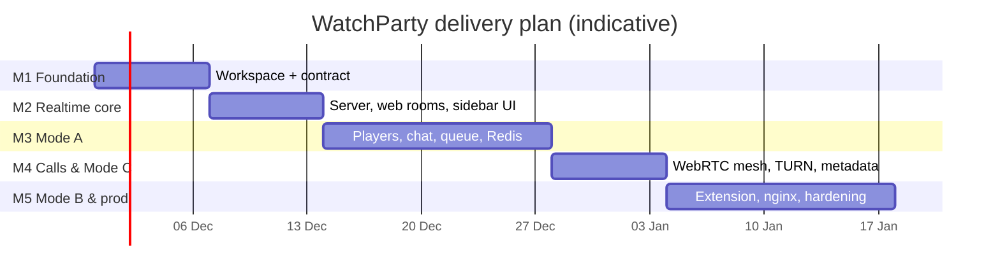
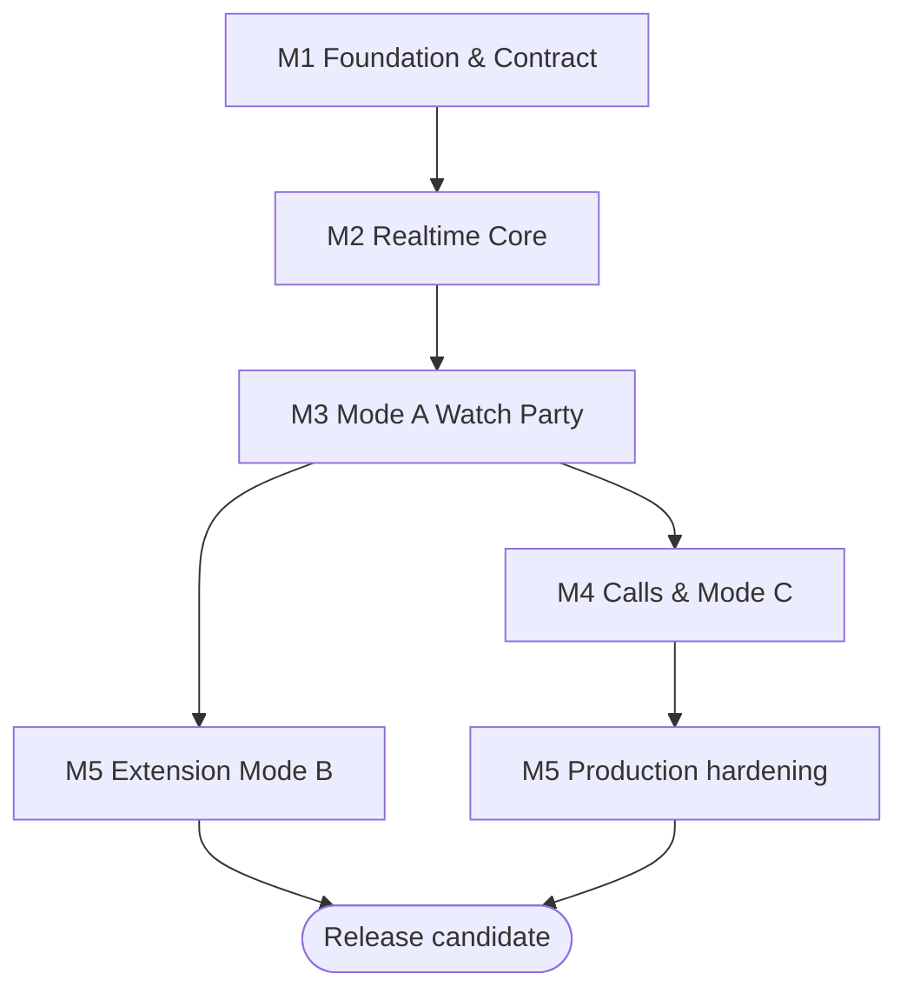

# Implementation Roadmap — Milestones 1–5

File-by-file build plan for the WatchParty monorepo. Every file in the contract's directory map appears here
exactly once, with its owner, its milestone, what it must export/do, and how we know it is done.

Read first: [CODING_CONTRACT.md](CODING_CONTRACT.md) (coding contract, zero-stub policy, gate commands). Protocol detail lives in
[SYNC_PROTOCOL.md](SYNC_PROTOCOL.md); topology and store design in [ARCHITECTURE.md](ARCHITECTURE.md); extension
internals in [EXTENSION_SPEC.md](EXTENSION_SPEC.md); calls/players in [WEBRTC_AND_MEDIA.md](WEBRTC_AND_MEDIA.md);
infra and hardening in [DEVOPS_AND_SECURITY.md](DEVOPS_AND_SECURITY.md).

**How to use this doc**

- `- [ ]` items are ticked in the milestone PR by the file owner; a reviewer from another persona re-ticks the
  acceptance criteria after running them.
- A file is listed in the milestone where it becomes **complete**. Files are never committed half-written
  (zero-stub policy): if a file needs something from a later milestone, it is scheduled in that later milestone.
- Every milestone ends with the **gate** (§7): `pnpm typecheck && pnpm build && pnpm test` green + the manual
  checklist.

| ID | Persona | Scope |
| --- | --- | --- |
| DEV-1 | Platform & DevOps Lead | root config, Dockerfiles, compose, coturn, nginx |
| DEV-2 | Sync & Protocol Engineer | `packages/shared-types`, `packages/sync-engine` |
| DEV-3 | Realtime Backend Engineer | `apps/server` |
| DEV-4 | Web & RTC Engineer | `apps/web` |
| DEV-5 | Extension Engineer | `apps/extension` |

---

## 1. Milestone overview

| # | Name | Outcome | Duration (indicative) |
| --- | --- | --- | --- |
| **M1** | Foundation & Contract | Workspace builds; `shared-types` and `sync-engine` complete and unit-tested; server pure libs tested; web toolchain compiles; extension background router + popup done | 1 week |
| **M2** | Realtime Core | Server fully functional on the memory store (all events, HTTP routes, rate limits); web rooms with chat, reactions, people; extension video finder + sidebar UI | 1 week |
| **M3** | Mode A Watch Party | Full in-browser party: HLS/file/YouTube/local players synced, chat with timestamps, reactions, queue, buffering; Redis store + adapter; web container | 2 weeks |
| **M4** | Calls & Mode C | WebRTC mesh voice/video, screen/tab share, TURN credentials, coturn; metadata previews | 1 week |
| **M5** | Extension Mode B & Production | Content script + sidebar on DRM sites, web→extension handoff, popup; nginx, hardening, full E2E matrix | 2 weeks |





Critical path: `shared-types` schemas (M1, DEV-2) → server handlers (M2, DEV-3) → web room page (M3, DEV-4) →
content script (M5, DEV-5). Any change to `shared-types` after M1 is a cross-boundary PR (all consumers approve).

---

## 2. Complete file inventory

```text
.                                              owner  milestone
├── package.json                               DEV-1  M1
├── pnpm-workspace.yaml                        DEV-1  M1
├── turbo.json                                 DEV-1  M1
├── tsconfig.base.json                         DEV-1  M1
├── scripts/lint.mjs                           DEV-1  M1 (stub/HTML-sink gate run by every package's `lint`)
├── .gitignore                                 DEV-1  M1
├── .env.example                               DEV-1  M2 (compose vars; extended M4)
├── .dockerignore                              DEV-1  M2
├── docker-compose.yml                         DEV-1  M2 → M3 → M4 (services added per milestone)
├── coturn/turnserver.conf                     DEV-1  M4
├── nginx/nginx.conf                           DEV-1  M5
├── packages/shared-types/
│   ├── package.json · tsconfig.json           DEV-2  M1
│   └── src/{index,constants,schemas,events}.ts + schemas.test.ts   DEV-2  M1
├── packages/sync-engine/
│   ├── package.json · tsconfig.json           DEV-2  M1
│   └── src/
│       ├── index.ts                           DEV-2  M1
│       ├── clock.ts + clock.test.ts           DEV-2  M1
│       ├── controller.ts + controller.test.ts DEV-2  M1
│       ├── adapters/html-video.ts             DEV-2  M1
│       ├── classify.ts + classify.test.ts     DEV-2  M1
│       └── timecode.ts + timecode.test.ts     DEV-2  M1
├── apps/server/
│   ├── package.json · tsconfig.json · .env.example   DEV-3  M1
│   ├── Dockerfile                             DEV-1  M2
│   └── src/
│       ├── env.ts                             DEV-3  M1
│       ├── lib/{roomCode,sanitize,timestamps,rateLimit,turn}.ts + tests   DEV-3  M1
│       ├── lib/metadata.ts + metadata.test.ts DEV-3  M2
│       ├── store/{types,memory}.ts + memory.test.ts   DEV-3  M2
│       ├── store/redis.ts + redis.test.ts     DEV-3  M3
│       ├── app.ts                             DEV-3  M2
│       ├── socket/index.ts                    DEV-3  M2 (redis adapter wiring M3)
│       ├── socket/handlers/{context,room,sync,player,chat,queue,rtc}.ts   DEV-3  M2
│       ├── socket/socket.test.ts              DEV-3  M2
│       └── index.ts                           DEV-3  M2
├── apps/web/
│   ├── package.json · tsconfig.json · next.config.ts · tailwind.config.ts · postcss.config.mjs · .env.example   DEV-4  M1
│   ├── Dockerfile                             DEV-1  M3
│   └── src/
│       ├── app/layout.tsx · app/globals.css   DEV-4  M1
│       ├── app/page.tsx                       DEV-4  M2
│       ├── app/room/[code]/page.tsx           DEV-4  M2 (chat/people) → M3 (player column)
│       ├── store/room.ts                      DEV-4  M2
│       ├── lib/socket.ts                      DEV-4  M2
│       ├── lib/youtube-adapter.ts             DEV-4  M3
│       ├── lib/webrtc.ts                      DEV-4  M4
│       ├── lib/extension.ts                   DEV-4  M5
│       └── components/                        DEV-4  M2–M5 (see per-milestone lists)
└── apps/extension/
    ├── package.json · tsconfig.json · manifest.config.ts · vite.config.ts · tailwind.config.ts · postcss.config.js · .env.example   DEV-5  M1
    └── src/
        ├── vite-env.d.ts                      DEV-5  M1
        ├── background.ts                      DEV-5  M1
        ├── popup/{index.html,main.tsx,Popup.tsx,popup.css}   DEV-5  M1 (session + health) → M5 (sync this tab, join form)
        ├── content/video-finder.ts            DEV-5  M2 → M5 (provider rules)
        ├── content/sidebar/{Sidebar,Chat,Participants,Reactions}.tsx · sidebar.css   DEV-5  M2 → M4 (media icons)
        ├── content/index.tsx                  DEV-5  M3 (generic <video> pages) → M5 (DRM hardening)
        └── content/main-world.ts              DEV-5  M5 (only if a site needs page-context seeking)
```

Files outside the contract's directory map, and why they exist: `socket/handlers/context.ts` (shared handler
wrapper, lives under `handlers/*`), `*.test.ts` (tests, required by CODING_CONTRACT.md), `vite-env.d.ts` (types
`import.meta.env` under strict TS), `content/main-world.ts` (conditional, see M5), config files each tool
requires.

---

## 3. Milestone 1 — Foundation & Contract

**Goal:** a workspace where `pnpm typecheck && pnpm build && pnpm test` pass, the wire contract is frozen in
`shared-types`, and every piece of logic that needs no network is implemented and tested.

**Exit criteria:** all M1 boxes ticked; `shared-types` tagged as "contract v1" in the PR description; consumers
(DEV-3, DEV-4, DEV-5) have approved `schemas.ts` and `events.ts`.

### 3.1 DEV-1 — workspace

- [ ] `package.json` — `"private": true`, `"type": "module"`, `"packageManager": "pnpm@9.15.4"`,
  `"engines": {"node": ">=24"}`; scripts `dev|build|typecheck|test|clean` → `turbo run <task>`; devDeps
  `turbo@^2`, `typescript@^5.6`.
- [ ] `pnpm-workspace.yaml` — `packages: ['apps/*', 'packages/*']`.
- [ ] `turbo.json` — `$schema`, `tasks` exactly as CODING_CONTRACT.md §6 (`build` outputs `dist/**`, `.next/**`,
  `!.next/cache/**`; `typecheck` and `dev` depend on `^build`; `test` depends on `build`; `dev` persistent,
  uncached); `globalEnv` lists `NEXT_PUBLIC_SERVER_URL`, `NEXT_PUBLIC_EXTENSION_ID`, `VITE_SERVER_URL`,
  `VITE_WEB_URL` so cached builds are invalidated when they change.
- [ ] `tsconfig.base.json` — exactly the block in CODING_CONTRACT.md §5.
- [ ] `.gitignore` — `node_modules`, `dist`, `.next`, `.turbo`, `*.tsbuildinfo`, `.env`, `.env.*`,
  `!.env.example`, `*.pem`, `coverage`.

**DEV-1 acceptance**

- [ ] Fresh clone → `pnpm install` produces a single root `pnpm-lock.yaml`; no `package-lock.json` anywhere.
- [ ] `pnpm build` twice in a row: second run reports all tasks `FULL TURBO` (cached).
- [ ] Changing `VITE_WEB_URL` in the shell invalidates the extension build cache.
- [ ] The CODING_CONTRACT.md stub grep returns `clean` on the repo.

### 3.2 DEV-2 — `packages/shared-types`

- [ ] `package.json` — name `@watchparty/shared-types`, `"type": "module"`, `exports` per CODING_CONTRACT.md §5,
  dependency `zod@^3.24`; scripts per CODING_CONTRACT.md §6.
- [ ] `tsconfig.json` — extends base, `rootDir: src`, `outDir: dist`.
- [ ] `src/constants.ts` — every constant in CODING_CONTRACT.md §4.2 / SYNC_PROTOCOL.md §2 (`as const`), plus:
  - `RATE_LIMITS = { chat: {capacity:5, windowMs:5000}, reaction: {10, 2000}, player: {20, 5000},
    sync: {20, 5000}, rtc: {200, 10000}, metadata: {30, 60000}, turn: {10, 60000} } as const`;
    `JOIN_FAIL_MAX = 10`, `JOIN_FAIL_WINDOW_S = 600`.
  - `ERROR_CODES` tuple and `type ErrorCode = typeof ERROR_CODES[number]`.
  - `DRM_PROVIDERS`: readonly array of `{ key, host: RegExp, pathPrefix?: string, matches: string[] }` used by
    `classify.ts` (`host.test(hostname)` + optional path prefix) and, via `PROVIDER_MATCHES`, by the extension
    manifest's `content_scripts.matches` (single source for both). `DRM_PROVIDER_KEYS` / `type DrmProvider`.
- [ ] `src/schemas.ts` — zod schemas exactly as SYNC_PROTOCOL.md §10.2 (unknown keys stripped, not rejected):
  - primitives: `roomCodeSchema` (`trim().toUpperCase()` then `ROOM_CODE_REGEX`),
    `nicknameSchema` (trim, 1..24 — re-checked after server sanitize), `chatTextSchema` (trim, 1..500),
    `mediaUrlSchema` (string 1..`MEDIA_URL_MAX`), `positionSchema` (finite number, 0..`MAX_POSITION_S`),
    `playbackRateSchema` (`PLAYBACK_RATE_MIN`..`PLAYBACK_RATE_MAX`), `emojiSchema` (`z.enum(REACTION_EMOJIS)`),
    `userIdSchema` (uuid), `sdpSchema` (string 1..`SDP_MAX`), `iceCandidateSchema` (`{candidate: string ≤4096,
    sdpMid?: string|null, sdpMLineIndex?: number|null, usernameFragment?: string|null}`).
  - C2S payloads, one per event: `roomCreateSchema`, `roomJoinSchema`, `roomLeaveSchema`, `syncPingSchema`,
    `playerPlaySchema`, `playerPauseSchema`, `playerSeekSchema`, `playerRateSchema`, `playerBufferingSchema`,
    `playerLoadSchema`, `chatSendSchema`, `reactionSendSchema`, `queueAddSchema` (title ≤ `QUEUE_TITLE_MAX`),
    `queueRemoveSchema`, `queueNextSchema`, `roomSettingsSchema`, `rtcOfferSchema`, `rtcAnswerSchema`,
    `rtcIceSchema`, `rtcMediaSchema`.
  - Entities: `playbackStateSchema` (incl. `seq`, `byUserId`), `participantSchema`, `chatMessageSchema`,
    `reactionSchema`, `queueItemSchema`, `mediaInfoSchema` (`{kind, mode, url, youtubeId?, provider?}`),
    `metadataSchema`, `turnResponseSchema`.
  - Exported inferred types for each (`export type PlaybackState = z.infer<typeof playbackStateSchema>` …).
- [ ] `src/events.ts` — `Ack<T>`, `AckCallback<T>`, `ClientToServerEvents`, `ServerToClientEvents`,
  `SocketData` (`{ userId?: string; roomCode?: string; nickname?: string; ip: string }`), and the ack data types
  `RoomCreateResult`, `RoomJoinResult`, `SyncPong`. Event names and shapes exactly as CODING_CONTRACT.md §4.5.
- [ ] `src/index.ts` — re-exports everything (`export * from './constants.js'` …).
- [ ] `src/schemas.test.ts` — accepts valid / rejects invalid for each payload; `roomCodeSchema` uppercases
  `k7qx2m` and rejects `O0I1AA`; extra keys are stripped; emoji outside the 12 rejected.

**DEV-2 acceptance (shared-types)**

- [ ] `REACTION_EMOJIS.length === 12` and `ROOM_CODE_ALPHABET.length === 32` asserted in tests.
- [ ] `pnpm --filter @watchparty/shared-types test` green; `dist/index.d.ts` exports every type the other four
  packages need (DEV-3/4/5 confirm by importing them in their M1 code without local re-declarations).

### 3.3 DEV-2 — `packages/sync-engine`

- [ ] `package.json` — name `@watchparty/sync-engine`, depends on `@watchparty/shared-types: workspace:*`;
  no runtime deps besides it.
- [ ] `tsconfig.json` — extends base, `lib: ["ES2023", "DOM", "DOM.Iterable"]`.
- [ ] `src/timecode.ts` — `parseTimecode(s: string): number | null` accepts `m:ss`, `mm:ss`, `h:mm:ss`
  (seconds/minutes segment 00–59 when not leading), returns seconds; `formatTimecode(seconds: number): string`
  → `m:ss` under an hour, `h:mm:ss` otherwise.
- [ ] `src/classify.ts` — `classifyMediaUrl(url: string, contentType?: string): MediaInfo | null` per CODING_CONTRACT.md
  §4.4. Order: `local:` sentinel / `blob:` / `file:` → URL parse (fail ⇒ `null`) → non-http(s) ⇒ `null` →
  YouTube → DRM (`DRM_PROVIDERS`, host suffix match on label boundary, `amazon.*` requires `/gp/video` path) →
  HLS (extension or content type) → file extension → `unknown`/C. Extension match is on `pathname` lowercased,
  ignoring query/hash.
- [ ] `src/clock.ts` — `class ClockSync`:
  - `constructor(ping: (t0: number) => Promise<SyncPong>, now: () => number = Date.now)`
  - `start()` → burst of `CLOCK_BURST_COUNT` sequential pings, then one every `CLOCK_INTERVAL_MS`; `stop()`.
  - `addSample(t0, t1, t2, t3)` computes `offset = ((t1-t0)+(t2-t3))/2`, `rtt = (t3-t0)-(t2-t1)`, keeps last
    `CLOCK_WINDOW`; chosen offset = sample with min RTT (ties → median offset of tied samples).
  - getters `offset`, `rtt`, `ready` (≥1 sample), `serverNow()` = `now() + offset`; `onUpdate(cb)` returns an
    unsubscribe function. Failed/timed-out pings are dropped, never recorded.
- [ ] `src/controller.ts` — exports `interface MediaAdapter`, `type MediaAdapterEvent`,
  `computeCorrection(drift, baseRate, rttMs)`, `expectedPosition(state, serverNow)`, `class SyncController`:
  - `MediaAdapter`: `getPosition()`, `isPaused()`, `getRate()`, `play(): Promise<void>`, `pause()`,
    `seek(s)`, `setRate(r)`, `on(event, cb): () => void`, `destroy()`. Events: `play pause seeked ratechange
    waiting stalled playing canplaythrough`.
  - `computeCorrection`: `|d| < 0.08` ⇒ `{type:'rate', rate: base}`; `0.08 ≤ |d| ≤ 1.5` ⇒
    `{type:'rate', rate: base * clamp(1 - d*0.04/1.5, 0.96, 1.04)}`; `|d| > 1.5` ⇒
    `{type:'seek', position: expected + rtt/2000 * base}` (caller passes `expected`).
  - `SyncController({adapter, clock, emit})` where `emit` has `play(pos) pause(pos) seek(pos) rate(r)
    buffering(b)`. `applyState(state)` drops `seq <= lastSeq`, sets the remote lock, applies paused/rate/position
    (holding until `updatedAt` when it's in the future). Lock released on the adapter's resulting event or after
    `REMOTE_LOCK_TIMEOUT_MS`. Local adapter events while unlocked become intents, debounced 150 ms (seek 250 ms).
    Correction loop every 500 ms while playing and unlocked. `waiting`/`stalled` → after 400 ms grace still not
    playing ⇒ `emit.buffering(true)`; `playing`/`canplaythrough` ⇒ `emit.buffering(false)` (only if true was
    sent). `destroy()` clears all timers and listeners.
- [ ] `src/adapters/html-video.ts` — `class HTMLVideoAdapter implements MediaAdapter` wrapping an
  `HTMLMediaElement`; `play()` swallows `NotAllowedError` into a rejected promise the caller can surface
  ("click to start"), never an unhandled rejection; no DOM globals touched at import time.
- [ ] `src/index.ts` — re-exports all of the above.
- [ ] Tests: `timecode.test.ts` (round-trip, rejects `1:60`, `abc`, `-1:00`), `classify.test.ts` (one positive
  case per kind and per DRM provider, `netflix.com.evil.io` ⇒ `unknown`, `youtu.be/<11>` id extraction,
  `amazon.de/gp/video/detail/x` ⇒ drm, `amazon.de/dp/x` ⇒ unknown, `ftp://` ⇒ `null`, `.M3U8?token=1` ⇒ hls,
  contentType HLS without extension ⇒ hls), `clock.test.ts` (symmetric 100 ms RTT ⇒ offset exact; noisy samples
  ⇒ min-RTT wins; window keeps 10), `controller.test.ts` (fake adapter + `mock.timers`: drift 0.05 ⇒ base rate,
  0.75 ⇒ 0.98, −0.75 ⇒ 1.02, 3.0 ⇒ seek; remote apply does not echo an intent; stale `seq` ignored; buffering
  grace: 300 ms stall ⇒ no emit, 500 ms ⇒ emit).

**DEV-2 acceptance (sync-engine)**

- [ ] All tests green; `controller.test.ts` covers every branch of `computeCorrection` and the lock timeout.
- [ ] `node -e "import('@watchparty/sync-engine').then(m => console.log(typeof m.classifyMediaUrl))"` from
  `apps/server` prints `function` (proves import-time DOM safety).
- [ ] No constant duplicated from `shared-types` (grep for `0.08`, `1.5`, `500` in `src` outside tests ⇒ none).

### 3.4 DEV-3 — server foundation (pure libs)

- [ ] `apps/server/package.json` — deps `fastify@^5`, `@fastify/cors@^10`, `socket.io@^4.8`, `ioredis@^5`,
  `@socket.io/redis-adapter@^8`, `zod@^3.24`, `@watchparty/shared-types`, `@watchparty/sync-engine`; devDeps
  `tsx`, `@types/node@^24`, `socket.io-client@^4.8` (integration test only).
- [ ] `apps/server/tsconfig.json` — extends base, `rootDir: src`, `outDir: dist`, `types: ["node"]`.
- [ ] `apps/server/.env.example` — every server variable from README §4.1 with defaults.
- [ ] `src/env.ts` — `process.loadEnvFile('.env')` if it exists; zod schema with defaults from the contract;
  `CORS_ORIGINS`, `EXTENSION_IDS`, `TURN_URLS`, `STUN_URLS` split on commas and trimmed; computed
  `allowedOrigins = [...CORS_ORIGINS, ...EXTENSION_IDS.map(id => 'chrome-extension://' + id)]`; on failure prints
  each issue as `ENV_NAME: message` and `process.exit(1)`. Exports a frozen `env` object and `type Env`.
- [ ] `src/lib/roomCode.ts` — `generateRoomCode()` using `crypto.randomInt(0, 32)` × 6 over
  `ROOM_CODE_ALPHABET`.
- [ ] `src/lib/sanitize.ts` — `sanitizeText(s)` per CODING_CONTRACT.md §7; `sanitizeNickname(s): string | null` and
  `sanitizeChat(s): string | null` (null when length out of bounds after sanitizing).
- [ ] `src/lib/timestamps.ts` — `extractTimestamps(text): number[]`: tokens `@m:ss`, `@mm:ss`, `@h:mm:ss`
  preceded by start or whitespace, parsed with `parseTimecode`, de-duplicated, order preserved, capped at
  `CHAT_TIMESTAMPS_MAX`.
- [ ] `src/lib/rateLimit.ts` — `class TokenBucket(capacity, windowMs, now = Date.now)` with `take(): boolean`
  (continuous refill `capacity/windowMs` tokens per ms); `createSocketBuckets()` returns the four per-socket
  buckets from `RATE_LIMITS` plus a `bucketFor(event)` mapping (`player:*` → player, `rtc:*` → rtc).
  `class KeyedBuckets` (Map + idle eviction every 60 s, `unref`'d) for the per-IP metadata limiter.
- [ ] `src/lib/turn.ts` — `turnCredentials({secret, userId, turnUrls, stunUrls, nowSeconds})` → `{iceServers,
  ttl}`; `username = \`${now+3600}:${userId}\``, `credential = createHmac('sha1', secret).update(username)
  .digest('base64')`; STUN-only when secret empty.
- [ ] Tests: `roomCode.test.ts` (10 000 codes: all match regex, ≥ 9 990 unique), `sanitize.test.ts` (control
  chars, bidi overrides, `\n` collapse, 25-char nickname ⇒ null, `<b>` preserved verbatim), `timestamps.test.ts`
  (`"see @1:02:03 and @4:05"` ⇒ `[3723, 245]`, `email@1:00` ignored, 11 tags ⇒ 10), `rateLimit.test.ts`
  (5 takes ok, 6th fails, refills after window with injected clock), `turn.test.ts` (known-vector HMAC; STUN-only
  path).

**DEV-3 acceptance (M1)**

- [ ] `pnpm --filter @watchparty/server test` green; `pnpm --filter @watchparty/server build` emits
  `dist/lib/*.js`.
- [ ] `PORT=abc node dist/env.js` exits 1 printing `PORT: Expected number…`.

### 3.5 DEV-4 — web toolchain

- [ ] `apps/web/package.json` — deps `next@^15`, `react@^19`, `react-dom@^19`, `zustand@^5`, `hls.js@^1.5`,
  `socket.io-client@^4.8`, workspace packages; devDeps `tailwindcss@^3.4`, `postcss`, `autoprefixer`,
  `@types/react@^19`, `@types/react-dom@^19`, `@types/node@^24`, `@types/chrome`, `@types/youtube`.
- [ ] `tsconfig.json` — extends base; overrides `module: esnext`, `moduleResolution: bundler`, `jsx: preserve`,
  `noEmit: true`, `lib: [dom, dom.iterable, es2023]`, `plugins: [{name: "next"}]`, path alias `@/*` → `src/*`.
- [ ] `next.config.ts` — `reactStrictMode: true`, `eslint.ignoreDuringBuilds: true`, `poweredByHeader: false`,
  `output: 'standalone'` (for the Docker image).
- [ ] `tailwind.config.ts` (content `./src/**/*.{ts,tsx}`, dark theme palette), `postcss.config.mjs`.
- [ ] `.env.example` — `NEXT_PUBLIC_SERVER_URL=http://localhost:4000`, `NEXT_PUBLIC_EXTENSION_ID=`.
- [ ] `src/app/globals.css` — Tailwind layers + base body styles.
- [ ] `src/app/layout.tsx` — `<html lang="en">`, metadata (title, description), viewport, body with app shell
  (header with product name linking to `/`).

**DEV-4 acceptance (M1)**

- [ ] `pnpm --filter @watchparty/web build` succeeds (layout renders the shell; `page.tsx` lands in M2 — until
  then Next's built-in 404 for `/` is the expected, real behaviour).
- [ ] `strict` errors are not silenced anywhere (`ignoreBuildErrors` absent).

### 3.6 DEV-5 — extension toolchain

- [ ] `apps/extension/package.json` — deps `react@^19`, `react-dom@^19`, `socket.io-client@^4.8`, `zod@^3.24`,
  workspace packages; devDeps `vite@^6`, `@vitejs/plugin-react`, `@crxjs/vite-plugin@^2`, `tailwindcss@^3.4`,
  `postcss`, `autoprefixer`, `@types/chrome`, `@types/react@^19`, `@types/react-dom@^19`.
- [ ] `tsconfig.json` — extends base; `module: esnext`, `moduleResolution: bundler`, `jsx: react-jsx`,
  `noEmit: true`, `lib: [dom, dom.iterable, es2023]`, `types: ["chrome", "vite/client"]`.
- [ ] `src/vite-env.d.ts` — `interface ImportMetaEnv { readonly VITE_SERVER_URL: string; readonly VITE_WEB_URL:
  string }`.
- [ ] `.env.example` — `VITE_SERVER_URL=http://localhost:4000`, `VITE_WEB_URL=http://localhost:3000`.
- [ ] `vite.config.ts` — `react()`, `crx({ manifest })`, `build.outDir: 'dist'`, `emptyOutDir: true`; reads env
  with `loadEnv(mode, process.cwd(), 'VITE_')` and fails the build if either URL is missing/invalid.
- [ ] `manifest.config.ts` — `defineManifest` with: `manifest_version: 3`, name/version from package.json,
  `background.service_worker: 'src/background.ts'`, `type: 'module'`, `action.default_popup:
  'src/popup/index.html'`, `permissions: ['storage', 'tabs', 'scripting', 'activeTab']`, `host_permissions`:
  `VITE_SERVER_URL` origin + DRM hosts from `DRM_PROVIDERS`, `externally_connectable.matches:
  [\`${webOrigin}/*\`]`, `content_scripts` (DRM hosts → `src/content/index.tsx`, `run_at: document_idle`). The
  `content_scripts` entry is added in M3 together with the file.
- [ ] `tailwind.config.ts` (content: `./src/**/*.{ts,tsx,html}`, `important: '#wp-root'` so sidebar classes win
  inside the shadow root), `postcss.config.js`.
- [ ] `src/background.ts` (needs no server, so it is finished in M1 — this also gives crxjs real inputs to build):
  - `chrome.runtime.onMessageExternal`: reject unless `new URL(sender.origin ?? sender.url ?? '').origin ===
    new URL(import.meta.env.VITE_WEB_URL).origin`; zod-validate `{type:'WP_PING'}` ⇒ reply `{ok:true,
    version}`; `{type:'WP_HANDOFF', roomCode, nickname, mediaUrl}` ⇒ validate with shared schemas, find an
    existing tab whose URL equals `mediaUrl` (focus it + its window) or create one, store `session = {roomCode,
    nickname, mediaUrl, tabId, createdAt}` in `chrome.storage.session`, reply `{ok:true, tabId}`. Return `true`
    from the listener for async `sendResponse`.
  - `chrome.runtime.onMessage` (internal, `sender.id === chrome.runtime.id` only): `WP_SESSION_GET` ⇒ the
    session if the sender is a popup or the session's tab; `WP_SESSION_SET` ⇒ validate, store, forward the same
    message to the session tab with `chrome.tabs.sendMessage`; `WP_SESSION_CLEAR` ⇒ remove and forward.
  - `chrome.tabs.onRemoved` ⇒ clear the session when its tab closes.
  - No module-level mutable state (the service worker may die any time).
- [ ] `src/popup/index.html`, `main.tsx`, `Popup.tsx`, `popup.css` — shows server health (`GET
  ${VITE_SERVER_URL}/healthz`, green/red), current session (room code, nickname, "Go to tab" button, "Leave"
  ⇒ `WP_SESSION_CLEAR`), and a link to open the web app.

**DEV-5 acceptance (M1)**

- [ ] `pnpm --filter @watchparty/extension build` produces `dist/manifest.json` with `externally_connectable
  .matches: ["http://localhost:3000/*"]`; loads unpacked without errors on `chrome://extensions`.
- [ ] From a page on `http://localhost:3000` (any page, even the 404): `chrome.runtime.sendMessage('<id>',
  {type:'WP_PING'}, console.log)` ⇒ `{ok:true, version:…}`; from any other origin ⇒ no response.
- [ ] `WP_HANDOFF` with `mediaUrl: 'https://example.com/'` opens/focuses the tab and the popup shows the session;
  closing the tab clears it. Stopping the service worker in `chrome://serviceworker-internals` and reopening the
  popup still shows the session.
- [ ] Popup shows red health while the server is down (M1) and green once DEV-3's server runs (M2).

### 3.7 M1 gate

- [ ] `pnpm typecheck && pnpm build && pnpm test` green from root (output pasted in PR).
- [ ] Contract freeze: DEV-3, DEV-4, DEV-5 approved `shared-types`.

---

## 4. Milestone 2 — Realtime Core

**Goal:** the server implements every event and route from the contract on the memory store; the web app creates
and joins rooms with chat, reactions and the participant list; the extension's video finder and sidebar UI are done.

### 4.1 DEV-3 — server

- [ ] `src/store/types.ts` — `RoomMeta { code, hostId, hostOnlyControl, createdAt, buffering: {userIds:
  string[]; resumeOnClear: boolean; sinceSeq: number} }`, `StoredParticipant` (participant + `socketId`),
  `interface RoomStore`:
  `createRoom(meta, state): Promise<boolean>` (false if code exists) · `getRoom(code): Promise<{meta, state} |
  null>` · `updateRoom(code, fn: (r) => {meta, state} | null): Promise<{meta, state} | null>` (atomic
  read-modify-write; `fn` returning null aborts) · `touch(code)` · `addParticipant` / `removeParticipant` /
  `listParticipants` / `updateParticipant` · `appendChat(code, msg)` (keeps last 200) / `recentChat(code, n)` ·
  `getQueue` / `setQueue` · `incrJoinFailures(ip): Promise<number>` / `getJoinFailures(ip)` · `close()` ·
  `readonly kind: 'memory' | 'redis'`.
- [ ] `src/store/memory.ts` — `MemoryStore implements RoomStore` with Maps; TTL via `expiresAt` checked on read
  plus a 60 s `unref`'d sweep; join-failure counters expire 600 s after first increment.
- [ ] `src/store/memory.test.ts` — create collision returns false; TTL expiry with injected clock; chat trimmed
  to 200; failure counter resets after window.
- [ ] `src/lib/metadata.ts` — `fetchMetadata(rawUrl)`:
  - classify first; YouTube ⇒ `https://www.youtube.com/oembed?url=…&format=json` (title, author → siteName,
    thumbnail_url → image).
  - otherwise SSRF guard: http/https only, port 80/443/default, `dns.lookup(host, {all:true})` and reject if any
    address is non-public (`isPublicAddress(ip)`: 0/8, 10/8, 100.64/10, 127/8, 169.254/16, 172.16/12,
    192.168/16, 198.18/15, 224/4, 240/4, `::1`, `fc00::/7`, `fe80::/10`, `::ffff:`-mapped private);
    `redirect: 'manual'`, re-validate each `Location` (max 3); `AbortSignal.timeout(5000)`; stream body and stop at
    1 MB; non-HTML ⇒ return classification with nulls (and HLS content-type re-classifies as `hls`).
  - parse `og:title|og:description|og:image|og:site_name` and `<title>` fallback with bounded regexes; decode
    the five basic HTML entities; resolve relative `og:image` against the final URL; each field ≤ 300 chars.
  - `// ponytail:` note: regex OG parsing, swap for an HTML parser if sites with odd markup matter.
- [ ] `src/lib/metadata.test.ts` — `isPublicAddress` table (every range above + `8.8.8.8` allowed); OG regex
  parsing on a fixture string (no network in tests).
- [ ] `src/app.ts` — `buildApp({env, store})`: Fastify with `logger: {level: env.LOG_LEVEL}`, `trustProxy`
  function that trusts only loopback/private peers; `@fastify/cors` with `origin: env.allowedOrigins`;
  routes `GET /healthz`, `GET /api/turn` (query `userId` validated with `userIdSchema`, missing ⇒ `'anon'`),
  `GET /api/metadata` (query `url` via `mediaUrlSchema`; per-IP `KeyedBuckets` ⇒ 429 `RATE_LIMITED`; errors
  ⇒ 422 `{error:{code:'INVALID_PAYLOAD'}}`). Responses carry `Cache-Control: no-store` for `/api/turn`.
- [ ] `src/socket/handlers/context.ts` — `HandlerContext {io, store, env, log, timers: Map<string,
  NodeJS.Timeout>}`; `withPayload(schema, bucketName, handler)` that: checks the socket bucket (→
  `RATE_LIMITED`), `safeParse`s (→ `INVALID_PAYLOAD` with first issue path), requires membership for in-room
  events (→ `FORBIDDEN`), catches exceptions (→ `INTERNAL`), and replies via ack if present else S2C `error`.
  Helpers `canControl(meta, userId)`, `broadcastState`, `broadcastParticipants`, `toPublicParticipants`.
- [ ] `src/socket/handlers/room.ts` — `room:create`, `room:join`, `room:leave`, `disconnect`, `room:settings`:
  - create: sanitize nickname (null ⇒ `INVALID_PAYLOAD`), optional media classified (null ⇒
    `INVALID_PAYLOAD`), up to 5 code-collision retries, initial state `paused:true, position:0, rate:1, seq:1`.
  - join: join-failure count ≥ 10 ⇒ `TOO_MANY_ATTEMPTS` (checked before lookup); unknown code ⇒ increment +
    `ROOM_NOT_FOUND`; 12 present ⇒ `ROOM_FULL`; a socket already in a room leaves it first; empty room ⇒
    joiner becomes host; ack includes last 50 chat + queue; broadcast `room:participants` to the room.
  - leave/disconnect: remove participant, drop from buffering set (may resume — reuse the player handler's
    `releaseBuffering`), host hand-off to min `joinedAt`, broadcast; room keys are left to expire.
  - settings: host only (else `FORBIDDEN`); broadcast `room:settings`.
- [ ] `src/socket/handlers/sync.ts` — `sync:ping`: `t1 = Date.now()` on entry, validate, `t2 = Date.now()`
  right before ack `{t0, t1, t2}`.
- [ ] `src/socket/handlers/player.ts` — `player:play|pause|seek|rate|load|buffering` exactly per
  [SYNC_PROTOCOL.md](SYNC_PROTOCOL.md): every accepted change bumps `seq`, sets `updatedAt`, `byUserId` and
  broadcasts `room:state`; `rate` re-bases `position` to the expected position first; `play` while the buffering
  set is non-empty only updates position and keeps waiting; user `pause` during a buffer wait sets
  `resumeOnClear=false`; buffer timeout (`BUFFER_TIMEOUT_MS`) timer keyed by room, callback re-reads state and
  acts only if `seq === sinceSeq`; resume sets `paused:false, updatedAt: now + RESUME_DELAY_MS`;
  `load` resets state and clears buffering.
- [ ] `src/socket/handlers/chat.ts` — `chat:send` (sanitize, `extractTimestamps`, `crypto.randomUUID()` id,
  `appendChat`, broadcast `chat:message`), `reaction:send` (allowlist via schema, broadcast `reaction`, not
  stored).
- [ ] `src/socket/handlers/queue.ts` — `queue:add` (classify; null ⇒ `INVALID_PAYLOAD`; length ≥ `QUEUE_MAX`
  ⇒ `INVALID_PAYLOAD` "Queue is full"; title sanitized, default = host + path truncated to 200), `queue:remove`
  (adder or host, else `FORBIDDEN`), `queue:next` (control rule; shift head and apply as `player:load`);
  broadcast `queue:update` after each change.
- [ ] `src/socket/handlers/rtc.ts` — `rtc:offer|answer|ice`: `to` must be a participant of the sender's room
  (else `FORBIDDEN`); relay to `participant.socketId` with `from: senderUserId`; `rtc:media`: update participant
  media flags, broadcast `room:participants`.
- [ ] `src/socket/index.ts` — `attachSocket(httpServer, ctx)`: `new Server<C2S, S2C, {}, SocketData>(…,
  {transports: ['websocket'], serveClient: false, maxHttpBufferSize: 200_000, pingInterval: 20000,
  pingTimeout: 20000})`; per-connection `socket.data.ip` (XFF rule from CODING_CONTRACT.md §7) and buckets; registers
  all handler modules; logs connect/disconnect at `debug`.
- [ ] `src/index.ts` — build store (memory in M2), `buildApp`, `attachSocket(app.server, …)`, `app.listen({port,
  host})`, `SIGINT`/`SIGTERM` ⇒ `io.close()`, `app.close()`, `store.close()`, exit 0; logs
  `store=<kind> listening on host:port`.
- [ ] `src/socket/socket.test.ts` — server on port 0 with `MemoryStore`, real `socket.io-client`
  (`transports:['websocket']`):
  1. A creates, B joins with lowercase code ⇒ both get `room:participants` with 2 entries, A is host.
  2. B `player:play {position: 10}` ⇒ both receive `room:state` with `seq: 2`, `paused: false`, `byUserId: B`.
  3. `hostOnlyControl: true` by A, then B `player:pause` ⇒ B gets `error {code:'FORBIDDEN'}`.
  4. B chat `"look @1:30"` ⇒ `timestamps: [90]`.
  5. A disconnects ⇒ B receives `hostId === B`.
  6. 11 extra clients join ⇒ the 13th gets `ROOM_FULL`.
  7. 10 joins with a bad code from one client ⇒ 11th gets `TOO_MANY_ATTEMPTS`.
  8. 6 rapid `chat:send` ⇒ 6th gets `RATE_LIMITED`.
  9. B `buffering:true` while playing ⇒ `room:buffer {waiting:true, userIds:[B]}` + paused state; `false` ⇒
     resumed state with `updatedAt > now`.
  10. Malformed payload (`player:seek {position: "x"}`) ⇒ `INVALID_PAYLOAD`, server still alive.

**DEV-3 acceptance (M2)**

- [ ] All ten integration scenarios green; `curl localhost:4000/healthz` ⇒ `{"ok":true,"store":"memory",…}`.
- [ ] `curl "localhost:4000/api/metadata?url=http://127.0.0.1:4000/healthz"` ⇒ 422; same for
  `http://169.254.169.254/` and a public URL that redirects to `http://localhost`.
- [ ] `curl -H "Origin: http://evil.test" -i localhost:4000/api/turn` has no `Access-Control-Allow-Origin`.
- [ ] Killing the server with Ctrl+C exits within 2 s with no stack trace.

### 4.2 DEV-4 — web: landing + connection

- [ ] `src/store/room.ts` — Zustand store: `connection: 'idle'|'connecting'|'connected'|'reconnecting'|'error'`,
  `session: {roomCode, userId, nickname} | null`, `hostId`, `state: PlaybackState | null`, `participants`,
  `chat` (capped 200), `queue`, `reactions` (transient list, each removed after 4 s), `buffer: {waiting,
  userIds}`, `hostOnlyControl`, `clock: {offset, rtt}`, `lastError`; actions `applyJoin`, `setState` (drops
  stale `seq`), `addChat`, `addReaction`, `setParticipants`, `setQueue`, `setBuffer`, `setSettings`, `reset`.
- [ ] `src/lib/socket.ts` — `getSocket()` singleton `io(NEXT_PUBLIC_SERVER_URL, {transports:['websocket'],
  autoConnect:false})` typed with the event maps; `request(event, payload)` using `socket.timeout(5000)
  .emitWithAck` and unwrapping `Ack<T>` into a thrown `RoomError(code, message)`; `createRoom`, `joinRoom`,
  `leaveRoom`; `bindRoomEvents(store)` subscribes every S2C event to store actions and returns an unbind;
  on reconnect re-joins with the stored nickname (decision D7); owns the shared `ClockSync` instance (started
  on connect, stopped on disconnect) and mirrors `offset/rtt` into the store.
- [ ] `src/components/CreateRoomForm.tsx` — nickname (remembered in `localStorage` key `wp:nickname`, read in
  try/catch), optional media URL with inline `classifyMediaUrl` feedback ("Plays in app" / "Needs extension" /
  "Screen share"), submit ⇒ `createRoom` ⇒ `router.push('/room/' + code)`; disabled + spinner while pending;
  error messages mapped from codes.
- [ ] `src/components/JoinRoomForm.tsx` — code input (auto-uppercase, 6 chars, alphabet-filtered as you type) +
  nickname ⇒ navigate to `/room/CODE` (the room page performs the join).
- [ ] `src/app/page.tsx` — hero copy, the two forms side by side (stacked on mobile), short explanation of modes
  A/B/C.
- [ ] `src/app/room/[code]/page.tsx` — `'use client'`; `useParams()`; validates code with `roomCodeSchema`
  (invalid ⇒ inline "Invalid room code" + link home); if no session for this code, shows `NicknameGate`; then
  `joinRoom` and `bindRoomEvents`; on unmount `leaveRoom` + unbind. Layout: header, main column (the player is
  added in M3; in M2 it shows the current `state.mediaUrl` and classification as text), side panel with tabs
  Chat / People.
- [ ] `src/components/NicknameGate.tsx` — nickname prompt prefilled from `wp:nickname`; shows `ROOM_NOT_FOUND`,
  `ROOM_FULL`, `TOO_MANY_ATTEMPTS` messages with a link home.
- [ ] `src/components/RoomHeader.tsx` — room code, copy-invite-link button (Clipboard API with fallback
  selection), connection badge, host badge, host-only-control toggle (host only, emits `room:settings`).
- [ ] `src/components/ChatPanel.tsx` — list (auto-scroll unless the user scrolled up), input with 500-char
  counter, Enter to send, `RATE_LIMITED` ⇒ inline "Slow down" for 2 s.
- [ ] `src/components/ChatMessage.tsx` — renders text as React text nodes; splits on the timestamp tokens and
  renders each as a `<button>` showing `formatTimecode(t)` that emits `player:seek {position: t}` (disabled when
  the user can't control).
- [ ] `src/components/ReactionBar.tsx` — 12 buttons from `REACTION_EMOJIS`, each with `aria-label`; received
  reactions appear as a short-lived list under the bar until the overlay lands in M3.
- [ ] `src/components/ParticipantList.tsx` — nickname, host crown, buffering indicator, media icons
  (mic/cam/screen from `participant.media`), "(you)" marker.

**DEV-4 acceptance (M2)** — two Chrome profiles against the M2 server:

- [ ] Create on the landing page ⇒ `/room/XXXXXX`; the second profile opens the invite link, enters a nickname,
  and both People tabs show 2 participants with the crown on the creator.
- [ ] Chat flows both ways; `@1:30` renders a button (seek has no visible effect until M3, but the server log /
  socket frames show `room:state` with `position: 90`).
- [ ] `` sent as chat and as nickname renders literally.
- [ ] Host closes their tab ⇒ the other profile gets the crown and the host-only toggle.
- [ ] Stopping the server shows the reconnecting badge; restarting recovers without reload (rejoin per D7, stale
  participant removed).

### 4.3 DEV-5 — video finder + sidebar UI

- [ ] `src/content/video-finder.ts` — video scan: all `<video>` in the document and
  open shadow roots, pick the largest visible one with `readyState > 0` (ties ⇒ the playing one);
  `watchPrimaryVideo(cb)` with a `MutationObserver` (throttled 500 ms) that calls back when the element is
  replaced and returns a disconnect function; `createAdapter` picks the seek adapter per provider
  (provider overrides in M5).
- [ ] `src/content/sidebar/sidebar.css` — `@tailwind base; components; utilities;` scoped through
  `important: '#wp-root'`; imported with `?inline` and injected into the shadow root as a `<style>`.
- [ ] `src/content/sidebar/Sidebar.tsx` — collapsible right-edge panel (fixed, `z-index: 2147483647`), header
  with room code + connection state, tabs Chat / People, nickname prompt when the session came from `#wp=`
  without a nickname (saved to `chrome.storage.local`). Receives all data and callbacks via props (the socket
  is owned by `content/index.tsx`, M3).
- [ ] `src/content/sidebar/Chat.tsx`, `Participants.tsx`, `Reactions.tsx` — same behaviour and limits as the web
  components (timestamps as seek buttons, 12-emoji bar, text nodes only).

**DEV-5 acceptance (M2)**

- [ ] `watchPrimaryVideo` binds the main player (not the preview/thumbnail videos) on three real pages with several
  `<video>` elements, checked via the sidebar's sync status on each page.
- [ ] Sidebar renders inside a shadow root mounted on a test page with hostile CSS (`* { all: unset }`,
  `html { font-size: 10px }`) and looks identical to a clean page (screenshots in the PR).

### 4.4 DEV-1 — server container

- [ ] `.dockerignore` — `node_modules`, `**/dist`, `**/.next`, `.turbo`, `.env*`, `!**/.env.example`.
- [ ] `apps/server/Dockerfile` — multi-stage on `node:24-alpine`: `corepack enable`, `pnpm fetch` + `pnpm
  install --offline --frozen-lockfile --filter @watchparty/server...`, `pnpm --filter @watchparty/server... build`,
  `pnpm deploy --filter @watchparty/server --prod /out`; runtime stage runs as `node` user, `EXPOSE 4000`,
  `HEALTHCHECK` via `wget -qO- localhost:4000/healthz`, `CMD ["node","dist/index.js"]`.
- [ ] `docker-compose.yml` — `redis` (redis:7-alpine, healthcheck `redis-cli ping`) and `server` (build
  `apps/server/Dockerfile`, context root, env from root `.env`, `depends_on: redis: condition:
  service_healthy`; `REDIS_URL` left unset until M3 when the Redis store exists).
- [ ] `.env.example` (root) — `TURN_SECRET=`, `CORS_ORIGINS=http://localhost:3000`, `EXTENSION_IDS=`.

**DEV-1 acceptance (M2)** — on a Docker-capable machine: `docker compose up -d --build server` ⇒ container
healthy, `/healthz` reachable on host port 4000; image < 200 MB.

### 4.5 M2 gate

- [ ] Root gate green. Manual: DEV-4 two-profile checklist re-run by DEV-3; extension popup shows green health
  against the M2 server.

---

## 5. Milestone 3 — Mode A Watch Party

**Goal:** a complete in-browser watch party for HLS, files, YouTube and local files, plus horizontal scaling
via Redis.

### 5.1 DEV-4 — players, queue, buffering

- [ ] `src/app/room/[code]/page.tsx` — main column now renders `MediaUrlBar`, `PlayerHost`, `BufferingBanner`,
  `ReactionOverlay`; side panel gains the Queue tab.
- [ ] `src/components/MediaUrlBar.tsx` — paste URL ⇒ classification badge ⇒ "Load" (`player:load`) or
  "Add to queue"; "Local file" button. Hidden for non-hosts when `hostOnlyControl`.
- [ ] `src/components/PlayerHost.tsx` — switch on `state.mode/kind`: `hls`/`file` ⇒ `VideoPlayer`, `youtube` ⇒
  `YouTubePlayer`, `local` ⇒ `LocalFilePicker` then `VideoPlayer` with blob URL, `B` ⇒ panel explaining the
  extension (handoff button lands in M5), `C` ⇒ panel with "Share a tab" (lands in M4); `null` ⇒ empty state
  "Paste a link to start".
- [ ] `src/components/VideoPlayer.tsx` — `<video playsInline controls>`; for `hls`: native if
  `canPlayType('application/vnd.apple.mpegurl')`, else dynamic `import('hls.js')` with fatal-error recovery
  (`recoverMediaError` once, then show error); creates `HTMLVideoAdapter` + `SyncController` wired to
  `lib/socket.ts` emitters and the shared clock; feeds every `room:state` to `applyState`; autoplay-blocked ⇒
  overlay "Click to join playback"; destroys controller/hls on unmount or URL change.
- [ ] `src/lib/youtube-adapter.ts` — `loadYouTubeApi()` (single script injection, promise cached) and
  `class YouTubeAdapter implements MediaAdapter` over `YT.Player`: maps `PLAYING ⇒ play+playing`, `PAUSED ⇒
  pause`, `BUFFERING ⇒ waiting`, emits `seeked` when the reported time jumps > 1 s between 250 ms polls or after
  `seekTo` completes; `setRate` snaps to the player's `getAvailablePlaybackRates()`.
- [ ] `src/components/YouTubePlayer.tsx` — mounts the iframe player (`playerVars: {playsinline:1, rel:0,
  modestbranding:1}`), wires `YouTubeAdapter` into a `SyncController`; shows YouTube error codes (101/150 ⇒
  "Embedding disabled by owner").
- [ ] `src/components/LocalFilePicker.tsx` — `<input type="file" accept="video/*">`; when the room's
  `mediaUrl` is `local:<name>`, prompts each viewer to pick their copy and warns (not blocks) if the name differs;
  host-side choose ⇒ `player:load {mediaUrl: 'local:' + file.name}`; object URL revoked on change/unmount.
- [ ] `src/components/BufferingBanner.tsx` — visible when `buffer.waiting`: "Waiting for Ana, Ben…"
  (nicknames resolved from participants), `aria-live="polite"`.
- [ ] `src/components/ReactionOverlay.tsx` — floating emojis over the player from `reactions`, CSS keyframe
  animation, `prefers-reduced-motion` ⇒ fade only; `ReactionBar`'s interim M2 list is removed in the same PR.
- [ ] `src/components/QueuePanel.tsx` — items with kind badge, remove (adder/host), "Play next" (control rule),
  add form reusing `MediaUrlBar` logic.

**DEV-4 acceptance (M3)** — two Chrome profiles, same room:

- [ ] HLS test stream: play/pause/seek/rate in either window mirrors in the other within 500 ms; after 2 min of
  playback `|drift| < 100 ms` (check `video.currentTime` in both consoles against each other).
- [ ] MP4, YouTube and local-file (same file in both profiles) pass the same checks.
- [ ] Network throttle to Slow 3G in one window ⇒ both pause with the banner naming that user; removing throttle
  ⇒ both resume together; leaving it throttled ⇒ the other resumes after 8 s.
- [ ] `@1:30` in chat renders a button; clicking it seeks both windows to 1:30.
- [ ] Reload one window ⇒ it rejoins, lands at the right position, and the participant count is correct
  (stale participant removed).

### 5.2 DEV-3 — Redis store and adapter

- [ ] `src/store/redis.ts` — `RedisStore implements RoomStore` on ioredis, keys exactly per CODING_CONTRACT.md §4.8:
  `createRoom` uses `HSETNX room:{code} meta` then `HSET state` + `EXPIRE` in a `MULTI`; `updateRoom` uses
  `WATCH room:{code}` / `MULTI` with ≤ 3 retries then throws (→ `INTERNAL`); `touch` refreshes TTL on all four
  room keys in one `MULTI`; `appendChat` = `RPUSH` + `LTRIM -200 -1`; `recentChat(n)` = `LRANGE -n -1`;
  `incrJoinFailures` = `INCR` + `EXPIRE 600 NX`; every JSON read is parsed with the shared zod schema (corrupt
  data ⇒ treated as missing + `log.warn`).
- [ ] `src/store/redis.test.ts` — same scenarios as `memory.test.ts`, executed only when `REDIS_URL` is set
  (`{ skip: !process.env.REDIS_URL }`), using a random key prefix-free room code and cleaning up its keys.
- [ ] `src/socket/index.ts` — when `REDIS_URL` is set: two ioredis clients (`pub`, `sub = pub.duplicate()`) and
  `io.adapter(createAdapter(pub, sub))`; closed on shutdown.
- [ ] `src/index.ts` — chooses `RedisStore` when `REDIS_URL` is set (connection failure at boot ⇒ log + exit 1).

**DEV-3 acceptance (M3)**

- [ ] With Redis available (compose or CI): integration test suite passes with `REDIS_URL` set.
- [ ] Two server instances (ports 4000/4001) on one Redis: a client on each in the same room sees each other's
  state, chat, reactions and `rtc:*` relays; buffer-wait and resume work when the buffering user is on the other
  instance.
- [ ] `redis-cli TTL room:XXXXXX` ≈ `ROOM_TTL_SECONDS` and resets after any chat message.

### 5.3 DEV-2 — integration support

- [ ] Pair with DEV-4 on the drift acceptance test; any controller fix lands with a new `controller.test.ts`
  case reproducing it.
- [ ] Validate `YouTubeAdapter` against the `MediaAdapter` contract: same remote-lock behaviour as
  `HTMLVideoAdapter` (no echo on remote seek).

**DEV-2 acceptance (M3):** zero echo loops in a 10-minute two-window session (server log shows no `player:*`
from the passive window when only the active one acts).

### 5.4 DEV-5 — content script on generic `<video>` pages

- [ ] `src/content/index.tsx` — on load: session via `WP_SESSION_GET` or `#wp=ROOMCODE` in `location.hash`;
  wait for `watchPrimaryVideo`; connect `socket.io-client` (`transports:['websocket']`) to `VITE_SERVER_URL`;
  `room:join`; `ClockSync` + `SyncController` + `HTMLVideoAdapter`; rebind adapter when `watchPrimaryVideo`
  reports a new element; mount the sidebar in an open shadow root on `<div id="wp-host">`;
  handle forwarded `WP_SESSION_SET` / `WP_SESSION_CLEAR` (join / leave + unmount). `manifest.config.ts` gains the
  `content_scripts` entry for DRM hosts, and the popup gains nothing yet (generic pages are joined via `#wp=`).

**DEV-5 acceptance (M3)**

- [ ] With the content script temporarily matched on a page that hosts a plain `<video>` (e.g. a page served
  locally with `pnpm dlx serve` or any public MP4 page loaded with `#wp=CODE` and the dev-only match pattern
  `http://localhost/*` added in `manifest.config.ts` behind `mode === 'development'`), the page's video syncs
  with a web-app participant in the same room within the M3 drift bounds; chat flows both ways.
- [ ] Closing the tab removes the participant from the room within the Socket.IO ping timeout (≤ 40 s), and
  `WP_SESSION_CLEAR` from the popup unmounts the sidebar and leaves the room immediately.

### 5.5 DEV-1 — web container and multi-instance

- [ ] `apps/web/Dockerfile` — multi-stage `node:24-alpine`; `ARG NEXT_PUBLIC_SERVER_URL`,
  `ARG NEXT_PUBLIC_EXTENSION_ID` promoted to `ENV` before `next build`; runtime copies `.next/standalone`,
  `.next/static`, `public` if present; non-root; `EXPOSE 3000`; `CMD ["node","apps/web/server.js"]`.
- [ ] `docker-compose.yml` — `web` service with build args from root `.env`; `server` gets
  `REDIS_URL=redis://:${REDIS_PASSWORD}@redis:6379`.

**DEV-1 acceptance (M3)** — `docker compose up -d --build` ⇒ web on :3000 creates a room against server on :4000,
`/healthz` reports `store: "redis"`; `docker compose restart server` keeps the room (rejoin works).

### 5.6 M3 gate

- [ ] Root gate green; DEV-4 manual checklist executed by DEV-2 as reviewer; DEV-3 multi-instance check run by
  DEV-1.

---

## 6. Milestone 4 — Calls & Mode C

**Goal:** voice/video calls and tab sharing in the web app, with TURN; link previews.

### 6.1 DEV-4 — WebRTC

- [ ] `src/lib/webrtc.ts` — `class MeshManager` (details in [WEBRTC_AND_MEDIA.md](WEBRTC_AND_MEDIA.md)):
  - `fetchIceServers(userId)` from `/api/turn`, refreshed via `pc.setConfiguration` at 80 % of `ttl`.
  - one `RTCPeerConnection` per remote participant, created when they appear in `room:participants`, closed when
    they leave; perfect negotiation (`polite = myUserId > peerUserId`), `onnegotiationneeded` ⇒ `rtc:offer`,
    glare handled with rollback on the polite side; ICE candidates sent via `rtc:ice` and queued until the remote
    description is set; `iceconnectionstatechange === 'failed'` ⇒ `restartIce()`.
  - `setMic(on)`, `setCam(on)` (getUserMedia once, then `track.enabled` / `replaceTrack`), `startScreenShare()`
    (`getDisplayMedia({video: true, audio: true})`, separate transceiver, `track.onended` ⇒ stop),
    `stopScreenShare()`; each change emits `rtc:media {audio, video, screen}`.
  - exposes remote streams per user via a subscribe callback; `destroy()` stops all tracks and closes all PCs.
  - `// ponytail:` mesh topology, ~6 video peers before uplink saturates; SFU when rooms need more.
- [ ] `src/components/CallBar.tsx` — mic / camera / share toggles with device-permission error messages
  (`NotAllowedError` ⇒ "Permission denied — check the site settings"), `aria-pressed`.
- [ ] `src/components/CallGrid.tsx` — tiles per participant with video or avatar initial, speaking indicator from
  an `AnalyserNode` level (throttled 200 ms), local tile muted + mirrored.
- [ ] `src/components/ScreenShareView.tsx` — Mode C: when the room is in mode `C`, shows the sharer's screen
  stream large; non-sharers see "Waiting for <host> to share"; the person who loaded the URL gets a "Share a tab"
  button (calls `startScreenShare`); PlayerHost's C branch now renders this.
- [ ] `src/components/MediaUrlBar.tsx` — adds a metadata preview (title, image, site) from `/api/metadata`
  (debounced 400 ms, aborted on change); queue items added from the bar carry `title`.

**DEV-4 acceptance (M4)**

- [ ] Two profiles on the same machine: audio both ways, video both ways, mute reflects on the remote tile icon
  within 1 s.
- [ ] Three participants: everyone sees two remote tiles; one leaves ⇒ their tile disappears, others unaffected.
- [ ] Mode C: load `https://en.wikipedia.org/` ⇒ host shares that tab, viewer sees it; stopping via Chrome's
  "Stop sharing" bar updates everyone.
- [ ] With TURN configured, `chrome://webrtc-internals` shows a `relay` candidate pair when direct UDP between
  the peers is blocked (two networks behind symmetric NAT, or a host firewall rule dropping UDP except to coturn).

### 6.2 DEV-1 — coturn

- [ ] `coturn/turnserver.conf` — `listening-port=3478`, `tls-listening-port=5349`, `min-port=49160`,
  `max-port=49200`, `use-auth-secret`, `static-auth-secret=${TURN_SECRET}`, `realm=watchparty`, `fingerprint`,
  `no-cli`, `no-multicast-peers`, `no-loopback-peers`, `denied-peer-ip` for all RFC1918/link-local/CGNAT ranges,
  `total-quota=100`, `user-quota=12`, `stale-nonce=600`, `log-file=stdout`, cert/key paths for TLS
  (commented guidance only in the file header, no commented-out directives).
- [ ] `docker-compose.yml` — `coturn` service: ports `3478:3478/udp`, `3478:3478/tcp`, `5349:5349/tcp`,
  `49160-49200:49160-49200/udp`; config mounted read-only at `/etc/coturn/turnserver.conf.tpl`; entrypoint
  renders it with `sed "s|\${TURN_SECRET}|$TURN_SECRET|"` into `/tmp/turnserver.conf` and `exec turnserver -c
  /tmp/turnserver.conf` (coturn does not expand env vars itself); compose fails fast if `TURN_SECRET` is empty
  (`${TURN_SECRET:?set TURN_SECRET in .env}`).
- [ ] Root `.env.example` gains `NEXT_PUBLIC_SERVER_URL`, `NEXT_PUBLIC_EXTENSION_ID`.

**DEV-1 acceptance (M4)** — the README `turnutils_uclient` check succeeds with a credential minted by
`/api/turn`; a credential with a past expiry is rejected (401 in coturn log).

### 6.3 DEV-3 — server support

- [ ] `/api/turn` returns TURN entries `{urls: TURN_URLS, username, credential}` + STUN entries when
  `TURN_SECRET` is set; verify `rtc:*` bucket (200/10 s) is sufficient for a 6-peer ICE burst (measure in the
  integration test with a synthetic 150-message burst — no `RATE_LIMITED`).
- [ ] `rtc:media` flags persisted in the participant record and returned on join.

**DEV-3 acceptance (M4):** `rtc:offer` to a userId in another room ⇒ `FORBIDDEN` (new integration case 11).

### 6.4 DEV-2 / DEV-5 in M4

- [ ] DEV-2: review `webrtc.ts` signalling payloads against `rtcOfferSchema`/`rtcIceSchema`; add
  `schemas.test.ts` cases with a real Chrome SDP (≈ 6 KB) and candidate objects with `null` `sdpMid`.
- [ ] DEV-5: sidebar `Participants.tsx` shows media icons from `participant.media` (no calls in the extension —
  calls stay in the web tab).

### 6.5 M4 gate

- [ ] Root gate green; call checklist run by DEV-5 as reviewer; coturn check run by DEV-3.

---

## 7. Milestone 5 — Extension Mode B & Production

**Goal:** DRM sites synced through the extension with handoff from the web app; production deployment
artefacts; full end-to-end matrix.

### 7.1 DEV-5 — Mode B

- [ ] `src/content/video-finder.ts` — per-provider handling from [EXTENSION_SPEC.md](EXTENSION_SPEC.md): ad /
  preview video exclusion (skip `<video>` elements smaller than 200×100 or muted+looping), episode change
  detection (URL change via `navigation` events / `popstate` + element replacement), and `createAdapter`
  returning `'main-world'` for providers whose players reject direct `currentTime` writes.
- [ ] `src/content/main-world.ts` *(only if a provider requires it)* — registered via `content_scripts` with
  `world: 'MAIN'` on that provider's hosts; listens for `window.postMessage({source:'watchparty', type:'seek',
  position})` from the isolated content script (checks `event.source === window` and `source` tag) and calls the
  site player's own seek API; no other capabilities.
- [ ] `src/content/index.tsx` — Mode B hardening: wait for the site player (up to 30 s, then sidebar shows "No
  video found — start playback, then click Retry"); ignore local events while the site shows ads (adapter
  reports `waiting` ⇒ buffering protocol handles it); on URL change to another title, offer "Load this for
  everyone" (emits `player:load` if allowed) instead of silently desyncing.
- [ ] `src/popup/Popup.tsx` — "Sync this tab" button: uses `activeTab` + `chrome.scripting.executeScript` with
  the content script entry (crxjs `?script` import) for `unknown`-kind pages, then `WP_SESSION_SET` with the
  current tab id; join form (room code + nickname) for users who didn't come via handoff.
- [ ] `manifest.config.ts` — final permissions review: nothing beyond `storage`, `tabs`, `scripting`,
  `activeTab`, server + DRM host permissions; `minimum_chrome_version: "120"`.

### 7.2 DEV-4 — handoff

- [ ] `src/lib/extension.ts` — `pingExtension(): Promise<{version: string} | null>` (500 ms timeout, handles
  missing `chrome.runtime` and `lastError`), `handoffToExtension({roomCode, nickname, mediaUrl}): Promise<void>`
  (rejects with a readable error when the background replies `ok:false`). Uses `NEXT_PUBLIC_EXTENSION_ID`; empty
  ID ⇒ `pingExtension` resolves `null` immediately.
- [ ] `src/components/ExtensionHandoff.tsx` — Mode B panel: extension detected ⇒ "Open <provider> with
  WatchParty" button ⇒ handoff, then the web tab leaves the room (avoids a duplicate participant) and shows
  "Continuing in the <provider> tab" with a "Rejoin here" button; not detected ⇒ install steps (link to README
  §7) and a "Check again" button. For `unknown` kind, offered as a secondary option next to screen share.
- [ ] `src/components/RoomHeader.tsx` — "Extension connected" badge from `pingExtension`.
- [ ] `next.config.ts` — security headers from [DEVOPS_AND_SECURITY.md](DEVOPS_AND_SECURITY.md) (CSP with
  `connect-src` for `NEXT_PUBLIC_SERVER_URL` + ws(s) equivalent, `frame-src` YouTube, `media-src` `blob:` `https:`,
  `X-Content-Type-Options`, `Referrer-Policy`, `Permissions-Policy: camera=(self), microphone=(self),
  display-capture=(self)`).

### 7.3 DEV-3 — production hardening

- [ ] Structured logs include `roomCode`, `userId`, `event` on every handler error; chat text never logged at
  `info`.
- [ ] Load check script-free: run the integration test's client harness with 12 clients × 20 rooms locally;
  server RSS < 300 MB and p95 `room:state` fan-out < 50 ms on the memory store (numbers recorded in PR).
- [ ] Review against [DEVOPS_AND_SECURITY.md](DEVOPS_AND_SECURITY.md) threat model; every "server" row has a
  test or a manual verification line in the PR.

### 7.4 DEV-1 — nginx + release

- [ ] `nginx/nginx.conf` — example with `upstream web {server web:3000}` and `upstream api {server server:4000;
  server server2:4000;}` (no sticky sessions needed — websocket-only); TLS server blocks for web and API
  hostnames, HTTP→HTTPS redirect, `proxy_set_header Upgrade/Connection` for `/socket.io/`,
  `proxy_read_timeout 75s`, `X-Forwarded-For` / `X-Forwarded-Proto`, `client_max_body_size 1m`, gzip for text
  assets, HSTS.
- [ ] `docker-compose.yml` final: all four services, healthchecks, `restart: unless-stopped`, named network.
- [ ] Release checklist executed and pasted in the M5 PR: secrets set, CORS origins match, extension rebuilt with
  production URLs, coturn `external-ip` set, ports open, `/healthz` green behind TLS.

### 7.5 DEV-2 — protocol sign-off

- [ ] Re-verify every event in [SYNC_PROTOCOL.md](SYNC_PROTOCOL.md) against `events.ts` and the server handlers
  (table in the PR: event ⇒ schema ⇒ handler file ⇒ test).
- [ ] Mode B drift check on one DRM provider with two real accounts: `|drift| < 250 ms` after 5 minutes
  (looser than Mode A because site players quantise seeks).

### 7.6 End-to-end matrix (run by all, recorded in the M5 PR)

| # | Scenario | Mode | Owner | Pass criteria |
| --- | --- | --- | --- | --- |
| E1 | Create → join → play HLS | A | DEV-4 | Mirrors < 500 ms, drift < 100 ms after 2 min |
| E2 | YouTube with rate 1.5 | A | DEV-4 | Both at 1.5×, drift < 150 ms |
| E3 | Local file, different file names | A | DEV-4 | Warning shown, sync still works |
| E4 | Buffer wait + 8 s straggler drop | A | DEV-2 | Banner, pause, resume as specified |
| E5 | Host-only control | A | DEV-3 | Non-host controls disabled in UI and `FORBIDDEN` on server |
| E6 | Host leaves | A | DEV-3 | Oldest participant becomes host everywhere |
| E7 | Chat timestamps + XSS strings | A | DEV-4 | Seek buttons work; markup rendered literally |
| E8 | Queue add/remove/next | A | DEV-4 | All clients' queues identical; next loads media |
| E9 | 3-way video call | — | DEV-4 | All tiles live, mute/unmute reflected |
| E10 | Tab share | C | DEV-4 | Viewer sees stream; stop updates all |
| E11 | Web → extension handoff on a DRM site | B | DEV-5 | Tab opens/focuses, sidebar joins, playback syncs |
| E12 | `#wp=CODE` fallback without handoff | B | DEV-5 | Sidebar prompts nickname, joins |
| E13 | Service worker killed mid-session | B | DEV-5 | Content script unaffected; popup still shows session |
| E14 | Two server instances behind Redis | A | DEV-1 | Clients on different instances stay in sync |
| E15 | TURN relay | — | DEV-1 | `relay` candidate pair in webrtc-internals |
| E16 | Join brute force | — | DEV-3 | `TOO_MANY_ATTEMPTS` after 10 failures/IP |
| E17 | Metadata SSRF probes | — | DEV-3 | Private/loopback/metadata IPs and redirects rejected |

### 7.7 M5 gate

- [ ] Root gate green from a clean clone; `docker compose up -d --build` green on a Docker host; E1–E17 all pass.

---

## 8. Gate procedure (every milestone)

```bash
cd "d:/strreaming platform"
pnpm install --frozen-lockfile
pnpm typecheck
pnpm build
pnpm test
grep -rnE "TODO|FIXME|XXX|HACK|not implemented|as any|@ts-ignore" apps packages --include=*.ts --include=*.tsx \
  --exclude-dir=node_modules --exclude-dir=dist --exclude-dir=.next && echo "STUB FOUND" || echo "clean"
grep -rnE "dangerouslySetInnerHTML|innerHTML|insertAdjacentHTML" apps/web/src apps/extension/src && echo "UNSAFE HTML" || echo "clean"
```

Milestone PR template:

```markdown
## Milestone M<n> — <name>
### Gate output
<tail of typecheck / build / test, both greps>
### Checklist
<copy of this milestone's section with boxes ticked>
### Manual acceptance
<who ran what, browser versions, observed numbers (drift, latency)>
### Cross-boundary changes
<files outside the persona's ownership, approvals>
### Docs updated
<README / SYNC_PROTOCOL / this roadmap sections touched>
```

---

## 9. Risk register

| Risk | Impact | Owner | Mitigation |
| --- | --- | --- | --- |
| DRM site player rejects direct seeks / swaps `<video>` elements | Mode B desync | DEV-5 | `createAdapter` + main-world seek; `watchPrimaryVideo` rebinding |
| Mesh WebRTC uplink saturation above ~6 video peers | Call quality | DEV-4 | Default video off for joiners 7–12; documented SFU upgrade path |
| Autoplay policies block remote `play()` | Viewer stuck paused | DEV-4 / DEV-2 | "Click to join playback" overlay; controller retries after user gesture |
| Redis `WATCH` contention on busy rooms | `INTERNAL` errors | DEV-3 | ≤ 3 retries; player intents debounced client-side (150/250 ms) keep write rate low |
| Content-script sockets carry the host page Origin | Origin checks impossible | DEV-3 | Websocket-only transport; rooms are code-capabilities; rate limits |
| Chrome Local Network Access prompts for `localhost` from public sites | Dev friction for Mode B | DEV-5 | Documented in README troubleshooting; production uses public HTTPS |
| No Docker on the primary dev machine | Redis/coturn paths untested locally | DEV-1 | Memory store is the default; Redis/TURN checks run on a Docker host before each gate |
| `NEXT_PUBLIC_*` / `VITE_*` baked at build | Wrong URLs in images/builds | DEV-1 | `turbo.json` `globalEnv`; compose build args; release checklist |
