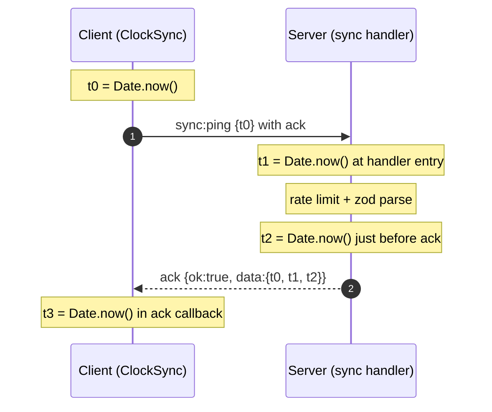
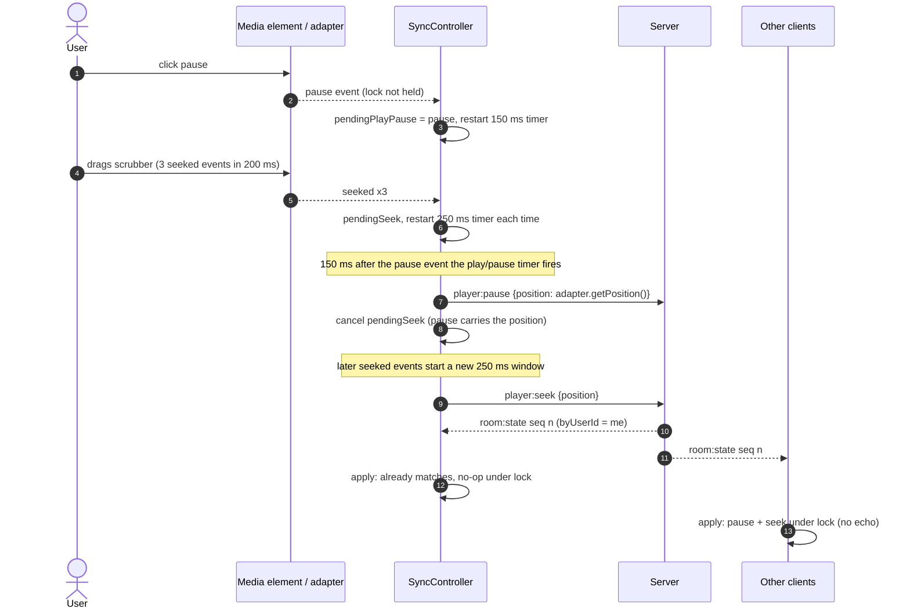
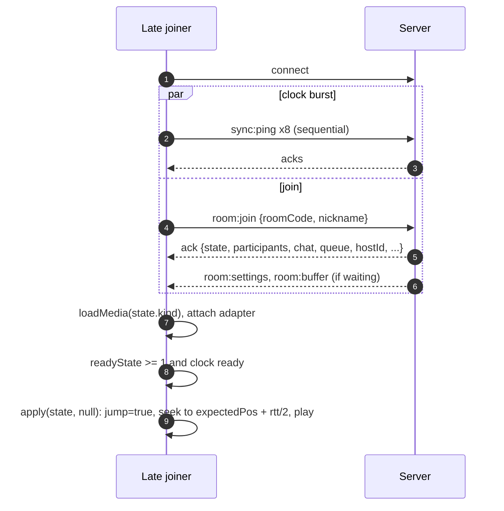
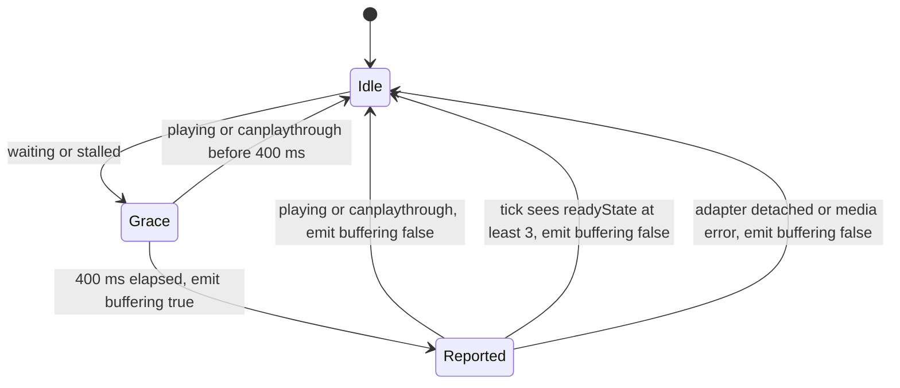
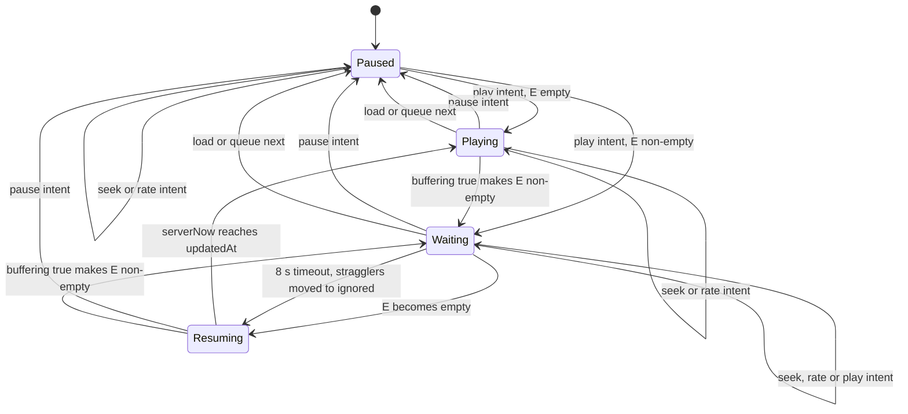
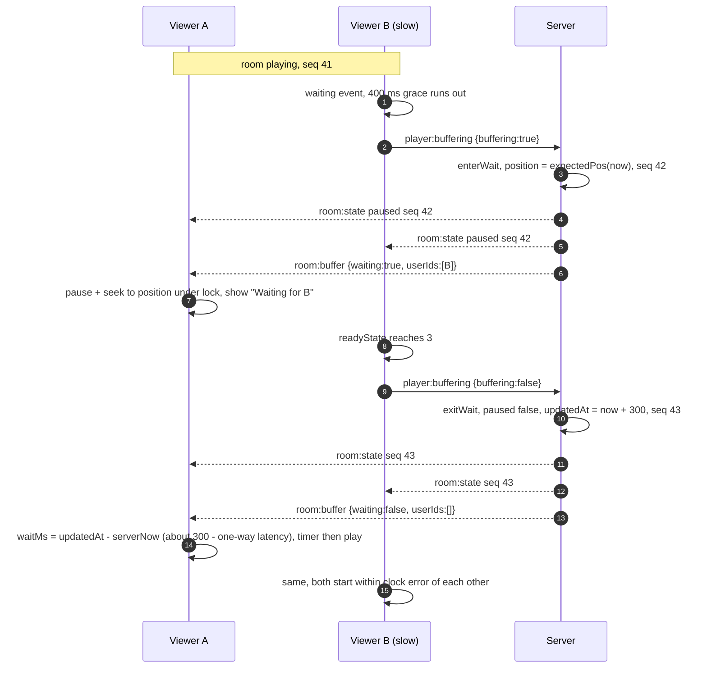

# Sync Protocol

> Status: authoritative wire and timing specification. Code in `packages/shared-types`, `packages/sync-engine` and `apps/server/src/socket` must match this document exactly.
> Related: [ARCHITECTURE.md](./ARCHITECTURE.md) (system design, 3-mode link engine, store), [EXTENSION_SPEC.md](./EXTENSION_SPEC.md) (Mode B adapter binding),
> [WEBRTC_AND_MEDIA.md](./WEBRTC_AND_MEDIA.md) (`rtc:*` semantics), [DEVOPS_AND_SECURITY.md](./DEVOPS_AND_SECURITY.md) (rate limits, threat model),
> [IMPLEMENTATION_ROADMAP.md](./IMPLEMENTATION_ROADMAP.md).

---

## 1. Goals and non-goals

| Goal | Target |
|---|---|
| Inter-viewer position error while playing (same network class, Mode A file/HLS) | p95 < 80 ms after convergence |
| Error immediately after any user seek/play | < 1 RTT + one correction tick (500 ms) |
| Visible artefacts from correction | none: rate nudges stay within ±4 % (pitch preserved by `preservesPitch`) |
| Stall behaviour | one viewer buffering pauses everyone (wait-for-buffer), max 8 s before stragglers are dropped |
| Server authority | the server's `PlaybackState` is the only truth, ordered by `seq` |

Non-goals: sample-accurate audio sync between rooms, sync in Mode C (it is a live WebRTC stream from one sharer), and sync of different content (regional catalog mismatches in Mode B are surfaced, not fixed).

---

## 2. Constants

All values live in `packages/shared-types/src/constants.ts` and are imported, never re-typed.

```ts
export const ROOM_CODE_ALPHABET = 'ABCDEFGHJKLMNPQRSTUVWXYZ23456789';
export const ROOM_CODE_LENGTH = 6;
export const ROOM_CODE_REGEX = /^[ABCDEFGHJKLMNPQRSTUVWXYZ23456789]{6}$/;
export const MAX_PARTICIPANTS = 12;
export const NICKNAME_MAX = 24;
export const CHAT_TEXT_MAX = 500;
export const CHAT_HISTORY_ON_JOIN = 50;
export const CHAT_HISTORY_MAX = 200;
export const CHAT_TIMESTAMPS_MAX = 10;
export const QUEUE_MAX = 50;
export const QUEUE_TITLE_MAX = 200;
export const MEDIA_URL_MAX = 2048;
export const MAX_POSITION_S = 86_400;
export const PLAYBACK_RATE_MIN = 0.25;
export const PLAYBACK_RATE_MAX = 2;
export const SDP_MAX = 32_768;                 // fits under the server's maxHttpBufferSize of 64 KiB
export const REACTION_EMOJIS = ['👍', '👎', '😂', '😮', '😢', '😡', '❤️', '🔥', '👏', '🎉', '💀', '🍿'] as const;

// Clock sync
export const CLOCK_BURST_COUNT = 8;
export const CLOCK_INTERVAL_MS = 5_000;
export const CLOCK_WINDOW = 10;
export const CLOCK_PING_TIMEOUT_MS = 2_000;
export const CLOCK_MAX_RTT_MS = 5_000;
export const CLOCK_READY_TIMEOUT_MS = 1_500;

// Drift correction
export const DRIFT_IGNORE_S = 0.08;
export const DRIFT_HARD_SEEK_S = 1.5;
export const DRIFT_HARD_SEEK_COARSE_S = 0.5;   // adapters without fine playbackRate (YouTube)
export const DRIFT_GAIN = 0.04 / 1.5;          // rate factor per second of drift; the calibration knob
export const CORRECTION_RATE_MIN = 0.96;
export const CORRECTION_RATE_MAX = 1.04;
export const CORRECTION_INTERVAL_MS = 500;

// Echo suppression / intents
export const REMOTE_LOCK_TIMEOUT_MS = 300;
export const INTENT_DEBOUNCE_MS = 150;
export const SEEK_DEBOUNCE_MS = 250;

// Wait-for-buffer
export const BUFFER_GRACE_MS = 400;
export const STARTUP_GRACE_MS = 1_500;         // grace for a stall within this long after a play start
export const BUFFER_TIMEOUT_MS = 8_000;
export const RESUME_DELAY_MS = 300;

// TURN credentials lifetime
export const TURN_TTL_SECONDS = 3_600;

// Rate limits: token bucket, `capacity` tokens refilled linearly over `windowMs`.
// Socket buckets are per socket; `metadata` and `turn` are per IP on the HTTP routes.
export const RATE_LIMITS = {
  chat:     { capacity: 5,   windowMs: 5_000 },
  reaction: { capacity: 10,  windowMs: 2_000 },
  player:   { capacity: 20,  windowMs: 5_000 },
  sync:     { capacity: 20,  windowMs: 5_000 },
  rtc:      { capacity: 200, windowMs: 10_000 },
  metadata: { capacity: 30,  windowMs: 60_000 },
  turn:     { capacity: 10,  windowMs: 60_000 },
} as const;
export const JOIN_FAIL_MAX = 10;
export const JOIN_FAIL_WINDOW_S = 600;

export const ERROR_CODES = [
  'RATE_LIMITED', 'INVALID_PAYLOAD', 'ROOM_NOT_FOUND', 'FORBIDDEN',
  'TOO_MANY_ATTEMPTS', 'ROOM_FULL', 'INTERNAL',
] as const;
```

`INTERNAL` is the one addition to the contract's error list: it is returned only for unexpected server faults (store unavailable, bug) so that clients never see a misleading `INVALID_PAYLOAD`.

---

## 3. Clock synchronisation (NTP-style)

### 3.1 Exchange



There is no separate `sync:pong` event; the Socket.IO acknowledgement **is** the pong. `t0`, `t3` are client epoch ms; `t1`, `t2` are server epoch ms. `sync:ping` is the only event accepted before the socket joins a room, so clock sync runs in parallel with the create/join UI.

### 3.2 Math

Let θ be the true offset (server clock − client clock), δ↑ and δ↓ the one-way delays.

```
t1 = t0 + δ↑ + θ
t3 = t2 + δ↓ − θ

offset = ((t1 − t0) + (t2 − t3)) / 2
       = ((δ↑ + θ) + (θ − δ↓)) / 2
       = θ + (δ↑ − δ↓) / 2

rtt    = (t3 − t0) − (t2 − t1)
       = δ↑ + δ↓
```

The error of a sample is `(δ↑ − δ↓)/2`, bounded by `±rtt/2`. Low-RTT samples therefore have the tightest error bound, which is why selection is by **minimum RTT** rather than by averaging.

Worked example (server is 250 ms ahead, 40 ms up, 60 ms down, 2 ms processing):

| Quantity | Value |
|---|---|
| t0 | 1000 |
| t1 | 1000 + 40 + 250 = 1290 |
| t2 | 1292 |
| t3 | (1292 − 250) + 60 = 1102 |
| offset | ((1290 − 1000) + (1292 − 1102)) / 2 = (290 + 190) / 2 = **240** |
| rtt | (1102 − 1000) − (1292 − 1290) = **100** |
| error | 240 − 250 = −10 ms (within ±50 ms) |

### 3.3 Sampling schedule and selection

```ts
// packages/sync-engine/src/clock.ts (normative behaviour)
interface ClockSample { offset: number; rtt: number; at: number }

samples: ClockSample[]   // last CLOCK_WINDOW (10), oldest evicted first
offset = 0, rtt = 0, ready = false

start():
  // burst: CLOCK_BURST_COUNT (8) pings, strictly sequential (next ping after the previous
  // ack or CLOCK_PING_TIMEOUT_MS), so samples never queue behind each other
  for i in 1..8: await pingOnce()
  every CLOCK_INTERVAL_MS (5 s): pingOnce()
  on socket reconnect: clear samples, ready = false, run the burst again

pingOnce():
  t0 = Date.now()
  res = await socket.timeout(2000).emitWithAck('sync:ping', { t0 })   // timeout => drop
  t3 = Date.now()
  if !res.ok or res.data.t0 !== t0: return                           // stale / foreign ack
  { t1, t2 } = res.data
  rtt = (t3 - t0) - (t2 - t1)
  if rtt < 0 or rtt > CLOCK_MAX_RTT_MS: return                        // clock step or garbage
  push { offset: ((t1 - t0) + (t2 - t3)) / 2, rtt, at: t3 }; trim to 10
  recompute()

recompute():
  minRtt   = min(samples.rtt)
  best     = samples.filter(s => s.rtt === minRtt)    // integer ms, ties are common
  offset   = median(best.map(s => s.offset))           // tie => median; one sample => itself
  rtt      = minRtt
  ready    = true

serverNow() = Date.now() + offset
```

`median` of an even count is the mean of the two middle values. Consumers read `clock.offset`, `clock.rtt`, `clock.ready` and `clock.serverNow()`.

Properties:

* A 10-sample window at 5 s spans ~50 s. Crystal drift between client and server (≤ 50 ppm) accumulates ≤ 2.5 ms in that span, so a 50 s-old min-RTT sample is still accurate. A network-path change shows up within ≤ 50 s as the old minimum is evicted.
* Samples with `rtt < 0` appear when the client wall clock steps (NTP correction, sleep/resume) between t0 and t3; they are discarded rather than corrupting the window.
* The `SyncController` does not apply a *playing* state until `clock.ready` **and** (the burst finished **or** `CLOCK_READY_TIMEOUT_MS` passed since attach). Paused states are applied immediately (they do not depend on the clock).

---

## 4. Authoritative playback state

### 4.1 Shape

```ts
interface PlaybackState {
  mediaUrl: string | null;          // normalised by classifyMediaUrl, or 'local:<filename>'
  mode: 'A' | 'B' | 'C' | null;
  kind: 'hls' | 'file' | 'youtube' | 'local' | 'drm' | 'unknown' | null;
  paused: boolean;
  position: number;                 // seconds, valid at updatedAt
  rate: number;                     // base playback rate chosen by users (0.25..2)
  updatedAt: number;                // server epoch ms (may be up to RESUME_DELAY_MS in the future)
  seq: number;                      // strictly monotonic per room, never reset (not even on load)
  byUserId: string | null;          // actor; null for system transitions (buffer pause / resume)
}
```

Initial state of a new room: `{ mediaUrl: null, mode: null, kind: null, paused: true, position: 0, rate: 1, updatedAt: now, seq: 0, byUserId: null }`, or, when `room:create` carried a valid `mediaUrl`, the same with the classified `mediaUrl`, `mode`, `kind` and `seq: 1`, `byUserId: hostId`.

### 4.2 Expected position

```
expectedPos(state, serverNow) =
  state.paused
    ? state.position
    : state.position + max(0, serverNow − state.updatedAt) / 1000 × state.rate
```

The `max(0, …)` clamp makes the contract formula well-defined for scheduled resumes (`updatedAt` in the future): until `updatedAt` arrives the expected position is frozen at `position`, and clients hold playback until then (§5.2). If the adapter knows the media duration, the result is clamped to `[0, duration]`.

Example: `{paused:false, position:120, rate:1.25, updatedAt:1_700_000_000_000}` at `serverNow = 1_700_000_004_000` → `120 + 4 × 1.25 = 125 s`.

### 4.3 Server mutation table

`now` is the server's `Date.now()` when the handler runs. Every row increments `seq` by exactly 1 and broadcasts `room:state {state}` to `room:{CODE}` (including the sender) inside `store.mutateRoom` (see [ARCHITECTURE.md §6.2](./ARCHITECTURE.md#62-store-contract)).

| Trigger | `paused` | `position` | `rate` | `updatedAt` | `byUserId` | Buffer side-effect |
|---|---|---|---|---|---|---|
| `player:play {position}`, effective buffering set empty | `false` | payload | unchanged | `now` | sender | none |
| `player:play {position}`, effective set non-empty | `true` | payload | unchanged | `now` | sender | enter/stay **Waiting**, `resumeOnClear = true` |
| `player:pause {position}` | `true` | payload | unchanged | `now` | sender | leave Waiting, `resumeOnClear = false`, broadcast `room:buffer {waiting:false, userIds:[]}` if it was active |
| `player:seek {position}` | unchanged | payload | unchanged | `now` | sender | none (stay in current buffer state) |
| `player:rate {rate}` | unchanged | `expectedPos(state, now)` (rebase) | payload | `now` | sender | none |
| `player:load {mediaUrl}` / `queue:next` | `true` | `0` | `1` | `now` | sender | reset buffer record entirely |
| Buffer **enter** (system) | `true` | `expectedPos(state, now)` | unchanged | `now` | `null` | `active = true`, `resumeOnClear = true`, `startedAt = now` |
| Buffer **exit** with `resumeOnClear` (system) | `false` | unchanged | unchanged | `now + RESUME_DELAY_MS` | `null` | `active = false` |

"Effective buffering set" = `buffer.userIds` minus `buffer.ignored` (see §8). In Mode C (`state.mode === 'C'`), `player:play|pause|seek|rate|buffering` are still accepted: web clients ignore Mode C state (the sharer controls the source page directly), while extension clients on that page treat it as a Mode B attempt and drive sync through these events.

### 4.4 Why the initiator's `position` is trusted

For `play`, `pause` and `seek` the server stores the position the initiating client reported, stamped with the server's receive time. The initiator's own frame is the one the user chose, so pausing "on this frame" lands everyone on that frame. The one-way latency (initiator ahead by δ↑ × rate while playing) is absorbed by that client's drift loop within the proportional band. `rate` is the exception: changing rate must not move the timeline, so the server rebases to its own expected position.

---

## 5. Client state application (`SyncController`)

### 5.1 `MediaAdapter` contract

```ts
// packages/sync-engine/src/controller.ts imports this from ./index.ts
export type MediaAdapterEvent =
  | 'play' | 'pause' | 'seeked' | 'ratechange'
  | 'waiting' | 'stalled' | 'playing' | 'canplaythrough'
  | 'ended' | 'error' | 'durationchange';

export interface MediaAdapter {
  readonly supportsFineRate: boolean;   // true: arbitrary playbackRate (HTMLMediaElement); false: YouTube's fixed set
  getPosition(): number;                 // seconds
  getDuration(): number | null;          // null if unknown / live
  getRate(): number;
  isPaused(): boolean;
  isSeeking(): boolean;
  isEnded(): boolean;
  readyState(): number;                  // HTMLMediaElement.readyState semantics (0..4)
  play(): Promise<void>;                 // may reject (autoplay policy)
  pause(): void;
  seek(seconds: number): void;
  setRate(rate: number): void;
  on(event: MediaAdapterEvent, cb: () => void): () => void;   // returns unsubscribe
  destroy(): void;
}
```

`HTMLVideoAdapter` maps these 1:1 to the element. The YouTube adapter (`apps/web/src/lib/youtube-adapter.ts`) maps `onStateChange` (`PLAYING` → `play`+`playing`, `PAUSED` → `pause`, `BUFFERING` → `waiting`, `ENDED` → `ended`), maps `readyState()` to `4` when not buffering and `getVideoLoadedFraction()` > 0, and **synthesises `seeked`** by polling `getCurrentTime()` every 250 ms and emitting it when the position jumps by more than 1 s from the extrapolated value. YouTube only supports rates in `getAvailablePlaybackRates()` (0.25 steps), so `supportsFineRate = false`.

### 5.2 Applying `room:state`

```ts
onState(s: PlaybackState):
  if (lastSeq !== null && s.seq <= lastSeq) return;        // reordered or duplicate
  const prev = current; current = s; lastSeq = s.seq;
  if (s.mediaUrl !== prev?.mediaUrl) return hostApp.loadMedia(s);  // adapter swap; controller re-runs apply on attach
  if (s.mode === 'C') return;
  apply(s, prev);

apply(s, prev):
  const debounceS = prev?.paused && !s.paused ? (INTENT_DEBOUNCE_MS / 1000) * s.rate : 0;  // sender ran on during its debounce
  const jump = prev === null
    || Math.abs(expectedPos(prev, s.updatedAt) - s.position) > DRIFT_IGNORE_S + debounceS;   // a real timeline discontinuity
  withRemoteLock(() => {
    if (Math.abs(adapter.getRate() - s.rate) > 0.001) { adapter.setRate(s.rate); appliedRate = s.rate; }
    const local = adapter.getPosition();
    if (s.paused) {
      if (!adapter.isPaused()) adapter.pause();
      if (Math.abs(local - s.position) > DRIFT_IGNORE_S) adapter.seek(s.position);
      return;
    }
    if (!clockUsable()) return deferUntilClockReady(s);
    const waitMs = s.updatedAt - clock.serverNow();
    if (waitMs > 0) {                                        // scheduled resume
      if (!adapter.isPaused()) adapter.pause();
      if (Math.abs(local - s.position) > DRIFT_IGNORE_S) adapter.seek(s.position);
      return scheduleTimer(waitMs, () => apply(current, current));   // re-enters, now waitMs <= 0
    }
    const target = expectedPos(s, clock.serverNow());
    const drift = local - target;
    const threshold = jump ? DRIFT_IGNORE_S : hardSeekThreshold();
    if (Math.abs(drift) > threshold) adapter.seek(target + (clock.rtt / 2000) * s.rate);
    const d = adapter.getDuration();
    if (adapter.isPaused() && (d === null || target < d - DRIFT_IGNORE_S))   // never play() at the end: it restarts from 0
      adapter.play().catch((e) => { if (e.name === 'NotAllowedError') onAutoplayBlocked(e); });
  });

hardSeekThreshold() = adapter.supportsFineRate ? DRIFT_HARD_SEEK_S : DRIFT_HARD_SEEK_COARSE_S;
```

Rules:

* A **jump** (someone seeked, media loaded, a buffer pause moved the timeline) is corrected by seeking whenever `|drift| > 80 ms`, because nudging a deliberate multi-second jump at ±4 % would take minutes. Non-jump changes (play after pause, rate change, scheduled resume) go through the normal bands.
* A scheduled timer is cancelled whenever a newer `room:state` arrives.
* **Autoplay policy**: `play()` can reject with `NotAllowedError` for a guest who has not interacted with the page. Any other rejection (`AbortError` when a `pause()` overtakes the play, adapter teardown) only releases the lock's `play` expectation; it is not an autoplay block. `onAutoplayBlocked` shows a "Click to join playback" overlay; the click handler calls `apply(current, current)` under a fresh lock. The rejection is never turned into a pause intent.
* `hostApp.loadMedia` creates the adapter for `s.kind` (hls.js / native video / YouTube / local-file picker) and calls `controller.attach(adapter)`, which runs `apply(current, null)` once the adapter reports `readyState() >= 1`.

### 5.3 The `isRemoteAction` lock (echo suppression)

Programmatic `play()/pause()/seek()` fire the same DOM events as user actions. Without a lock, applying a remote pause would emit `pause`, be read as a local intent, be sent back to the server, bump `seq`, and loop.

```ts
withRemoteLock(fn):
  lock = { expected: new Set<MediaAdapterEvent>(), until: Date.now() + REMOTE_LOCK_TIMEOUT_MS }
  wrap adapter calls inside fn so that:
    play()    adds 'play'
    pause()   adds 'pause'
    seek()    adds 'seeked'
    setRate() adds 'ratechange'
  fn()
  if lock.expected is empty: release now
  else: release when every expected event has fired, or after REMOTE_LOCK_TIMEOUT_MS (300 ms), whichever first

isRemoteAction() = lock !== null
```

* While the lock is held, an event in `lock.expected` is consumed and **never** becomes an intent; an unexpected `seeked`/`ratechange` is a side effect of the remote action and is dropped; an unexpected `play`/`pause` is the user acting and goes through §5.4 as usual.
* Buffering events (`waiting`, `stalled`, `playing`, `canplaythrough`) are **not** suppressed: buffering is a fact, not an intent.
* Drift-loop **rate** nudges do not take the lock (it would block user intents for 300 ms every tick). Their `ratechange` echoes are recognised because `|adapter.getRate() − appliedRate| ≤ 0.001`, where `appliedRate` is the last rate the controller set. Drift-loop **seeks** do take the lock.

### 5.4 Local intents and debounce



Normative rules (`controller.ts`):

| Event (lock not held) | Pending intent | Debounce | Payload at flush |
|---|---|---|---|
| `play` | `play` (replaces pending `pause`) | 150 ms trailing | `{position: adapter.getPosition()}` |
| `pause` (ignored if `adapter.isEnded()`) | `pause` (replaces pending `play`) | 150 ms trailing | `{position}` |
| `seeked` | `seek` | 250 ms trailing, restarted on each event | `{position}` |
| `ratechange` with `|rate − appliedRate| > 0.001` | `rate`; then `appliedRate = rate` | 150 ms trailing | `{rate: adapter.getRate()}` |

* Flushing a `play` or `pause` cancels a pending `seek`, because both carry `position`.
* A flush is skipped when it would not change the server state: `play` while `current.paused === false` and `|drift| < DRIFT_IGNORE_S`; `pause` while `current.paused === true` and `|position − current.position| < DRIFT_IGNORE_S`.
* Intents are sent with an ack (`timeout 3000`). On `{ok:false}` (e.g. `FORBIDDEN` under `hostOnlyControl`), the controller re-applies `current` under the lock, snapping the local element back to the authoritative state, and the UI shows the error.
* App-level controls (custom play button, rate menu) call the adapter; the resulting media events go through exactly the same path, so there is one intent pipeline for native controls, custom controls and site controls (Mode B).
* On `ended`: no intent. If the queue is non-empty, **only the host's** client sends `queue:next {}` (prevents N duplicate advances).

---

## 6. Drift correction

### 6.1 Bands

`drift = localPos − expectedPos(current, clock.serverNow())`, positive means this client is **ahead**.

| `|drift|` | Fine-rate adapter (HTML video, Mode A/B) | Coarse-rate adapter (YouTube) |
|---|---|---|
| < 0.08 s | rate = base (`state.rate`) | rate = base |
| 0.08 s – 1.5 s | rate = base × clamp(1 − drift × DRIFT_GAIN, 0.96, 1.04) | ≤ 0.5 s: nothing. > 0.5 s: hard seek |
| > 1.5 s | hard seek to `expectedPos + rtt/2 × rate` (rate = base) | hard seek |

`DRIFT_GAIN = 0.04 / 1.5 ≈ 0.026667` per second of drift, so the factor reaches the ±4 % bound exactly at the hard-seek boundary.

| drift (s) | factor | effective rate at base 1.0 |
|---|---|---|
| +0.08 | 1 − 0.002133 | 0.997867 |
| +0.50 | 1 − 0.013333 | 0.986667 |
| −1.00 | 1 + 0.026667 | 1.026667 |
| +1.50 | 0.96 | 0.960000 |
| −1.50 | 1.04 | 1.040000 |

Convergence: inside the band `d(drift)/dt ≈ −drift × DRIFT_GAIN`, so drift decays as `drift₀ · e^(−t/37.5 s)`. From 300 ms to below 80 ms takes ~50 s; from 1.5 s ~110 s. That is intentionally gentle (inaudible, no frame skips); real drift sources (decoder clock skew, one-way latency after a play) are usually below 300 ms, and discontinuities are handled by seeks (§5.2). `DRIFT_GAIN` is the tuning knob if field data shows slow convergence; do not change the band edges without updating this document.

Hard-seek lead `rtt/2 × rate`: a seek on a playing element completes after decoding resumes, and the min-RTT sample's offset still carries up to `±rtt/2` asymmetry error. Leading by half the RTT is a cheap compensation; whatever residual remains falls into the proportional band.

### 6.2 Correction loop

```ts
every CORRECTION_INTERVAL_MS (500 ms) while attached:
  if (!current || current.paused || current.mode === 'C') return;
  if (isRemoteAction() || adapter.isSeeking() || roomWaiting || bufferPhase !== 'idle') return;   // grace counts too
  if (!clockUsable() || current.updatedAt > clock.serverNow()) return;   // scheduled resume pending
  const base = current.rate;
  const target = expectedPos(current, clock.serverNow());
  const drift = adapter.getPosition() - target;
  const a = Math.abs(drift);
  if (a < DRIFT_IGNORE_S) {
    setRateIfChanged(base);
  } else if (a <= hardSeekThreshold()) {
    if (adapter.supportsFineRate) setRateIfChanged(base * clamp(1 - drift * DRIFT_GAIN, CORRECTION_RATE_MIN, CORRECTION_RATE_MAX));
  } else {
    if (Date.now() - lastDriftSeekAt < SEEK_LOCK_MAX_MS) return;   // 5 s cooldown: a seek that never lands must not loop
    lastDriftSeekAt = Date.now();
    setRateIfChanged(base);
    withRemoteLock(() => adapter.seek(target + (clock.rtt / 2000) * base));
  }

setRateIfChanged(r): if (Math.abs(adapter.getRate() - r) > 0.001) { appliedRate = r; adapter.setRate(r); }
```

The same tick also runs the buffering `readyState` poll (§8.1) and exposes `{drift, rate, offset, rtt}` to the UI's sync-status indicator.

---

## 7. Join, reconnect, media change



* **Reconnect**: Socket.IO auto-reconnects. The client clears clock samples, re-runs the burst and re-sends `room:join` with the stored code and nickname; it receives a new `userId`. `lastSeq` is reset to `null` so the ack's `state` is applied regardless of its `seq`. The buffering reporter is reset to Idle (the server forgot the old socket's report) and, if `readyState() < 3`, re-enters Grace so a still-stalled client reports again.
* **Media change** (`mediaUrl` differs): controller detaches the old adapter (pending intents dropped, buffering reported `false` if it was reported), host app builds the new adapter, `attach` applies `current`.
* **Mode B**: identical, with the adapter built by `video-finder.ts` over the provider's `<video>`; re-bound when the provider replaces the element ([EXTENSION_SPEC.md](./EXTENSION_SPEC.md)).

---

## 8. Wait-for-buffer

### 8.1 Client side: reporting



* The `readyState() >= 3` (HAVE_FUTURE_DATA) poll is required: while the room is paused for buffering, `playing` will not fire on the stalled client, and `canplaythrough` is unreliable under MSE (hls.js).
* A media `error` clears the report so a viewer who cannot play at all never stalls the room.
* **Startup grace**: a stall that begins within `STARTUP_GRACE_MS` (1.5 s) of a play start (remote apply or local play) gets `STARTUP_GRACE_MS` instead of 400 ms, so cold starts (YouTube's first `BUFFERING`, HLS) don't pause the room; the drift loop is idle meanwhile and catches the late starter up once it plays.
* `player:buffering` is sent without debounce beyond the grace period, on the `player` rate-limit bucket.

### 8.2 Server side: room state machine

The server keeps, per room, the buffer record `{ active, userIds, ignored, startedAt, resumeOnClear }` (field `buffer` of `room:{code}`). Effective set `E = userIds − ignored`.



| Diagram label | Wire event |
|---|---|
| play / pause / seek / rate intent | `player:play` / `player:pause` / `player:seek` / `player:rate` |
| buffering report, buffering true | `player:buffering {buffering:true}` |
| load or queue next | `player:load` / `queue:next` |
| room buffer | S2C `room:buffer {waiting, userIds}` |

`Paused`, `Playing`, `Waiting` are derived (`Waiting` = `buffer.active`; otherwise `state.paused`). `Resuming` is `Playing` with `state.updatedAt > now` (the 300 ms scheduled resume); it is not stored separately.

Normative server logic (`handlers/player.ts`, all inside `mutateRoom`):

```ts
onBuffering(userId, buffering):
  b = room.buffer
  resolveOverdue()
  if (buffering) {
    if (b.ignored.includes(userId)) return;                     // straggler already dropped
    addUnique(b.userIds, userId);
    if (!b.active && !state.paused) enterWait();
    else if (b.active) emit('room:buffer', { waiting: true, userIds: E() });
  } else {
    remove(b.userIds, userId); remove(b.ignored, userId);       // recovered => may trigger future waits
    if (b.active && E().length === 0) exitWait();
    else if (b.active) emit('room:buffer', { waiting: true, userIds: E() });
  }

enterWait():
  state = { ...state, position: expectedPos(state, now), paused: true, updatedAt: now, byUserId: null, seq: seq + 1 };
  b.active = true; b.resumeOnClear = true; b.startedAt = now;
  emit('room:state', { state }); emit('room:buffer', { waiting: true, userIds: E() });
  setTimeout(() => onWaitTimeout(b.startedAt), BUFFER_TIMEOUT_MS);   // on this instance

onWaitTimeout(token):                                    // idempotent; re-reads the room
  if (!b.active || b.startedAt !== token) return;
  b.ignored = union(b.ignored, b.userIds); b.userIds = [];
  exitWait();

exitWait():
  b.active = false;
  if (b.resumeOnClear) {
    state = { ...state, paused: false, updatedAt: now + RESUME_DELAY_MS, byUserId: null, seq: seq + 1 };
    emit('room:state', { state });
  }
  emit('room:buffer', { waiting: false, userIds: [] });

resolveOverdue():                                        // called by every player:* handler
  if (b.active && now - b.startedAt >= BUFFER_TIMEOUT_MS) onWaitTimeout(b.startedAt);

onPlayIntent(position):                                   // see mutation table §4.3
  if (E().length > 0) {
    state = { ...state, paused: true, position, updatedAt: now, byUserId: sender, seq: seq + 1 };
    if (!b.active) { b.active = true; b.startedAt = now; setTimeout(...); }
    b.resumeOnClear = true;
    emit('room:state', { state }); emit('room:buffer', { waiting: true, userIds: E() });
  } else { state = { ...state, paused: false, position, updatedAt: now, byUserId: sender, seq: seq + 1 }; emit(...) }

onDisconnect / room:leave: remove userId from userIds and ignored, then same exit check as buffering:false.
```

Edge cases:

| Case | Behaviour |
|---|---|
| Two viewers stall at once | One `enterWait`; second report only broadcasts `room:buffer` with both ids. |
| Viewer stalls while room is paused | Tracked in `userIds`, no broadcast. If someone presses play while still stalled, the room goes straight to Waiting. |
| User pauses during Waiting | Wait cancelled, `resumeOnClear = false`, room stays paused at the user's position. Buffering reports keep being tracked. |
| User seeks during Waiting | Position updated, still Waiting (everyone will rebuffer at the new position anyway). |
| Chronic straggler | After 8 s they are moved to `ignored`, the room resumes; they catch up with a hard seek once their buffer fills. They can trigger a new wait only after reporting `buffering:false`. |
| Server instance holding the timer dies | Next `player:*` on any instance calls `resolveOverdue()`. |
| Media load | Buffer record reset to `{active:false, userIds:[], ignored:[], startedAt:0, resumeOnClear:false}`. |
| Joiner during Waiting | Gets `room:buffer {waiting:true, userIds}` right after the join ack. |

### 8.3 Timeline example



---

## 9. Chat timestamp tags

`apps/server/src/lib/timestamps.ts` extracts `@mm:ss` and `@h:mm:ss` tags from the sanitised text:

```ts
const TAG = /(?<![\w@])@(\d{1,2}):([0-5]\d)(?::([0-5]\d))?(?![\w:])/g;
// match with 3rd group: h = g1, m = g2, s = g3  -> h*3600 + m*60 + s
// match without:        m = g1, s = g2          -> m*60 + s
// keep values <= MAX_POSITION_S, in order of appearance, max CHAT_TIMESTAMPS_MAX (10), duplicates kept
```

| Input | `timestamps` |
|---|---|
| `look at @1:02:03 and @12:34` | `[3723, 754]` |
| `@0:05!` | `[5]` |
| `mail me@1:00`, `@1:2`, `@1:60`, `@12:34:5` | `[]` |

The text itself is not rewritten; the renderer turns `@…` tags into buttons that call `player:seek` with the parsed value (formatted with `formatTimecode` from `sync-engine/src/timecode.ts`: `m:ss` below one hour, `h:mm:ss` above).

---

## 10. Socket.IO event catalog

Namespace `/`. Every C2S event accepts an **optional** ack callback; if present the server calls it exactly once with an `Ack<T>`. If absent, failures are emitted to the sender as the `error` event. Processing order per event: rate-limit bucket → `schema.safeParse` → `sanitizeText` on free-text fields (then re-check min length 1) → membership/authorisation → mutation → broadcast → ack.

### 10.1 Envelope

```ts
export type ErrorCode = (typeof ERROR_CODES)[number];
export type Ack<T> =
  | { ok: true; data: T }
  | { ok: false; error: { code: ErrorCode; message: string } };
```

### 10.2 Zod schemas (`packages/shared-types/src/schemas.ts`)

```ts
import { z } from 'zod';
import {
  ROOM_CODE_REGEX, NICKNAME_MAX, CHAT_TEXT_MAX, MEDIA_URL_MAX, QUEUE_TITLE_MAX,
  MAX_POSITION_S, PLAYBACK_RATE_MIN, PLAYBACK_RATE_MAX, REACTION_EMOJIS, ERROR_CODES, SDP_MAX,
} from './constants.js';
// Also in the real file: drmProviderSchema, mediaInfoSchema, metadataSchema, turnResponseSchema,
// turn/metadata query schemas, the extension bridge schemas (WP_PING / WP_HANDOFF) and a type per payload.

// ---------- primitives ----------
export const roomCodeSchema = z.string().trim().toUpperCase().regex(ROOM_CODE_REGEX);
export const userIdSchema = z.string().uuid();
export const nicknameSchema = z.string().trim().min(1).max(NICKNAME_MAX);
export const chatTextSchema = z.string().trim().min(1).max(CHAT_TEXT_MAX);
export const mediaUrlSchema = z.string().trim().min(1).max(MEDIA_URL_MAX);
export const queueTitleSchema = z.string().trim().min(1).max(QUEUE_TITLE_MAX);
export const positionSchema = z.number().finite().min(0).max(MAX_POSITION_S);
export const playbackRateSchema = z.number().finite().min(PLAYBACK_RATE_MIN).max(PLAYBACK_RATE_MAX);
export const emojiSchema = z.enum(REACTION_EMOJIS);
export const sdpSchema = z.string().min(1).max(SDP_MAX);   // the event name carries the type (offer/answer)
export const iceCandidateSchema = z.object({
  candidate: z.string().max(4_096),
  sdpMid: z.string().max(64).nullable().optional(),
  sdpMLineIndex: z.number().int().min(0).max(1_024).nullable().optional(),
  usernameFragment: z.string().max(256).nullable().optional(),
});
export const mediaKindSchema = z.enum(['hls', 'file', 'youtube', 'local', 'drm', 'unknown']);
export const syncModeSchema = z.enum(['A', 'B', 'C']);
export const errorCodeSchema = z.enum(ERROR_CODES);
export const mediaFlagsSchema = z.object({ audio: z.boolean(), video: z.boolean(), screen: z.boolean() });

// ---------- C2S payloads ----------
export const roomCreateSchema = z.object({ nickname: nicknameSchema, mediaUrl: mediaUrlSchema.optional() });
export const roomJoinSchema = z.object({ roomCode: roomCodeSchema, nickname: nicknameSchema });
export const roomLeaveSchema = z.object({});
export const roomSettingsSchema = z.object({ hostOnlyControl: z.boolean().optional() });
export const syncPingSchema = z.object({ t0: z.number().finite().nonnegative() });
export const playerPlaySchema = z.object({ position: positionSchema });
export const playerPauseSchema = z.object({ position: positionSchema });
export const playerSeekSchema = z.object({ position: positionSchema });
export const playerRateSchema = z.object({ rate: playbackRateSchema });
export const playerBufferingSchema = z.object({ buffering: z.boolean() });
export const playerLoadSchema = z.object({ mediaUrl: mediaUrlSchema });
export const chatSendSchema = z.object({ text: chatTextSchema });
export const reactionSendSchema = z.object({ emoji: emojiSchema });
export const queueAddSchema = z.object({ mediaUrl: mediaUrlSchema, title: queueTitleSchema.optional() });
export const queueRemoveSchema = z.object({ id: z.string().uuid() });
export const queueNextSchema = z.object({});
export const rtcOfferSchema = z.object({ to: userIdSchema, sdp: sdpSchema });
export const rtcAnswerSchema = z.object({ to: userIdSchema, sdp: sdpSchema });
export const rtcIceSchema = z.object({ to: userIdSchema, candidate: iceCandidateSchema });
export const rtcMediaSchema = mediaFlagsSchema;

// Server handlers import each schema directly; event names are typed as `C2SEventName = keyof ClientToServerEvents` (events.ts).

// ---------- S2C shapes (server-produced; schemas double as types and client-side test fixtures) ----------
export const playbackStateSchema = z.object({
  mediaUrl: z.string().nullable(),
  mode: syncModeSchema.nullable(),
  kind: mediaKindSchema.nullable(),
  paused: z.boolean(),
  position: z.number().finite().min(0),
  rate: z.number().finite().positive(),
  updatedAt: z.number().int(),
  seq: z.number().int().nonnegative(),
  byUserId: userIdSchema.nullable(),
});
export const participantSchema = z.object({
  id: userIdSchema,
  nickname: z.string(),
  isHost: z.boolean(),
  joinedAt: z.number().int(),
  media: mediaFlagsSchema,
});
export const chatMessageSchema = z.object({
  id: z.string().uuid(),
  userId: userIdSchema,
  nickname: z.string(),
  text: z.string(),
  timestamps: z.array(z.number().nonnegative()),
  at: z.number().int(),
});
export const reactionSchema = z.object({ id: z.string().uuid(), userId: userIdSchema, emoji: emojiSchema, at: z.number().int() });
export const queueItemSchema = z.object({
  id: z.string().uuid(),
  mediaUrl: z.string(),
  title: z.string(),
  addedBy: userIdSchema,
  kind: mediaKindSchema,
  mode: syncModeSchema,
});

export const roomStateEventSchema = z.object({ state: playbackStateSchema });
export const roomParticipantsEventSchema = z.object({ participants: z.array(participantSchema), hostId: userIdSchema });
export const roomBufferEventSchema = z.object({ waiting: z.boolean(), userIds: z.array(userIdSchema) });
export const queueUpdateEventSchema = z.object({ queue: z.array(queueItemSchema) });
export const roomSettingsEventSchema = z.object({ hostOnlyControl: z.boolean() });
export const rtcOfferRelaySchema = z.object({ from: userIdSchema, sdp: sdpSchema });
export const rtcAnswerRelaySchema = z.object({ from: userIdSchema, sdp: sdpSchema });
export const rtcIceRelaySchema = z.object({ from: userIdSchema, candidate: iceCandidateSchema });
export const errorEventSchema = z.object({ code: errorCodeSchema, message: z.string() });

// ---------- ack data ----------
export const roomCreateAckSchema = z.object({
  roomCode: z.string(), userId: userIdSchema, state: playbackStateSchema, participants: z.array(participantSchema),
});
export const roomJoinAckSchema = z.object({
  roomCode: z.string(), userId: userIdSchema, hostId: userIdSchema, state: playbackStateSchema,
  participants: z.array(participantSchema), chat: z.array(chatMessageSchema), queue: z.array(queueItemSchema),
});
export const syncPingAckSchema = z.object({ t0: z.number(), t1: z.number().int(), t2: z.number().int() });
export const playerAckSchema = z.object({ seq: z.number().int() });
export const playerLoadAckSchema = z.object({ seq: z.number().int(), kind: mediaKindSchema, mode: syncModeSchema });
export const idAckSchema = z.object({ id: z.string().uuid() });
export const queueAddAckSchema = z.object({ item: queueItemSchema });
export const roomSettingsAckSchema = roomSettingsEventSchema;

export type PlaybackState = z.infer<typeof playbackStateSchema>;
export type Participant = z.infer<typeof participantSchema>;
export type ChatMessage = z.infer<typeof chatMessageSchema>;
export type Reaction = z.infer<typeof reactionSchema>;
export type QueueItem = z.infer<typeof queueItemSchema>;
export type MediaKind = z.infer<typeof mediaKindSchema>;
export type SyncMode = z.infer<typeof syncModeSchema>;
export type MediaFlags = z.infer<typeof mediaFlagsSchema>;
```

Notes on the schemas:

* `.trim()` / `.toUpperCase()` run before the following checks, so `" abc23k "` parses to `ABC23K`; codes containing `0`, `O`, `1` or `I` are rejected.
* Unknown keys are stripped (Zod default), not rejected, so newer clients can add optional fields without breaking older servers.
* `mediaUrlSchema` only bounds length. Semantic validity is `classifyMediaUrl(url) !== null` on the server (shared-types cannot depend on sync-engine); `null` → `INVALID_PAYLOAD`.
* `nickname`, `text` and `title` are additionally passed through `sanitizeText` server-side (CR/LF/TAB → space, strip `\u0000-\u001F`, `\u007F-\u009F`, `‪-‮`, `⁦-⁩`, trim). If the result is empty → `INVALID_PAYLOAD`. Sanitising can only shorten, so max lengths still hold.

### 10.3 Typed event maps (`packages/shared-types/src/events.ts`)

```ts
import type { z } from 'zod';
import type * as S from './schemas.js';

type In<T extends z.ZodTypeAny> = z.input<T>;
type Out<T extends z.ZodTypeAny> = z.output<T>;
type Cb<T> = (res: Ack<T>) => void;

export interface ClientToServerEvents {
  'room:create':      (p: In<typeof S.roomCreateSchema>,      ack?: Cb<Out<typeof S.roomCreateAckSchema>>) => void;
  'room:join':        (p: In<typeof S.roomJoinSchema>,        ack?: Cb<Out<typeof S.roomJoinAckSchema>>) => void;
  'room:leave':       (p: In<typeof S.roomLeaveSchema>,       ack?: Cb<null>) => void;
  'room:settings':    (p: In<typeof S.roomSettingsSchema>,    ack?: Cb<Out<typeof S.roomSettingsAckSchema>>) => void;
  'sync:ping':        (p: In<typeof S.syncPingSchema>,        ack?: Cb<Out<typeof S.syncPingAckSchema>>) => void;
  'player:play':      (p: In<typeof S.playerPlaySchema>,      ack?: Cb<Out<typeof S.playerAckSchema>>) => void;
  'player:pause':     (p: In<typeof S.playerPauseSchema>,     ack?: Cb<Out<typeof S.playerAckSchema>>) => void;
  'player:seek':      (p: In<typeof S.playerSeekSchema>,      ack?: Cb<Out<typeof S.playerAckSchema>>) => void;
  'player:rate':      (p: In<typeof S.playerRateSchema>,      ack?: Cb<Out<typeof S.playerAckSchema>>) => void;
  'player:buffering': (p: In<typeof S.playerBufferingSchema>, ack?: Cb<null>) => void;
  'player:load':      (p: In<typeof S.playerLoadSchema>,      ack?: Cb<Out<typeof S.playerLoadAckSchema>>) => void;
  'chat:send':        (p: In<typeof S.chatSendSchema>,        ack?: Cb<Out<typeof S.idAckSchema>>) => void;
  'reaction:send':    (p: In<typeof S.reactionSendSchema>,    ack?: Cb<Out<typeof S.idAckSchema>>) => void;
  'queue:add':        (p: In<typeof S.queueAddSchema>,        ack?: Cb<Out<typeof S.queueAddAckSchema>>) => void;
  'queue:remove':     (p: In<typeof S.queueRemoveSchema>,     ack?: Cb<null>) => void;
  'queue:next':       (p: In<typeof S.queueNextSchema>,       ack?: Cb<Out<typeof S.playerLoadAckSchema>>) => void;
  'rtc:offer':        (p: In<typeof S.rtcOfferSchema>,        ack?: Cb<null>) => void;
  'rtc:answer':       (p: In<typeof S.rtcAnswerSchema>,       ack?: Cb<null>) => void;
  'rtc:ice':          (p: In<typeof S.rtcIceSchema>,          ack?: Cb<null>) => void;
  'rtc:media':        (p: In<typeof S.rtcMediaSchema>,        ack?: Cb<null>) => void;
}

export interface ServerToClientEvents {
  'room:state':        (p: Out<typeof S.roomStateEventSchema>) => void;
  'room:participants': (p: Out<typeof S.roomParticipantsEventSchema>) => void;
  'room:buffer':       (p: Out<typeof S.roomBufferEventSchema>) => void;
  'room:settings':     (p: Out<typeof S.roomSettingsEventSchema>) => void;
  'chat:message':      (p: Out<typeof S.chatMessageSchema>) => void;
  'reaction':          (p: Out<typeof S.reactionSchema>) => void;
  'queue:update':      (p: Out<typeof S.queueUpdateEventSchema>) => void;
  'rtc:offer':         (p: Out<typeof S.rtcOfferRelaySchema>) => void;
  'rtc:answer':        (p: Out<typeof S.rtcAnswerRelaySchema>) => void;
  'rtc:ice':           (p: Out<typeof S.rtcIceRelaySchema>) => void;
  'error':             (p: Out<typeof S.errorEventSchema>) => void;
}
```

Server: `new Server<ClientToServerEvents, ServerToClientEvents>(...)`. Clients: `io(...) as Socket<ServerToClientEvents, ClientToServerEvents>`.

### 10.4 C2S events

Legend: **Room** = sender must be a participant of a room (else `FORBIDDEN`). **Control** = host, or anyone when `hostOnlyControl === false` (else `FORBIDDEN`).

| Event | Payload | Auth | Bucket | Ack `data` | Server effect / broadcasts | Errors |
|---|---|---|---|---|---|---|
| `room:create` | `{nickname, mediaUrl?}` | none (implicit leave if in a room) | player | `{roomCode, userId, state, participants}` | new room, sender = host; then `room:settings {hostOnlyControl:false}` to sender | `INVALID_PAYLOAD` (incl. unclassifiable `mediaUrl`), `RATE_LIMITED`, `INTERNAL` |
| `room:join` | `{roomCode, nickname}` | IP join-failure counter < 10 | player | `{roomCode, userId, hostId, state, participants, chat (last 50), queue}` | sender added; `room:settings` + (if waiting) `room:buffer` to sender; `room:participants` to room | `TOO_MANY_ATTEMPTS`, `ROOM_NOT_FOUND` (counts a failure), `ROOM_FULL` (12), `INVALID_PAYLOAD` |
| `room:leave` | `{}` | Room | player | `null` | participant removed, host transfer to min `joinedAt`, buffer cleanup; `room:participants` | `FORBIDDEN` |
| `room:settings` | `{hostOnlyControl?}` | host only | player | `{hostOnlyControl}` | meta updated; `room:settings` to room | `FORBIDDEN` |
| `sync:ping` | `{t0}` | none | sync | `{t0, t1, t2}` | refreshes participant `lastSeen` if in a room | `RATE_LIMITED`, `INVALID_PAYLOAD` |
| `player:play` | `{position}` | Room + Control, mode ≠ C | player | `{seq}` | §4.3; `room:state` (+ `room:buffer` if entering Waiting) | `FORBIDDEN` |
| `player:pause` | `{position}` | Room + Control, mode ≠ C | player | `{seq}` | §4.3; `room:state` (+ `room:buffer {waiting:false}` if a wait is cancelled) | `FORBIDDEN` |
| `player:seek` | `{position}` | Room + Control, mode ≠ C | player | `{seq}` | §4.3; `room:state` | `FORBIDDEN` |
| `player:rate` | `{rate}` (0.25..2) | Room + Control, mode ≠ C | player | `{seq}` | rebase then set rate; `room:state` | `FORBIDDEN` |
| `player:buffering` | `{buffering}` | Room, mode ≠ C (never gated by `hostOnlyControl`) | player | `null` | §8.2; may emit `room:state` + `room:buffer` | `FORBIDDEN` |
| `player:load` | `{mediaUrl}` | Room + Control | player | `{seq, kind, mode}` | classify, reset state (paused, 0, rate 1), reset buffer; `room:state` | `INVALID_PAYLOAD`, `FORBIDDEN` |
| `chat:send` | `{text}` (1..500) | Room | chat | `{id}` | sanitize, parse tags, `RPUSH` + `LTRIM -200 -1`; `chat:message` to room | `RATE_LIMITED`, `INVALID_PAYLOAD` |
| `reaction:send` | `{emoji}` (allowlist of 12) | Room | reaction | `{id}` | not persisted; `reaction` to room | `RATE_LIMITED`, `INVALID_PAYLOAD` |
| `queue:add` | `{mediaUrl, title?}` | Room | player | `{item}` | classify (`null` → error); `title` defaults to `/api/metadata` cache title or the URL hostname + path (truncated to 200); max 50 items; `queue:update` | `INVALID_PAYLOAD` (incl. queue full) |
| `queue:remove` | `{id}` | Room; adder or host | player | `null` | `queue:update` | `FORBIDDEN`, `INVALID_PAYLOAD` (unknown id) |
| `queue:next` | `{}` | Room + Control | player | `{seq, kind, mode}` | `LPOP` head and load it exactly like `player:load`; `queue:update` + `room:state` | `INVALID_PAYLOAD` (queue empty), `FORBIDDEN` |
| `rtc:offer` | `{to, sdp}` | Room; `to` in same room, `to ≠ sender` | rtc | `null` | `rtc:offer {from, sdp}` to `user:{to}` | `FORBIDDEN` |
| `rtc:answer` | `{to, sdp}` | same | rtc | `null` | `rtc:answer {from, sdp}` to `user:{to}` | `FORBIDDEN` |
| `rtc:ice` | `{to, candidate}` | same | rtc | `null` | `rtc:ice {from, candidate}` to `user:{to}` | `FORBIDDEN` |
| `rtc:media` | `{audio, video, screen}` | Room | rtc | `null` | participant media flags updated; `room:participants` | `FORBIDDEN` |

Every event additionally may fail with `RATE_LIMITED` (bucket empty), `INVALID_PAYLOAD` (schema) and `INTERNAL`.

### 10.5 S2C events

| Event | Payload | Sent to | When |
|---|---|---|---|
| `room:state` | `{state: PlaybackState}` (full, with `seq`, `byUserId`) | room | every state mutation (§4.3) |
| `room:participants` | `{participants: Participant[], hostId}` | room | join, leave/disconnect, host transfer, `rtc:media`, stale prune |
| `room:buffer` | `{waiting, userIds}` | room; also the joiner on join while waiting | enter Waiting, effective set change while Waiting, exit Waiting |
| `room:settings` | `{hostOnlyControl}` | room; the sender after create/join | `room:settings` change, after create/join ack |
| `chat:message` | `{id, userId, nickname, text, timestamps, at}` | room (incl. sender) | `chat:send` accepted |
| `reaction` | `{id, userId, emoji, at}` | room (incl. sender) | `reaction:send` accepted |
| `queue:update` | `{queue: QueueItem[]}` (full list) | room | `queue:add`, `queue:remove`, `queue:next` |
| `rtc:offer` | `{from, sdp}` | `user:{to}` | relay |
| `rtc:answer` | `{from, sdp}` | `user:{to}` | relay |
| `rtc:ice` | `{from, candidate}` | `user:{to}` | relay |
| `error` | `{code, message}` | the sender | a C2S event without ack failed |

`participants` are ordered by `joinedAt` ascending; `isHost` is `id === hostId`. The server never sends `lastSeen` or socket ids.

### 10.6 Error codes

| Code | Meaning | Client reaction |
|---|---|---|
| `RATE_LIMITED` | token bucket for the event group is empty | drop; for chat show "slow down" |
| `INVALID_PAYLOAD` | Zod failure, empty after sanitising, unclassifiable URL, unknown queue id, empty/full queue | form-level message; message text is safe to display |
| `ROOM_NOT_FOUND` | code unknown or expired | back to landing; counts toward IP join failures |
| `FORBIDDEN` | not in a room, host-only action, `hostOnlyControl` gate, `rtc` target not in room, `player:*` in Mode C | re-apply authoritative state, toast |
| `TOO_MANY_ATTEMPTS` | ≥ 10 failed joins from this IP in 10 min | disable join form until the window passes |
| `ROOM_FULL` | 12 participants | message, no retry loop |
| `INTERNAL` | unexpected server fault (logged with request id) | retry once, then "something went wrong" |

---

## 11. Conformance checklist and test vectors

Each item below has a unit test in the owning package.

- [ ] **Clock math** (`sync-engine`): `t0=1000, t1=1290, t2=1292, t3=1102` → `offset=240`, `rtt=100`.
- [ ] **Selection**: rtts `[30, 12, 12, 40]` with offsets `[5, 100, 110, 7]` → `offset=105` (median of ties), `rtt=12`. Single sample → itself. Window keeps 10 newest.
- [ ] **Sample rejection**: `rtt < 0` and `rtt > 5000` discarded; `t0` mismatch discarded.
- [ ] **Expected position**: paused → `position`; playing `{120, rate 1.25, +4 s}` → `125`; `updatedAt` 300 ms in the future → `position`.
- [ ] **Drift factor**: values of the table in §6.1 to 6 decimals; clamp at ±1.5 s.
- [ ] **Bands**: drift 0.05 → base; 0.5 fine-rate → 0.986667 × base; 0.5 coarse → no-op; 0.6 coarse → seek; 1.6 → seek to `expected + rtt/2000 × rate`.
- [ ] **Lock**: remote pause emits `pause` → no intent; lock releases after `pause` or 300 ms; a user `seeked` 301 ms later → intent.
- [ ] **Debounce**: `pause` then `play` within 150 ms → one `player:play`; three `seeked` in 200 ms → one `player:seek` 250 ms after the last; `pause` flush cancels pending seek.
- [ ] **Seq**: `room:state` with `seq <= lastSeq` ignored; reconnect resets `lastSeq`.
- [ ] **Server mutation table**: one test per row of §4.3, asserting `seq + 1` and the exact field values.
- [ ] **Wait-for-buffer**: playing + `buffering:true` → paused at `expectedPos(now)`, `room:buffer {waiting:true}`; all clear → `paused:false`, `updatedAt = now + 300`; 8 s timeout → stragglers in `ignored`, resume; ignored user `buffering:true` → no-op; pause during wait → no auto-resume; disconnect of the last buffering user → resume.
- [ ] **Timestamps**: vectors of §9.
- [ ] **Schemas**: room code `abc23k` → `ABC23K`; `ABC10K` rejected; nickname of 25 chars rejected; 500-char text accepted, 501 rejected; emoji outside the 12 rejected; `rate 2.01` rejected; `position -0.1`, `NaN`, `Infinity` rejected.
- [ ] **Sanitize**: `"‮evil\u0007 \r\nname "` → `"evil   name"` (three spaces: space, CR, LF each become one); `"\u0000\u0001"` → empty → `INVALID_PAYLOAD`.
- [ ] **Auth**: `player:play` from non-host with `hostOnlyControl` → `FORBIDDEN`, state unchanged; `player:buffering` from non-host with `hostOnlyControl` → accepted; `rtc:offer` to a user in another room → `FORBIDDEN`.
- [ ] **Rate limits**: 6th `chat:send` within 1 s → `RATE_LIMITED`; 11th failed join from one IP → `TOO_MANY_ATTEMPTS` even for a valid code.
