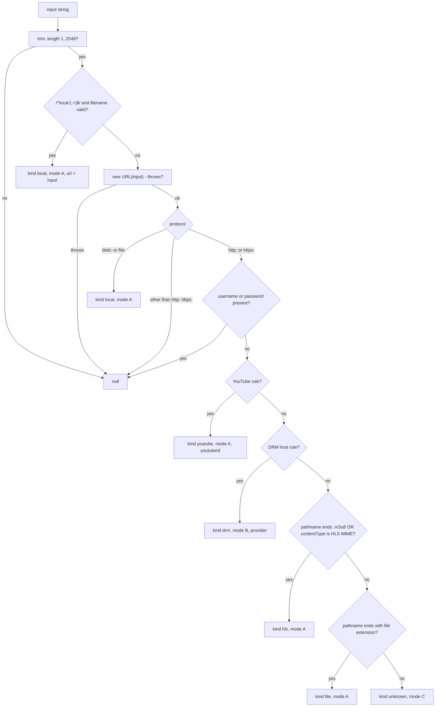
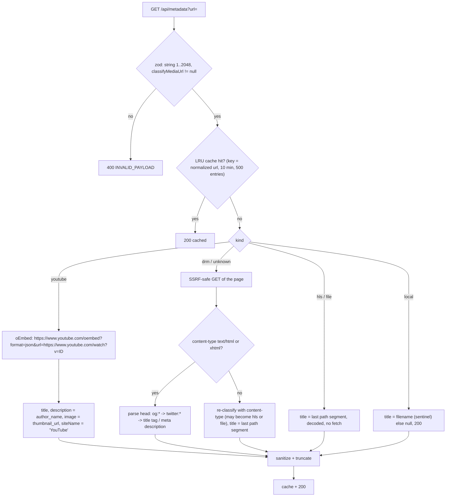
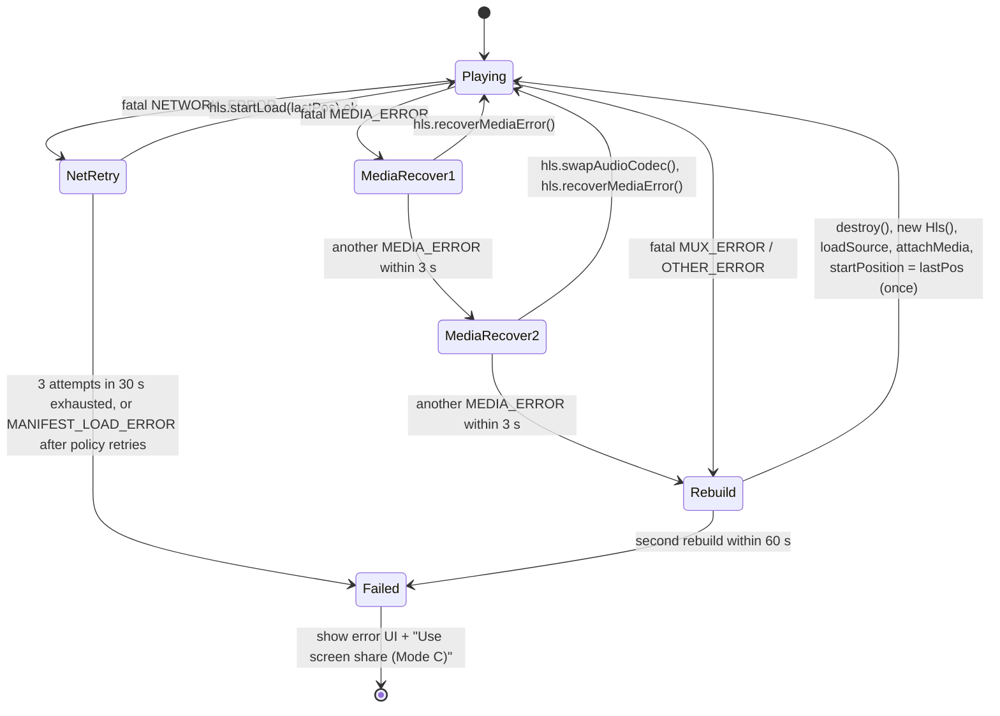
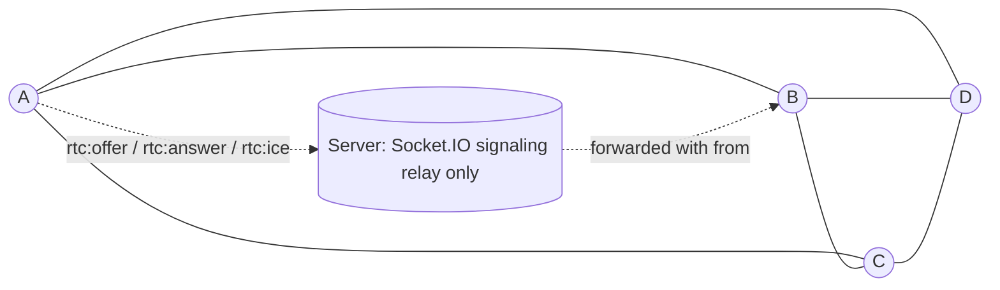
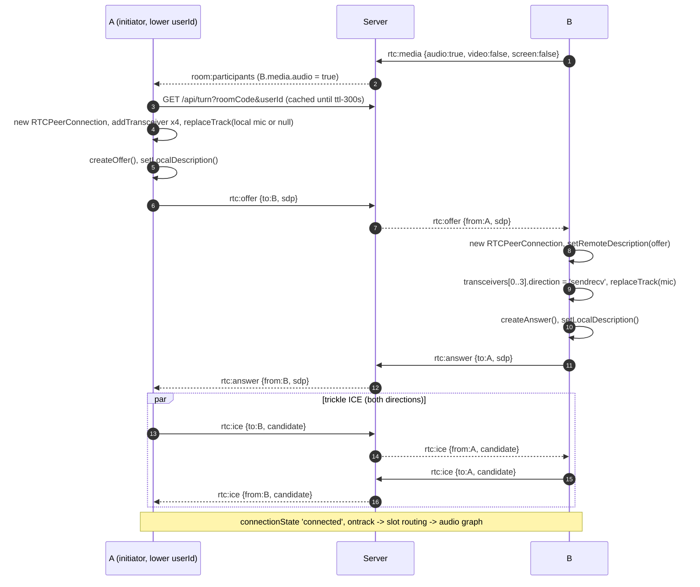
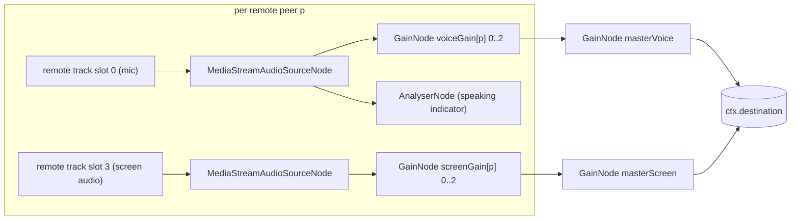
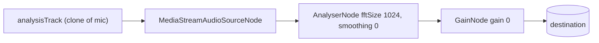

# WebRTC and Media Specification

Status: v1 spec, written before implementation. This document is normative for media classification, the metadata endpoint, HLS playback, WebRTC voice, video and screen share, and TURN.
Related: [ARCHITECTURE.md](./ARCHITECTURE.md), [SYNC_PROTOCOL.md](./SYNC_PROTOCOL.md) (PlaybackState, drift correction, MediaAdapter contract), [EXTENSION_SPEC.md](./EXTENSION_SPEC.md) (Mode B), [DEVOPS_AND_SECURITY.md](./DEVOPS_AND_SECURITY.md) (Coturn deployment, ports, rate limits, CSP), [IMPLEMENTATION_ROADMAP.md](./IMPLEMENTATION_ROADMAP.md), [../CLAUDE.md](../CLAUDE.md).

| Module | Package or path |
|---|---|
| `classifyMediaUrl` | `packages/sync-engine/src/classify.ts` |
| `MediaAdapter`, `HTMLVideoAdapter` | `packages/sync-engine/src/adapters/html-video.ts` |
| YouTube IFrame adapter | `apps/web/src/lib/youtube-adapter.ts` |
| WebRTC mesh, audio graph, PTT and VAD | `apps/web/src/lib/webrtc.ts` |
| TURN credentials | `apps/server/src/lib/turn.ts` (served at `GET /api/turn`) |
| Metadata | `apps/server/src/lib/metadata.ts` (served at `GET /api/metadata`) |

---

## 1. Media classification (`classifyMediaUrl`)

### 1.1 Signature and invalid-input decision

```ts
type MediaKind = 'hls' | 'file' | 'youtube' | 'local' | 'drm' | 'unknown';
type SyncMode = 'A' | 'B' | 'C';

interface MediaInfo {
  kind: MediaKind;
  mode: SyncMode;
  url: string;            // normalized: URL.href, or the 'local:<filename>' sentinel unchanged
  youtubeId?: string;     // kind === 'youtube' only
  provider?: DrmProvider; // kind === 'drm' only
}

export function classifyMediaUrl(input: string, contentType?: string): MediaInfo | null;
```

- **Invalid input returns `null`; the function never throws.** Callers map `null` to `INVALID_PAYLOAD`: the server in `player:load`, `queue:add` and `room:create`, and the web app as an inline form error. This choice is documented once here and in `classify.ts`'s JSDoc.
- The optional second argument `contentType` is a small, compatible extension of the contract's `classifyMediaUrl(url)`. It is how the contract's MIME rule for HLS (`application/vnd.apple.mpegurl` / `application/x-mpegURL`) gets applied. Called with one argument, the function behaves exactly as the contract says.
- The function is pure and synchronous, with no network and no DOM. The server imports it through the package subpath `@watchparty/sync-engine/classify`, so it does not compile DOM-typed adapter code.

### 1.2 Rule order

The first matching rule wins:



### 1.3 Exact rules

The hostname used below is `url.hostname.toLowerCase()`. `hostIs(host, d)` means `host === d || host.endsWith('.' + d)`, which keeps `notnetflix.com` from matching `netflix.com`.

| # | Kind / mode | Rule (exact) |
|---|---|---|
| R1 | `local` / A | Sentinel: `/^local:([^/\\\u0000-\u001f]{1,255})$/` on the trimmed input. Capture group 1 is the filename. `url` is the input unchanged. |
| R2 | `local` / A | `url.protocol === 'blob:' \|\| url.protocol === 'file:'` |
| R3 | reject | `url.protocol` not in `{http:, https:}` returns `null`. This covers `javascript:`, `data:`, `ftp:`, `chrome:` and `about:`. Also `url.username \|\| url.password` returns `null`. |
| R4 | `youtube` / A | Host `/^(?:www\.\|m\.\|music\.)?youtube\.com$/` and one of these: `pathname === '/watch'` with `searchParams.get('v')` matching ID; `pathname` matching `/^\/(?:shorts\|embed)\/([A-Za-z0-9_-]{11})(?:[/?#]\|$)/`. **Or** host `youtu.be` with `pathname` matching `/^\/([A-Za-z0-9_-]{11})(?:\/\|$)/`. ID regex: `/^[A-Za-z0-9_-]{11}$/`. A YouTube host without a valid ID (channel, playlist only, home page) falls through to `unknown`. |
| R5 | `drm` / B | Provider table in section 1.4. Checked against `hostname`, and against `pathname` for Amazon. |
| R6 | `hls` / A | `/\.m3u8$/i.test(url.pathname)`, **or** `contentType` normalized (`split(';')[0].trim().toLowerCase()`) is `application/vnd.apple.mpegurl` or `application/x-mpegurl` |
| R7 | `file` / A | `/\.(mp4\|webm\|ogg\|ogv\|mov\|m4v\|mkv)$/i.test(url.pathname)` |
| R8 | `unknown` / C | Any other `http(s)` URL. The UI may still offer "Try with extension" (Mode B). |

Notes:
- Query strings and fragments are ignored by R6 and R7 because they test `pathname`. `https://cdn/x.m3u8?token=...` is `hls`.
- `.mkv` is classified as `file` per the contract. Chrome plays Matroska only with H.264, VP8/VP9 or AV1 video and AAC, Opus or Vorbis audio. If the element errors (`MEDIA_ERR_SRC_NOT_SUPPORTED`), the UI says the container or codec is unsupported and suggests Mode C.
- `url` for R2 to R8 is `new URL(input).href`. That lowercases the host and percent-encodes, so the same media always compares equal. YouTube URLs are **not** rewritten. The adapter uses `youtubeId`.

### 1.4 DRM provider table (`DRM_PROVIDERS` in `@watchparty/shared-types`)

| `provider` key | Host rule | Path rule |
|---|---|---|
| `netflix` | `hostIs(h, 'netflix.com')` | any |
| `primevideo` | `hostIs(h, 'primevideo.com')` | any |
| `amazon` | `/^(?:www\.\|smile\.)?amazon\.[a-z]{2,3}(?:\.[a-z]{2})?$/` (e.g. `amazon.com`, `amazon.co.uk`, `amazon.com.br`) | `pathname.startsWith('/gp/video')` (otherwise falls through to `unknown`) |
| `disneyplus` | `hostIs(h, 'disneyplus.com')` | any |
| `hulu` | `hostIs(h, 'hulu.com')` | any |
| `max` | `hostIs(h, 'max.com')` | any |
| `hbomax` | `hostIs(h, 'hbomax.com')` | any |
| `appletv` | `h === 'tv.apple.com'` (exact) | any (other `apple.com` hosts fall through to `unknown`) |
| `peacock` | `hostIs(h, 'peacocktv.com')` | any |
| `paramountplus` | `hostIs(h, 'paramountplus.com')` | any |
| `crunchyroll` | `hostIs(h, 'crunchyroll.com')` | any |
| `moviebox` | `/(?:^\|\.)moviebox\.[a-z]{2,3}(?:\.[a-z]{2})?$/` (covers `moviebox.ng`, `moviebox.ph` and other `moviebox.*`) | any |
| `hotstar` | `hostIs(h, 'hotstar.com')` | any |
| `jiocinema` | `hostIs(h, 'jiocinema.com')` | any |

The extension's static content-script match list ([EXTENSION_SPEC.md section 3.2](./EXTENSION_SPEC.md#32-provider-match-patterns)) is derived from the same table.

### 1.5 Test vectors (the `classify.ts` self-check must cover every row)

| Input | `contentType` | Expected |
|---|---|---|
| `https://cdn.example.com/live/master.m3u8?token=abc` | | `{kind:'hls', mode:'A'}` |
| `https://example.com/stream` | `application/x-mpegURL; charset=utf-8` | `{kind:'hls', mode:'A'}` |
| `https://example.com/movie.MP4` | | `{kind:'file', mode:'A'}` |
| `https://example.com/a.mkv#t=10` | | `{kind:'file', mode:'A'}` |
| `https://www.youtube.com/watch?v=dQw4w9WgXcQ&t=42` | | `{kind:'youtube', mode:'A', youtubeId:'dQw4w9WgXcQ'}` |
| `https://youtu.be/dQw4w9WgXcQ?si=x` | | `youtube`, `dQw4w9WgXcQ` |
| `https://www.youtube.com/shorts/dQw4w9WgXcQ` | | `youtube` |
| `https://www.youtube.com/embed/dQw4w9WgXcQ` | | `youtube` |
| `https://music.youtube.com/watch?v=dQw4w9WgXcQ` | | `youtube` |
| `https://m.youtube.com/watch?v=dQw4w9WgXcQ` | | `youtube` |
| `https://www.youtube.com/watch?v=short` | | `{kind:'unknown', mode:'C'}` |
| `https://www.youtube.com/@somechannel` | | `unknown` / C |
| `blob:http://localhost:3000/4f9c...` | | `{kind:'local', mode:'A'}` |
| `file:///C:/Movies/a.mkv` | | `local` / A |
| `local:My Movie (2019).mkv` | | `{kind:'local', mode:'A', url:'local:My Movie (2019).mkv'}` |
| `local:../etc/passwd` | | `null` (contains `/`) |
| `https://www.netflix.com/watch/80100172` | | `{kind:'drm', mode:'B', provider:'netflix'}` |
| `https://www.amazon.co.uk/gp/video/detail/B0ABC` | | `drm`, `amazon` |
| `https://www.amazon.com/dp/B0ABC` | | `unknown` / C |
| `https://play.max.com/video/watch/x` | | `drm`, `max` |
| `https://tv.apple.com/us/show/x` | | `drm`, `appletv` |
| `https://www.apple.com/tv` | | `unknown` / C |
| `https://moviebox.ph/movies/x` | | `drm`, `moviebox` |
| `https://notnetflix.com/watch/1` | | `unknown` / C |
| `https://example.com/page` | | `unknown` / C |
| `javascript:alert(1)` | | `null` |
| `ftp://host/a.mp4` | | `null` |
| `https://user:pw@example.com/a.mp4` | | `null` |
| `not a url` | | `null` |
| ` ` (whitespace) | | `null` |

### 1.6 Server-side classification on `player:load`, `queue:add` and `room:create`

1. `info = classifyMediaUrl(mediaUrl)`. If `null`, ack `INVALID_PAYLOAD`.
2. (Addition: ARCHITECTURE.md applies the `contentType` upgrade in `/api/metadata` only. This step brings the same upgrade to the socket path, and shares that endpoint's cache.) If `info.kind === 'unknown'`, the server **probes** the URL's `Content-Type` with the SSRF-safe fetcher from section 2.3: `HEAD`, falling back to `GET` with `Range: bytes=0-0`, 2 s timeout, cached for 10 min. It then runs `classifyMediaUrl(mediaUrl, contentType)` again. This turns extensionless HLS endpoints into `hls`. A failed probe keeps `unknown`.
3. The resulting `{kind, mode}` goes into `PlaybackState` and the queue item.

### 1.7 What each kind plays with (web app, Mode A / B / C)

| `kind` | Mode | Player | Adapter | Notes |
|---|---|---|---|---|
| `hls` | A | `<video>` + hls.js (section 3), or native HLS where `Hls.isSupported()` is false and `video.canPlayType('application/vnd.apple.mpegurl')` succeeds | `HTMLVideoAdapter` | The source must send CORS headers (`Access-Control-Allow-Origin`) because hls.js fetches with XHR. Without them, playback fails and the UI suggests Mode C. |
| `file` | A | `<video src>` (no `crossOrigin` attribute, so CORS is not required) | `HTMLVideoAdapter` | On an HTTPS deployment, `http:` media is auto-upgraded or blocked as mixed content. |
| `youtube` | A | YouTube IFrame Player API (`www.youtube.com/iframe_api`) | `YouTubeAdapter` (`lib/youtube-adapter.ts`) | `setPlaybackRate` only snaps to `getAvailablePlaybackRates()` (0.25 steps), so the 0.96..1.04 soft band cannot be applied. The adapter reports `supportsFineRate = false`. Drift is then corrected only by the hard-seek path ([SYNC_PROTOCOL.md](./SYNC_PROTOCOL.md)). |
| `local` | A | `<input type="file" accept="video/*,.mkv">` -> `URL.createObjectURL(file)` -> `<video>` | `HTMLVideoAdapter` | A `blob:` URL means nothing to other peers. The web app always sends `local:<file.name>` to the server. Each peer picks their own copy. On `loadedmetadata`, the UI warns if `abs(duration - hostDuration) > 2s` (host duration shown from the host's participant UI). |
| `drm` | B | The participant's own logged-in tab | `HTMLVideoAdapter` inside the extension | [EXTENSION_SPEC.md](./EXTENSION_SPEC.md). EME-protected output appears **black** in screen capture, which is why DRM can never be Mode C. |
| `unknown` | C | One participant shares the tab with `getDisplayMedia` (section 7) and everyone else watches the WebRTC stream | none (no sync needed) | The "Try with extension" button sends `WP_HANDOFF` anyway. |

---

## 2. Metadata extraction: `GET /api/metadata?url=`

### 2.1 Contract

```
GET /api/metadata?url=<percent-encoded URL>
200 { title: string|null, description: string|null, image: string|null, siteName: string|null, kind: MediaKind, mode: 'A'|'B'|'C' }
400 { error: { code: 'INVALID_PAYLOAD', message } }     // url missing, > 2048 chars, or classifyMediaUrl === null
429 { error: { code: 'RATE_LIMITED', message } }        // 30 req / 60 s per IP (RATE_LIMITS.metadata; see DEVOPS_AND_SECURITY.md section 4)
Cache-Control: public, max-age=600
```

A failed upstream fetch (timeout, non-2xx, non-HTML, oversize body) **still returns 200**, with nulls and the URL-based `kind` and `mode`; clients treat metadata as decoration. A target refused by the SSRF policy (scheme, credentials, port, or any hop resolving to a non-public address) returns **422** `{ error: { code: 'INVALID_PAYLOAD', message: 'Target not allowed' } }`. That answer is the same whether or not the internal host exists, so it reveals nothing beyond the URL the caller already sent.

### 2.2 Pipeline



Field precedence for HTML pages:

| Field | 1st | 2nd | 3rd |
|---|---|---|---|
| `title` | `meta[property="og:title"]` | `meta[name="twitter:title"]` | `<title>` |
| `description` | `og:description` | `twitter:description` | `meta[name="description"]` |
| `image` | `og:image:secure_url` | `og:image` | `twitter:image` |
| `siteName` | `og:site_name` | `application-name` | final URL hostname without `www.` |

Parsing is regex over the bytes **before `</head>`** (`/<meta\s+[^>]*>/gi`, attributes read with `/([a-zA-Z:-]+)\s*=\s*("([^"]*)"|'([^']*)'|([^\s>]+))/g`). No HTML-parser dependency is used, since only `<meta>` and `<title>` are needed. Values are HTML-entity decoded (`&amp; &lt; &gt; &quot; &#39; &#NNN; &#xHH;`). They are then passed through `sanitize.ts` (strip control and bidi characters, collapse whitespace, trim). `title` is truncated to 200 and `description` to 500 characters. `image` is resolved against the final URL and kept only if it is `http(s)`. The web app renders it with ``.

### 2.3 SSRF-safe fetcher (`lib/metadata.ts`, Node stdlib only)

Built on `node:https` / `node:http` `request()` with a custom `lookup`, so the address that was validated is the address the socket connects to. That defeats DNS rebinding without any dependency.

| Control | Value |
|---|---|
| Schemes | `http:`, `https:` only |
| Ports | the default port, `80`, or `443`. Anything else is blocked. |
| Credentials in URL | blocked |
| DNS | `dns.lookup(host, { all: true, verbatim: true })`. **Every** returned address must pass the blocklist, otherwise blocked. The validated first address is returned to the socket's `lookup` callback. |
| IP literal hosts | checked against the same blocklist |
| Blocklist (`net.BlockList`) | IPv4: `0.0.0.0/8`, `10.0.0.0/8`, `100.64.0.0/10`, `127.0.0.0/8`, `169.254.0.0/16`, `172.16.0.0/12`, `192.0.0.0/24`, `192.0.2.0/24`, `192.88.99.0/24`, `192.168.0.0/16`, `198.18.0.0/15`, `198.51.100.0/24`, `203.0.113.0/24`, `224.0.0.0/4`, `240.0.0.0/4`, `255.255.255.255/32`. IPv6: `::/128`, `::1/128`, `::ffff:0:0/96` (mapped addresses are checked again as IPv4), `64:ff9b::/96`, `100::/64`, `2001:db8::/32`, `fc00::/7`, `fe80::/10`, `ff00::/8` |
| Redirects | handled manually, **max 3**. Each `Location` is resolved against the current URL and fully validated again. |
| Timeouts | 3 s to response headers, 5 s total (`AbortSignal.timeout(5000)`) |
| Request headers | `User-Agent: WatchPartyBot/1.0 (+metadata)`, `Accept: text/html,application/xhtml+xml;q=0.9,*/*;q=0.1`, `Accept-Encoding: identity` (no decompression, so no zip bombs), `Accept-Language: en` |
| Body cap | 512 KiB. Reading also stops at the first `</head>`. |
| Charset | taken from the `Content-Type` `charset=` when `TextDecoder` supports it, else UTF-8 with `fatal: false` |
| Cookies | never sent or stored |

The same fetcher (`HEAD`, falling back to a ranged `GET`) serves the content-type probe in section 1.6.

### 2.4 YouTube oEmbed

`GET https://www.youtube.com/oembed?format=json&url=https%3A%2F%2Fwww.youtube.com%2Fwatch%3Fv%3D{ID}` through the same fetcher. It returns `{ title, author_name, thumbnail_url, provider_name }`. A `401` or `404` (private, removed or not embeddable) gives `title: null` and `image: https://i.ytimg.com/vi/{ID}/hqdefault.jpg`.

---

## 3. HLS playback (hls.js)

### 3.1 Setup

hls.js `^1.5` is used, which includes `ManagedMediaSource` support for iOS 17.1+ Safari.

```ts
import Hls, { type HlsConfig } from 'hls.js';

export const HLS_CONFIG: Partial<HlsConfig> = {
  enableWorker: true,               // transmux off the main thread (CSP: worker-src 'self' blob:)
  lowLatencyMode: true,             // LL-HLS partial segments + blocking playlist reload when the playlist advertises them
  backBufferLength: 30,             // keep 30 s behind playhead: cheap backward seeks without memory blow-up
  maxBufferLength: 30,              // forward buffer target (s)
  maxMaxBufferLength: 120,          // hard ceiling when bandwidth is plentiful
  maxBufferHole: 0.5,               // jump small gaps instead of stalling
  nudgeMaxRetry: 5,
  startFragPrefetch: true,
  capLevelToPlayerSize: true,       // don't fetch 4K into a 640 px player
  abrEwmaDefaultEstimate: 5_000_000,
  liveSyncDurationCount: 3,         // live edge target = 3 target durations
  liveMaxLatencyDurationCount: 10,
  maxLiveSyncPlaybackRate: 1,       // DISABLE hls.js live catch-up: SyncController owns playbackRate
  liveDurationInfinity: true,
  manifestLoadPolicy: { default: {
    maxTimeToFirstByteMs: 8_000, maxLoadTimeMs: 15_000,
    timeoutRetry: { maxNumRetry: 2, retryDelayMs: 0, maxRetryDelayMs: 0 },
    errorRetry:   { maxNumRetry: 3, retryDelayMs: 1_000, maxRetryDelayMs: 8_000, backoff: 'exponential' },
  } },
  playlistLoadPolicy: { default: {
    maxTimeToFirstByteMs: 8_000, maxLoadTimeMs: 15_000,
    timeoutRetry: { maxNumRetry: 2, retryDelayMs: 0, maxRetryDelayMs: 0 },
    errorRetry:   { maxNumRetry: 4, retryDelayMs: 1_000, maxRetryDelayMs: 8_000, backoff: 'exponential' },
  } },
  fragLoadPolicy: { default: {
    maxTimeToFirstByteMs: 8_000, maxLoadTimeMs: 20_000,
    timeoutRetry: { maxNumRetry: 4, retryDelayMs: 0, maxRetryDelayMs: 0 },
    errorRetry:   { maxNumRetry: 6, retryDelayMs: 1_000, maxRetryDelayMs: 8_000, backoff: 'exponential' },
  } },
};

export function attachHls(video: HTMLVideoElement, src: string): Hls | null {
  if (Hls.isSupported()) {
    const hls = new Hls(HLS_CONFIG);
    hls.loadSource(src);
    hls.attachMedia(video);
    return hls;
  }
  if (video.canPlayType('application/vnd.apple.mpegurl')) { video.src = src; return null; }
  throw new Error('HLS not supported in this browser');
}
```

Why these values matter for sync:
- `maxLiveSyncPlaybackRate: 1` is **required**. Otherwise hls.js changes `playbackRate` on live streams and fights the drift controller.
- A hard seek from drift correction lands inside `backBufferLength`/`maxBufferLength` most of the time, so correction seeks rarely cause a network round trip.

### 3.2 VOD vs live

| Stream | Detection | Sync behavior |
|---|---|---|
| VOD | `data.details.live === false` on `LEVEL_LOADED` (`#EXT-X-ENDLIST` present) | Full position sync per [SYNC_PROTOCOL.md](./SYNC_PROTOCOL.md). |
| Live / LL-HLS | `data.details.live === true` | `currentTime` is **not comparable across clients** (each timeline starts at the client's first fragment). v1: play and pause are synced, position sync and drift correction are off, and on `play` each client seeks to `hls.liveSyncPosition`. `ponytail:` live sessions show live-edge spread of about 1 target duration. The upgrade path is syncing on `EXT-X-PROGRAM-DATE-TIME` (`hls.playingDate`) when present. |

### 3.3 Error recovery



Rules:
- **Fatal network:** `hls.startLoad(video.currentTime)` with a delay of 1 s, 2 s, 4 s (attempt n waits `1000 * 2^(n-1)` ms). The counter resets after 30 s without errors.
- **Fatal media:** the escalation in the diagram is the documented hls.js pattern. Each step's timestamp is tracked with `performance.now()`.
- **Non-fatal `BUFFER_STALLED_ERROR` / `BUFFER_NUDGE_ON_STALL`:** log only. The `<video>` `waiting` event already drives `player:buffering` ([SYNC_PROTOCOL.md](./SYNC_PROTOCOL.md)).
- **During any recovery** the adapter emits `player:buffering {buffering:true}` so the room waits. When `playing` fires again, it emits `{buffering:false}`, and the SyncController hard-seeks to the expected position.
- `hls.destroy()` runs on unmount and on every `player:load`, so no workers or MediaSource objects leak.

---

## 4. WebRTC mesh (voice, camera, screen share)

### 4.1 Topology and limits



- Full mesh, at most 12 participants (the contract room limit), so at most 11 `RTCPeerConnection`s per client.
- **Lazy connections:** the pair `(a, b)` is connected only while `a.media` or `b.media` has any `true` flag (from `room:participants`). If both are all-false for 30 s, the pair closes. A room where nobody uses voice or camera therefore makes no WebRTC connections and uses no TURN allocations.
- **Initiator rule (no glare):** for each pair, the participant whose `userId` sorts lower (`a < b`, string compare) is the **initiator**. Only the initiator creates the `RTCPeerConnection` proactively and sends offers, including ICE-restart offers. The other side creates its PC when the first `rtc:offer` from that peer arrives, and only ever answers. When the non-initiator turns media on, it emits `rtc:media`. The server rebroadcasts `room:participants`, and the initiator reacts by connecting.
- `ponytail:` mesh bandwidth grows with N-1 per sender. Screen share to 11 peers is limited by uplink (section 7.3). The upgrade path is an SFU (LiveKit or mediasoup) behind the same `rtc:*` contract.

### 4.2 Fixed transceiver layout (no renegotiation for media toggles)

The initiator creates exactly four transceivers right after `new RTCPeerConnection(config)`:

| Index | `kind` | Purpose | Initiator setup | Non-initiator setup (after `setRemoteDescription(offer)`, before `createAnswer`) |
|---|---|---|---|---|
| 0 | audio | microphone | `addTransceiver('audio', {direction:'sendrecv'})` | `pc.getTransceivers()[0].direction = 'sendrecv'` |
| 1 | video | camera | `addTransceiver('video', {direction:'sendrecv'})` | `[1].direction = 'sendrecv'` |
| 2 | video | screen video | `addTransceiver('video', {direction:'sendrecv'})` | `[2].direction = 'sendrecv'` |
| 3 | audio | screen / system audio | `addTransceiver('audio', {direction:'sendrecv'})` | `[3].direction = 'sendrecv'` |

- Turning mic, camera or screen on or off is `transceivers[i].sender.replaceTrack(track | null)`. **No SDP renegotiation** happens, so toggles are instant and glare is impossible.
- Remote tracks are routed to slots with `ontrack: idx = pc.getTransceivers().indexOf(e.transceiver)`. Both sides list transceivers in m-line order.
- Whether a remote slot is "live" is decided by the participant's `media:{audio,video,screen}` flags, not by track arrival. A transceiver always has a (possibly silent) receiver track.
- `RTCPeerConnection` config: `{ iceServers, iceTransportPolicy: 'all', bundlePolicy: 'max-bundle', rtcpMuxPolicy: 'require' }`.

### 4.3 Signaling payloads (Zod, `@watchparty/shared-types/schemas.ts`)

Authoritative definitions are in [SYNC_PROTOCOL.md §10.2](./SYNC_PROTOCOL.md#102-zod-schemas-packagesshared-typessrcschemasts); summary:

```ts
const userId = z.string().uuid();
const sdp = z.string().min(1).max(SDP_MAX);             // SDP_MAX = 32_768; the SDP text only
const candidate = z.object({
  candidate: z.string().max(4_096),                     // '' = end-of-candidates
  sdpMid: z.string().max(64).nullable().optional(),
  sdpMLineIndex: z.number().int().min(0).max(1_024).nullable().optional(),
  usernameFragment: z.string().max(256).nullable().optional(),
});

// C2S. The event name carries the description type: the receiver of rtc:offer calls
// setRemoteDescription({ type: 'offer', sdp }), of rtc:answer ({ type: 'answer', sdp }).
rtcOffer  = z.object({ to: userId, sdp });
rtcAnswer = z.object({ to: userId, sdp });
rtcIce    = z.object({ to: userId, candidate });
rtcMedia  = z.object({ audio: z.boolean(), video: z.boolean(), screen: z.boolean() });

// S2C
// rtc:offer {from, sdp}   rtc:answer {from, sdp}   rtc:ice {from, candidate}
```

Server relay rules (`socket/handlers/rtc.ts`):
1. Rate limit `rtc:*` at 200 per 10 s per socket ([DEVOPS_AND_SECURITY.md section 4](./DEVOPS_AND_SECURITY.md#4-per-socket-token-bucket-rate-limits)).
2. Zod-validate. The sender must be joined to a room. `to` must be a **current participant of the same room** (`HEXISTS room:{code}:participants {to}`), otherwise `FORBIDDEN`. `to === self` returns `INVALID_PAYLOAD`.
3. Forward with `io.to('user:' + to).emit(event, { from: senderUserId, ... })`. Every socket joins its personal room `user:{userId}` on `room:join`. Through the Redis adapter this reaches the target on any instance.
4. The server never parses or stores SDP. `from` is always set by the server and never taken from the client.
5. `rtc:media` updates the participant's `media` in `room:{code}:participants` and broadcasts `room:participants`.

### 4.4 Connection sequence



Candidate handling:
- `rtc:ice` that arrives before `setRemoteDescription` is queued per peer and flushed right after. Errors from `addIceCandidate` are logged and ignored, because stale candidates after a restart are expected.
- `onicecandidate` with `e.candidate === null` sends `{candidate: ''}` (end-of-candidates).

### 4.5 Failure handling

| Condition | Action |
|---|---|
| `connectionState === 'disconnected'` | Wait 5 s. If still disconnected, the initiator calls `pc.restartIce()`, which fires `negotiationneeded` and an offer with new ICE credentials. |
| `connectionState === 'failed'` | The initiator restarts ICE immediately. After 2 failed restarts in 60 s, it closes the PC and connects again from scratch (new PC, new `/api/turn` fetch). |
| `negotiationneeded` on the non-initiator | Ignored. It never offers. |
| Peer leaves (`room:participants` no longer lists them) | `pc.close()`. Disconnect and stop that peer's audio-graph nodes. |
| TURN credentials near expiry (`ttl - 300 s`) | Fetch `/api/turn` again and call `pc.setConfiguration({...config, iceServers})` on every PC. Only new allocations and restarts use the new credentials, and existing allocations are refreshed by the browser. |
| Socket reconnect (new `userId`) | Close all PCs. The pairs are built again from the new participant list. |

---

## 5. TURN / STUN (Coturn) with time-limited HMAC credentials

### 5.1 Credential scheme (TURN REST API, `use-auth-secret`)

```ts
// apps/server/src/lib/turn.ts
import { createHmac } from 'node:crypto';

export function turnCredentials(secret: string, userId: string, ttl = 3600, now = Date.now()) {
  const expiry = Math.floor(now / 1000) + ttl;                  // unix seconds
  const username = `${expiry}:${userId}`;
  const credential = createHmac('sha1', secret).update(username).digest('base64');
  return { username, credential, ttl };
}
```

Coturn computes the same HMAC from `static-auth-secret`, and rejects the credential once `expiry` is in the past. Nothing is stored server-side.

### 5.2 `GET /api/turn`

```
GET /api/turn?roomCode=ABC234&userId=<uuid>
200 {
  "iceServers": [
    { "urls": ["stun:stun.l.google.com:19302"] },
    { "urls": ["turn:localhost:3478?transport=udp", "turn:localhost:3478?transport=tcp"],
      "username": "1767225600:2b0c8f5e-5b1d-4a5e-9a0e-3f0e7d1c9a11",
      "credential": "pS0d1hQn0x2mXf0iY3M6l8m8W1A=" }
  ],
  "ttl": 3600
}
400 { error: { code: 'INVALID_PAYLOAD', message } }   // roomCode or userId missing or malformed
403 { error: { code: 'FORBIDDEN', message } }         // userId is not a current participant of roomCode
Cache-Control: no-store
```

- `STUN_URLS` and `TURN_URLS` come from env, comma-separated. Production `TURN_URLS` also includes `turns:turn.example.com:5349?transport=tcp` for networks that only allow TLS on port 443 or 5349.
- **Auth (an addition to the contract's bare `GET /api/turn`):** the `roomCode` and `userId` query parameters are required. The server checks `HEXISTS room:{code}:participants {userId}`. `userId` is a random UUID given only in that socket's `room:join` or `room:create` ack, so it works as a short-lived bearer token. This keeps the TURN relay from being an open proxy for anyone who can reach `/api/turn`. The endpoint is rate-limited to 10 requests per 60 s per IP.
- If `TURN_SECRET` is unset (local dev without Coturn), the response contains only the STUN entry. Host and server-reflexive candidates are enough on localhost and most LANs.

### 5.3 `coturn/turnserver.conf`

```ini
# Listeners
listening-port=3478
tls-listening-port=5349
# relay range: must match the docker-compose UDP mapping
min-port=49160
max-port=49200

# Auth: TURN REST API (HMAC-SHA1 time-limited credentials)
use-auth-secret
static-auth-secret=${TURN_SECRET}
realm=watchparty
fingerprint

# NAT: public IP of the host; "public/private" form when coturn runs behind Docker NAT
external-ip=${TURN_EXTERNAL_IP}

# TLS (turns:)
cert=/etc/coturn/certs/fullchain.pem
pkey=/etc/coturn/certs/privkey.pem
no-tlsv1
no-tlsv1_1
cipher-list="ECDHE-ECDSA-AES256-GCM-SHA384:ECDHE-RSA-AES256-GCM-SHA384:ECDHE-ECDSA-CHACHA20-POLY1305:ECDHE-RSA-CHACHA20-POLY1305:ECDHE-ECDSA-AES128-GCM-SHA256:ECDHE-RSA-AES128-GCM-SHA256"

# Abuse limits
total-quota=1200
user-quota=24
max-bps=8000000
stale-nonce=600

# SSRF hardening: the relay must never reach private networks
no-multicast-peers
denied-peer-ip=0.0.0.0-0.255.255.255
denied-peer-ip=10.0.0.0-10.255.255.255
denied-peer-ip=100.64.0.0-100.127.255.255
denied-peer-ip=127.0.0.0-127.255.255.255
denied-peer-ip=169.254.0.0-169.254.255.255
denied-peer-ip=172.16.0.0-172.31.255.255
denied-peer-ip=192.0.0.0-192.0.0.255
denied-peer-ip=192.168.0.0-192.168.255.255
denied-peer-ip=198.18.0.0-198.19.255.255
denied-peer-ip=::1
denied-peer-ip=fc00::-fdff:ffff:ffff:ffff:ffff:ffff:ffff:ffff
denied-peer-ip=fe80::-febf:ffff:ffff:ffff:ffff:ffff:ffff:ffff

# Ops
no-cli
no-software-attribute
log-file=stdout
simple-log
```

Coturn does **not** expand `${VAR}` itself. The compose service renders the file at start (`sed` into `/tmp/turnserver.conf`, see [DEVOPS_AND_SECURITY.md section 7.2](./DEVOPS_AND_SECURITY.md#72-docker-composeyml-production)). `TURN_SECRET` must therefore be hex (`openssl rand -hex 32`), so it contains no `sed` metacharacters. `TURN_EXTERNAL_IP` is a compose-level variable; it is not one of the server's env vars.

Capacity note: each relayed pair uses about one allocation per side. The contract range `49160-49200` is 41 ports. That is enough for dev and small deployments (about 20 relayed pairs). Production should run Coturn with `network_mode: host` and `min-port=49152`, `max-port=65535`.

### 5.4 Verifying TURN

```bash
# from any machine: allocation with a freshly minted credential
U="$(( $(date +%s) + 3600 )):probe"; P=$(printf %s "$U" | openssl dgst -sha1 -hmac "$TURN_SECRET" -binary | base64)
turnutils_uclient -u "$U" -w "$P" -y -n 10 turn.example.com
```

In the browser, the WebRTC samples "Trickle ICE" page with the `/api/turn` response must show `relay` candidates for both `udp` and `tcp`, and `turns` must work over 5349.

---

## 6. Audio pipeline (Web Audio, per-peer gain)

### 6.1 Graph



- There is one `AudioContext({ latencyHint: 'interactive' })` per page. It is created and `resume()`d on the first user gesture (join click), because of the autoplay policy.
- Per peer: `voiceGain` and `screenGain`, each with a slider from 0 to 200 % (`gain.value` 0..2), persisted in `localStorage['wp:gain:{nickname}']` inside `try/catch`. Changes use `gain.setTargetAtTime(v, ctx.currentTime, 0.015)` to avoid clicks. Mute is `gain = 0`, so the receiver keeps running and unmuting is instant.
- **Chrome quirk (required workaround):** remote WebRTC audio sent only into Web Audio is silent unless the `MediaStream` is also attached to a media element. For each remote stream, create `const el = new Audio(); el.srcObject = stream; el.muted = true; el.play()`. It produces no sound, and keep a reference so it is not garbage-collected.
- Output device (optional): `ctx.setSinkId(deviceId)` where supported (Chrome 110+).

### 6.2 Microphone capture

```ts
const mic = await navigator.mediaDevices.getUserMedia({
  audio: { echoCancellation: true, noiseSuppression: true, autoGainControl: true, channelCount: 1, sampleRate: 48_000 },
  video: false,
});
```

Speakers playing the movie plus an open mic causes echo for everyone else. AEC handles most of it. The UI recommends headphones the first time voice is enabled.

---

## 7. Push-to-talk and voice activity detection

### 7.1 Modes

| Mode | Gate open when | Default |
|---|---|---|
| `open` | always (while unmuted) | |
| `vad` | RMS above threshold (section 7.2) | **yes** |
| `ptt` | PTT key held | |

**Gating** is `micTrack.enabled = open`. A disabled track sends silence frames with no renegotiation. The analyser must read a **clone** (`analysisTrack = micTrack.clone()`). If it read the gated track, it would hear silence while the gate is closed and could never open it again.

### 7.2 VAD (AnalyserNode RMS)



The analyser is routed into a zero-gain node and then to `destination`, so the graph is pulled and the analyser keeps processing. Without that path, some engines stop processing an unconnected branch.

```
every 20 ms (setInterval; tabs playing audio are not timer-throttled):
  an.getFloatTimeDomainData(buf)                     // 1024 samples, about 21 ms at 48 kHz
  rms  = sqrt(sum(x*x) / N)
  dbfs = rms > 0 ? 20 * log10(rms) : -100
  if !open and dbfs > OPEN_DB:   aboveCount++; if aboveCount >= 2 -> open = true      // about 40 ms attack
  if  open and dbfs < CLOSE_DB:  belowMs += 20;   if belowMs >= 300 -> open = false     // 300 ms hangover
  else reset the counter that does not apply
```

| Parameter | Default | User range | Notes |
|---|---|---|---|
| `OPEN_DB` | -45 dBFS | -70 to -20 | Slider in voice settings |
| `CLOSE_DB` | `OPEN_DB - 3` | derived | 3 dB hysteresis stops chattering at the threshold |
| Attack | 2 frames (about 40 ms) | fixed | |
| Hangover | 300 ms | fixed | Keeps word endings |
| Calibrate | button: measures 1.5 s of ambient sound, then `OPEN_DB = clamp(ambientDb + 10, -70, -20)` | | Tune per mic and room |

The same RMS function drives the **speaking indicator** for each remote peer, using the per-peer `AnalyserNode` in section 6.1 with a fixed -50 dBFS threshold and a 250 ms hangover. It is local UI only and nothing is sent to the server.

### 7.3 Push-to-talk

- Default key: `KeyV` (`event.code`, so the keyboard layout does not matter). It can be rebound in settings and is stored in `localStorage['wp:pttKey']`.
- `keydown` (ignoring `e.repeat`, and ignoring events whose target is `input`, `textarea` or `[contenteditable]`) opens the gate. `keyup` closes it after a **150 ms release tail**.
- The gate also closes on `window` `blur` and `document.visibilitychange` to hidden, so a stuck key cannot hold an open mic.
- An on-screen hold-to-talk button (pointer events with `setPointerCapture`) covers touch devices.
- Space is not offered as a default, because it is play/pause.

---

## 8. Screen share (`getDisplayMedia`), 1080p60 with system audio

### 8.1 Constraints

```ts
const controller = 'CaptureController' in window ? new CaptureController() : undefined;
const stream = await navigator.mediaDevices.getDisplayMedia({
  video: {
    width: { ideal: 1920, max: 1920 },
    height: { ideal: 1080, max: 1080 },
    frameRate: { ideal: 60, max: 60 },
    displaySurface: 'browser',              // pre-select "Chrome tab" (Mode C sources are usually a tab)
  },
  audio: {
    echoCancellation: false,                // movie audio, not speech
    noiseSuppression: false,
    autoGainControl: false,
    channelCount: 2,
    sampleRate: 48_000,
    suppressLocalAudioPlayback: false,      // sharer still hears the tab
  },
  controller,
  selfBrowserSurface: 'exclude',            // don't offer our own tab (hall-of-mirrors)
  preferCurrentTab: false,
  surfaceSwitching: 'include',              // "share this tab instead" button
  systemAudio: 'include',                   // offer system audio on full-screen captures where supported
  monitorTypeSurfaces: 'include',
} as DisplayMediaStreamOptions);
controller?.setFocusBehavior?.('no-focus-change');   // keep focus on the watch-party tab after picking
```

- The call must come from a user gesture (the "Share screen" click). `NotAllowedError` means the user cancelled, which is a silent no-op.
- `videoTrack.contentHint = 'motion'` (prefer frame rate over sharpness, since this is film) and `audioTrack.contentHint = 'music'`.
- Audio availability: **tab audio** works in Chromium on all desktop OSes. **Whole-screen system audio** works on Windows and ChromeOS (macOS support depends on OS version). Firefox and Safari return no audio track. If `stream.getAudioTracks().length === 0`, the UI says "No audio captured: share a Chrome tab and tick 'Share tab audio'".
- On `videoTrack.onended` (the browser's "Stop sharing" bar): `replaceTrack(null)` on slots 2 and 3 of every PC, and emit `rtc:media {screen:false}`.

### 8.2 Sending

- Slot 2 gets the video track and slot 3 the audio track, via `replaceTrack` on every PC (section 4.2).
- Encoding parameters on slot 2's sender. `peers` is the number of connected PCs. The uplink budget defaults to 15 Mbps and is adjustable in settings:

```ts
const p = sender.getParameters();
p.degradationPreference = 'maintain-framerate';
p.encodings[0].maxBitrate   = Math.max(1_000_000, Math.min(6_000_000, Math.floor(uplinkBps / peers)));
p.encodings[0].maxFramerate = peers <= 3 ? 60 : 30;
await sender.setParameters(p);
```

- Camera (slot 1): capture at `{ width: 640, height: 360, frameRate: 24 }` with `maxBitrate` 500 kbps. Above 4 peers with video on, `scaleResolutionDownBy: 2` and 250 kbps apply.
- **Stereo Opus for screen audio:** by default Opus is negotiated mono (about 32 kbps). Before every `setLocalDescription`, the offer and the answer are both rewritten. Each `a=fmtp:<opus-pt> ...` line gets `;stereo=1;sprop-stereo=1;maxaveragebitrate=128000` appended, where the Opus payload type is found from `a=rtpmap:<pt> opus/48000/2`. This is the only SDP munging in the codebase.

### 8.3 Receiving

- Remote slot 2 goes into a `<video autoplay playsInline muted>` element. It is muted because its audio comes through the Web Audio `screenGain` path.
- Mode C UI: the sharer's stream fills the main player area for everyone. The room `PlaybackState` is unused in Mode C, so play and pause are whatever the sharer does.

---

## 9. Implementation checklist

- [ ] `classify.ts`: rules R1 to R8 in this order. `null` on invalid input, never throws. The self-check covers every row of the table in section 1.5.
- [ ] `DRM_PROVIDERS` and `PROVIDER_MATCHES` exported from shared-types, and the extension manifest is derived from them.
- [ ] The server re-classifies `unknown` URLs with a Content-Type probe through the SSRF-safe fetcher.
- [ ] `/api/metadata`: Zod-validated, cached, 200 with nulls on upstream failure, rate-limited, and every redirect hop checked again.
- [ ] hls.js uses `maxLiveSyncPlaybackRate: 1`, the error-recovery ladder runs, buffering is signalled during recovery, and `destroy()` is called on unload.
- [ ] Mesh: lazy pairs, lower `userId` initiates, 4 fixed transceivers, `replaceTrack` toggles, ICE candidates queued, restart only from the initiator.
- [ ] The server's `rtc:*` relay checks that `to` is in the same room and sets `from` itself.
- [ ] `/api/turn` requires a valid `roomCode` and `userId`, credentials are HMAC-SHA1 with ttl 3600, clients refresh at ttl-300 s.
- [ ] Coturn: `denied-peer-ip` covers private ranges, TLS on 5349, the relay range matches compose.
- [ ] Audio: one `AudioContext`, per-peer voice and screen gains, the muted `<audio>` workaround, gains persisted.
- [ ] VAD reads a cloned track. PTT closes on blur and when the tab is hidden.
- [ ] `getDisplayMedia` uses the constraints in section 8.1, handles the missing-audio message, and sets bitrate per peer count.
